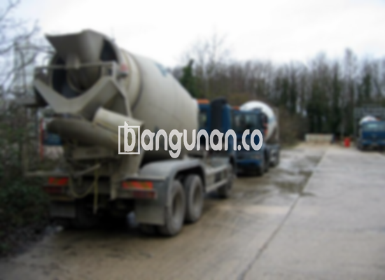

**Jasa Cor Beton Readymix & Jayamix Di Batangan Pati** – Bagi Mitra Bangunan yang tengah merencanakan pembangunan di Batangan Pati, beton cor readymix dari bangunan.co adalah solusi praktis dan efisien. Layanan adukan beton siap pakai ini memungkinkan proyek Anda berjalan lebih cepat, rapi, dan dengan mutu yang terjaga. Kami menyediakan beton dengan kualitas terjamin, langsung dikirim ke lokasi Anda dengan truk molen.



## Mengoptimalkan Pengecoran dengan Jasa Cor Beton Readymix & Jayamix Di Batangan Pati

Penyediaan beton siap pakai, seperti yang ditawarkan oleh bangunan.co, bertujuan memperlancar proses pengecoran dan menjamin kualitas bangunan Anda. Dengan formula yang telah terkalibrasi, Anda akan menerima campuran beton yang tepat sesuai dengan kebutuhan konstruksi. Hal ini memastikan hasil pengecoran yang kuat dan tahan lama, sesuai dengan standar kualitas yang diinginkan.

Beton readymix memberikan kemudahan dalam memilih mutu yang sesuai dengan aplikasi. Beton ini diproduksi di pabrik modern, siap digunakan begitu tiba di lokasi proyek. Anda tak perlu lagi repot mengaduk semen, pasir, dan air secara manual, menghemat waktu dan tenaga. Persiapan yang diperlukan hanyalah memastikan bekisting yang kokoh untuk menampung beton yang akan dituang.

Kualitas produk kami dikendalikan secara ketat mulai dari pemilihan bahan baku hingga proses pengiriman. Pihak pabrik pengolahan beton bangunan.co memastikan setiap batch sesuai dengan spesifikasi yang telah ditetapkan. Dengan demikian, Anda dapat yakin akan menerima material berkualitas tinggi yang akan mendukung keberhasilan proyek Anda.

## Keunggulan dan Hal yang Perlu Diperhatikan saat Memilih Cor Readymix di Batangan Pati

Perbandingan antara beton yang dicampur di pabrik pengolahan beton dan adukan manual mengungkapkan perbedaan signifikan dalam hal efisiensi dan kualitas. Berikut ini adalah beberapa kelebihan dan kekurangan yang perlu Anda pertimbangkan:

Beton yang diproduksi oleh bangunan.co menawarkan sejumlah keuntungan yang menonjol:

1.  Konsistensi mutu sesuai dengan spesifikasi yang dipesan.
2.  Distribusi material yang merata, menjamin kekuatan beton secara menyeluruh.
3.  Penggunaan material berkualitas tinggi yang telah melewati proses seleksi ketat.
4.  Proses pengolahan yang efisien, menghemat waktu dan biaya operasional.
5.  Anda tidak perlu khawatir dengan perhitungan proporsi campuran, karena semua telah ditangani oleh tenaga ahli.

Namun, ada beberapa hal yang perlu Anda perhatikan:

Pemesanan beton readymix memerlukan perencanaan yang matang dan penjadwalan yang tepat. Proses pengorderan tidak bisa dilakukan secara spontan, dan diperlukan survei lokasi untuk menentukan volume kubikasi yang dibutuhkan secara akurat. Hal ini bertujuan untuk memastikan ketersediaan beton yang cukup saat tiba di lokasi.

## Jenis Mutu Beton yang Paling Banyak Diminta di Batangan Pati

Di Batangan Pati, mutu beton K225 adalah pilihan paling populer. Mutu beton K225 sangat ideal untuk pengecoran lantai rumah atau lantai dua, memberikan kekuatan yang memadai untuk menopang beban bangunan. Selain itu, mutu ini juga sering digunakan untuk pengecoran jalan gang yang tidak dilalui oleh kendaraan berat.

Mutu beton K250 dan K300 juga banyak digunakan untuk berbagai aplikasi konstruksi. K250 dan K300 seringkali dipilih untuk pengecoran tiang, pondasi, atau cakar ayam, karena menawarkan kekuatan yang lebih tinggi. Untuk jalan pedesaan, mutu beton K250, K300, atau K350 direkomendasikan untuk memastikan ketahanan terhadap lalu lintas kendaraan. Untuk proyek yang membutuhkan waktu pengeringan lebih cepat, seperti jalan tol atau area parkir dengan beban berat, beton *fast track* dengan mutu K400 ke atas menjadi pilihan yang tepat.

## bangunan.co: Jaminan Kualitas Cor Beton Readymix & Jayamix Di Batangan Pati



Formulasi adukan beton readymix yang baik harus dirancang dengan cermat untuk memastikan performa dan daya tahan yang optimal. Beton dengan kualitas tinggi akan memberikan kekuatan, kelenturan, dan ketahanan terhadap berbagai kondisi lingkungan. Penggunaan material yang tepat, sesuai dengan standar nasional (SNI), sangat penting untuk mencapai kualitas beton yang diinginkan. Komposisi yang ideal terdiri dari 10% hingga 15% semen Portland, 60% hingga 75% agregat halus dan kasar (pasir dan split), dan 10% hingga 15% air.

Salah satu kunci utama dalam menghasilkan beton berkualitas adalah meminimalkan rasio air terhadap semen tanpa mengorbankan kemampuan kerja beton. Penggunaan air bersih juga sangat penting, karena air yang kotor dapat menurunkan kekuatan dan daya tahan beton. Hindari penggunaan air yang mengandung lumpur, minyak, atau zat organik lainnya.

Dengan memilih layanan bangunanan.co, Anda mendapatkan jaminan kualitas dan konsistensi dalam setiap pengiriman beton readymix. Kami berkomitmen untuk memberikan solusi terbaik bagi kebutuhan konstruksi Anda di Batangan Pati.

Itulah penjelasan dari Jasa Cor Beton Readymix & Jayamix Di Batangan Pati dari bangunan.co. Bagi Mitra Bangunan yang ingin mengetahui lebih lanjut mengenai harga dan ketersediaan produk, segera hubungi kami melalui tombol WhatsApp atau Telepon yang tersedia di halaman ini. Tim kami siap membantu Anda menemukan solusi cor beton yang tepat untuk proyek Anda.

**Ref by:** [Cor Beton Readymix & Jayamix Batangan Pati](https://id.wikipedia.org/wiki/Cor)