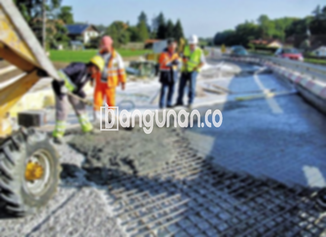

**Jasa Cor Beton Readymix & Jayamix Di Bawang Banjarnegara** – Bagi Mitra Bangunan yang berencana membangun atau mengerjakan proyek konstruksi di Bawang Banjarnegara, beton readymix dari bangunan.co menawarkan solusi praktis dan efisien. Jenis adukan beton siap pakai ini diformulasikan secara khusus untuk pengecoran yang cepat dan menghasilkan kualitas terjamin. Komposisi materialnya serupa dengan beton konvensional, yaitu terdiri dari pasir beton, batu pecah, semen, dan air, namun dengan takaran yang telah diatur secara presisi untuk menghasilkan mutu beton yang diinginkan.



## Tujuan Pengadukan Beton dengan Layanan dari bangunan.co di Bawang Banjarnegara

Pengembangan campuran beton seperti ini bertujuan untuk mempercepat proses pengecoran sekaligus menjamin kualitas yang konsisten. Dengan kualitas yang terjamin, Anda dapat memastikan bahwa mutu beton sesuai dengan standar yang ditetapkan untuk konstruksi yang direncanakan.

Beton ready mix hadir dengan beragam pilihan mutu, sehingga Anda dapat memilih jenis yang paling sesuai dengan kebutuhan proyek Anda. Beton ini sering disebut juga beton cair siap guna karena telah dipersiapkan secara khusus oleh pabrik pengolahan beton agar siap digunakan. Beton ini siap dicurahkan dan diratakan saat tiba di lokasi proyek, sehingga Anda tidak perlu lagi memikirkan proses pengadukan manual dan memastikan kualitasnya. Anda hanya perlu menyiapkan bekisting sebagai cetakan beton.

Keunggulan layanan dari bangunan.co terletak pada kontrol kualitas yang ketat, mulai dari pencampuran bahan hingga pengiriman. Hal ini memudahkan Anda dalam memperoleh beton berkualitas tanpa harus repot memilih bahan baku dan meracik campuran yang optimal.

## Keunggulan dan Kekurangan Cor Readymix dibandingkan Metode Tradisional

Tentu saja terdapat perbedaan antara beton yang dicampur oleh pabrik pengolahan beton bangunan.co dengan beton yang dicampur secara manual. Masing-masing metode memiliki kelebihan dan kekurangannya masing-masing. Berikut ini adalah perbandingannya:

Kelebihan beton campuran pabrik bangunan.co:

1.  Kualitas adukan terjamin sesuai dengan standar kualitas yang ditetapkan.
2.  Kualitas beton merata karena proses pencampuran dilakukan dengan mesin.
3.  Bahan material yang digunakan merupakan bahan berkualitas terbaik untuk menghasilkan beton dengan mutu tinggi.
4.  Proses pengolahan lebih cepat dan efisien, sehingga menghemat waktu dan biaya.
5.  Anda tidak perlu lagi memikirkan mutu beton yang sesuai dengan konstruksi yang dibangun, karena pabrik telah melakukan perhitungan yang akurat.

Meskipun demikian, terdapat juga kekurangan yang perlu Anda ketahui:

Pemesanan beton readymix dari bangunan.co memerlukan penjadwalan dan survei lokasi untuk menentukan volume yang dibutuhkan. Hal ini bertujuan untuk memastikan ketersediaan beton yang cukup dan menghindari kelebihan produksi.

## Ragam Kualitas Beton Paling Banyak Dipilih di Bawang Banjarnegara

Dari berbagai jenis beton yang tersedia, kualitas beton K225 merupakan yang paling banyak digunakan di Bawang Banjarnegara. Kualitas beton ini umumnya dipilih untuk pengecoran dak rumah atau lantai 2 ke atas karena dirancang khusus untuk aplikasi tersebut. Namun, beton K225 juga dapat digunakan untuk pengecoran jalan gang yang tidak dilalui kendaraan berat.

Pilihan lain yang populer adalah beton K250 dan K300. Keduanya sering diaplikasikan untuk pengecoran tiang, pondasi, atau cakar ayam. Untuk jalan pedesaan, K250, K300, serta K350 sering menjadi pilihan utama. Untuk aplikasi yang membutuhkan kekuatan lebih tinggi, seperti beton *fast track* yang cepat kering, mutu beton K375, K400, K500, dan seterusnya sering digunakan pada proyek jalan tol atau area parkir yang menahan beban berat.

## bangunan.co Menjamin Kualitas Beton untuk Proyek Anda



Penting untuk diingat bahwa adukan beton cor readymix harus dirancang dengan baik agar kinerja dan ketahanannya optimal. Komposisi adukan harus memenuhi standar nasional (SNI) untuk mencegah beton mudah keropos, retak, atau terkelupas. Komposisinya idealnya terdiri dari 10% hingga 15% semen Portland, 60% hingga 75% agregat halus dan kasar (pasir dan split), serta 10% hingga 15% air.

Untuk mencapai kualitas beton yang tinggi, rasio air terhadap semen harus diminimalkan tanpa mengurangi kemampuan kerja beton saat masih segar. Penggunaan air bersih juga sangat krusial, karena air yang kotor atau mengandung lumut dapat menurunkan kualitas beton.

**Ref by:** [Cor Beton Readymix & Jayamix Bawang Banjarnegara](https://id.wikipedia.org/wiki/Cor)

Mitra Bangunan yang mencari jasa cor beton readymix & jayamix di Bawang Banjarnegara, hubungi bangunan.co melalui tombol WhatsApp atau Telepon di halaman ini untuk mendapatkan penawaran terbaik. Kami siap memberikan solusi beton berkualitas tinggi untuk mendukung keberhasilan proyek konstruksi Anda.