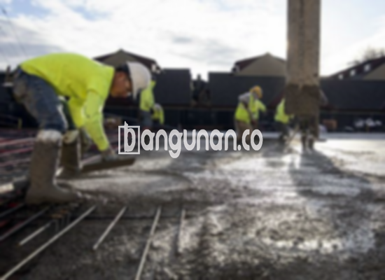

**Jasa Cor Beton Readymix & Jayamix Di Bawen Semarang** – Pengecoran beton dengan readymix atau jayamix dari bangunan.co adalah solusi praktis bagi kebutuhan konstruksi Anda di Bawen Semarang. Beton siap pakai ini menawarkan kemudahan, kecepatan, dan konsistensi kualitas, sehingga Mitra Bangunan tidak perlu lagi repot mengaduk beton secara manual di lokasi proyek. Kami melayani pengiriman readymix dengan truk molen untuk berbagai kebutuhan konstruksi Anda.



## Mengapa Memilih Pengcampuran Beton dari Jasa Cor Beton Readymix & Jayamix Di Bawen Semarang?

Penyediaan campuran beton yang tepat bertujuan untuk mempercepat proses pengecoran sekaligus memastikan mutu konstruksi yang sesuai standar. Dengan demikian, Anda dapat mengandalkan kualitas beton yang konsisten dan memenuhi spesifikasi proyek yang Anda rencanakan.

Beton readymix hadir dengan berbagai pilihan mutu, memungkinkan Anda menyesuaikan kualitas beton dengan kebutuhan spesifik konstruksi Anda. Produk ini sering disebut juga sebagai beton cair siap pakai karena telah diformulasikan secara khusus di pabrik pengolahan beton. Beton ini siap dicurahkan dan diratakan begitu sampai di lokasi proyek, menghilangkan kebutuhan untuk mencampur bahan-bahan secara manual. Anda hanya perlu memastikan kesiapan bekisting sebagai wadah pengecoran.

Kualitas beton dikontrol secara ketat oleh pihak pengolahan beton, mulai dari pencampuran material hingga pengiriman. Proses ini diatur oleh standar mutu yang berlaku, memastikan kualitas beton yang optimal. Hal ini memberikan kemudahan bagi para pelaku konstruksi dalam mendapatkan beton berkualitas tinggi tanpa membuang waktu dan tenaga untuk proses pencampuran manual.

## Keunggulan dan Pertimbangan dalam Menggunakan Cor Readymix dari Jasa Cor Beton Readymix & Jayamix Di Bawen Semarang

Terdapat perbedaan mendasar antara beton yang dicampur di pabrik pengolahan beton (batching plant) dengan beton yang dicampur secara manual. Masing-masing metode memiliki keunggulan dan kekurangannya tersendiri.

Berikut adalah keunggulan beton yang dicampur di pabrik pengolahan beton:

1.  Adukan sesuai dengan mutu yang dipesan, memastikan kualitas yang diinginkan tercapai.
2.  Kualitas beton yang lebih merata karena proses pencampuran menggunakan mesin modern.
3.  Penggunaan material berkualitas tinggi yang dipilih secara cermat untuk menghasilkan beton terbaik.
4.  Efisiensi waktu dan biaya, karena proses pengolahan dilakukan dengan cepat dan tepat.
5.  Anda tidak perlu lagi khawatir tentang formulasi adukan beton yang tepat untuk konstruksi Anda, karena semua telah dihitung dan diatur oleh pabrik.

Meskipun memiliki banyak keunggulan, beton readymix juga memiliki kekurangan, yaitu:

Pemesanan beton readymix umumnya memerlukan penjadwalan karena pabrik perlu mempersiapkan produksi. Anda tidak bisa memesan hari ini dan mengharapkan pengiriman pada hari yang sama. Selain itu, survei lokasi diperlukan untuk menentukan volume beton yang dibutuhkan secara akurat, menghindari kelebihan atau kekurangan pasokan.

## Pilihan Mutu Beton yang Umum Digunakan di Bawen Semarang

Salah satu mutu beton yang paling banyak digunakan adalah K225. Mutu ini ideal untuk pengecoran dak rumah atau lantai 2 ke atas, karena dirancang khusus untuk aplikasi tersebut. K225 juga dapat digunakan untuk pengecoran jalan gang yang tidak dilalui oleh kendaraan berat.

Selain K225, mutu beton K250 dan K300 juga sering digunakan, terutama untuk pengecoran tiang, pondasi, atau cakar ayam. K250, K300, dan bahkan K350 sering digunakan untuk pengecoran jalan pedesaan. Kualitas beton yang lebih tinggi seperti K375, K400, atau K500 umumnya digunakan untuk beton *fast track*—beton yang mengering dengan cepat—misalnya untuk jalan tol atau area parkir yang membutuhkan kekuatan dan kecepatan kering yang tinggi.

## Jasa Cor Beton Readymix & Jayamix Di Bawen Semarang: Komitmen Terhadap Kualitas



Campuran beton readymix harus dirancang dengan cermat untuk memastikan kemampuan kerja, daya tahan, dan kualitas yang optimal. Campuran yang baik akan menghasilkan beton yang kuat, tahan lama, dan tidak mudah retak atau mengelupas. Secara umum, campuran beton terdiri dari: 10% hingga 15% semen Portland, 60% hingga 75% agregat halus dan kasar (pasir dan split), serta 10% hingga 15% air. Sisanya adalah udara, karena beton tetap membutuhkan kandungan udara tertentu.

Untuk menghasilkan beton berkualitas tinggi, rasio air dan semen harus dijaga serendah mungkin tanpa mengorbankan kemampuan kerja beton. Semakin sedikit air yang digunakan, semakin tinggi kualitas beton yang dihasilkan. Air yang digunakan juga harus bersih dan bebas dari kotoran atau lumut. Penggunaan air kotor dapat menurunkan kualitas beton secara signifikan.

Sampai di sini penjelasan dari Jasa Cor Beton Readymix & Jayamix Di Bawen Semarang. Untuk informasi harga masing-masing mutu beton, Mitra Bangunan dapat menghubungi kami melalui tombol WhatsApp.

**Ref by:** [Cor Beton Readymix & Jayamix Bawen Semarang](https://id.wikipedia.org/wiki/Cor)