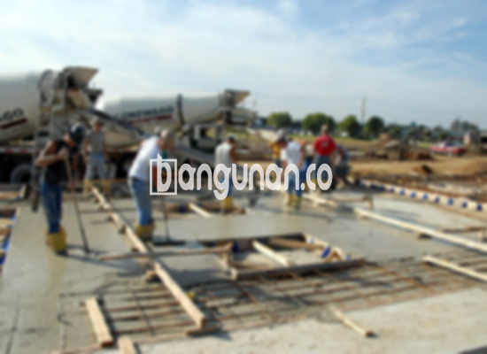

**Jasa Cor Beton Readymix & Jayamix Di Bayan Purworejo** – Solusi pengecoran cepat dan terpercaya bagi proyek Anda tersedia dari Bangunan.co! Layanan cor readymix atau campuran beton siap pakai kami dirancang khusus untuk kebutuhan konstruksi di Bayan Purworejo, memastikan adukan material beton yang tepat guna, efisien waktu, dan kualitas terjamin. Mitra Bangunan hadir untuk memenuhi kebutuhan tersebut, memberikan fondasi yang kokoh untuk bangunan Anda.



## Keunggulan Menggunakan Jasa Pengadukan Beton Readymix dari Bangunan.co di Bayan Purworejo

Bangunan.co memahami betul bahwa kualitas beton merupakan kunci utama keberhasilan setiap proyek konstruksi. Itulah mengapa kami menyediakan jasa cor beton readymix dan jayamix dengan fokus utama pada kemudahan, efisiensi, serta mutu beton yang konsisten.  Dengan memilih layanan kami, Anda akan mendapatkan solusi pengecoran yang mempercepat laju pekerjaan Anda, serta menjamin kekuatan dan ketahanan bangunan yang Anda impikan.

Beton readymix, atau beton siap pakai, merupakan campuran beton yang diformulasikan khusus di pabrik pengolahan beton sebelum dikirim ke lokasi proyek Anda. Hal ini memungkinkan Anda untuk langsung menuangkan dan meratakan beton tanpa perlu lagi repot mencampur bahan-bahan secara manual.  Dengan demikian, Anda dapat lebih fokus pada persiapan bekisting sebagai cetakan beton, dan memastikan seluruh proses pembangunan berjalan lancar dan efisien.

Kualitas beton yang dihasilkan oleh Bangunan.co selalu diawasi ketat, mulai dari proses pencampuran bahan hingga pengiriman ke lokasi Anda. Kami memastikan setiap batch beton memenuhi standar mutu yang berlaku, memberikan Anda keyakinan penuh terhadap kekuatan dan keandalan material konstruksi yang Anda gunakan.

## Perbandingan Kelebihan dan Kekurangan Cor Readymix vs. Aduk Manual di Bayan Purworejo

Tentu saja, terdapat perbedaan signifikan antara beton yang diproduksi di pabrik pengolahan beton (batching plant) Bangunan.co dan beton yang dicampur secara manual di lokasi proyek.  Masing-masing metode memiliki kelebihan dan kekurangan yang perlu Anda pertimbangkan sebelum memutuskan pilihan.

Berikut adalah keunggulan beton yang diproduksi oleh Bangunan.co:

1.  Mutu dan kualitas adukan yang presisi dan terukur.
2.  Konsistensi kualitas beton yang seragam berkat proses pencampuran yang merata.
3.  Penggunaan bahan material berkualitas tinggi yang dipilih secara cermat untuk menghasilkan beton terbaik.
4.  Efisiensi waktu dan biaya karena proses pengolahan yang cepat dan teroptimasi.
5.  Anda tidak perlu lagi khawatir mengenai perhitungan dan pencampuran material secara manual, karena semuanya telah ditangani oleh tim ahli Bangunan.co.

Namun, perlu Anda ketahui juga bahwa pemesanan beton readymix dari Bangunan.co memerlukan penjadwalan terlebih dahulu. Kami tidak dapat langsung memenuhi permintaan hari ini karena perlu waktu untuk melakukan survei lokasi dan menghitung kebutuhan kubikasi beton yang tepat.  Proses ini penting untuk memastikan pasokan beton yang cukup dan akurat sesuai dengan kebutuhan proyek Anda.

## Variasi Mutu Beton yang Sering Digunakan di Bayan Purworejo

Salah satu mutu beton yang paling banyak diminati di Bayan Purworejo adalah K225, kualitas yang ideal untuk pengecoran dak rumah atau lantai dua ke atas.  Selain itu, mutu K250 dan K300 juga kerap dipilih untuk pengecoran tiang, pondasi, atau cakar ayam. Untuk proyek jalan pedesaan, mutu K250, K300, hingga K350 seringkali menjadi pilihan terbaik. 

Mutu beton yang lebih tinggi seperti K375, K400, K500, dan seterusnya umumnya digunakan untuk aplikasi khusus yang membutuhkan waktu pengerasan beton yang cepat – sering disebut beton *fast track*. Contohnya adalah pembangunan jalan tol atau area parkir yang menahan beban berat dan membutuhkan waktu pengerjaan yang singkat.  Mutu di atas K400 ini seringkali menjadi solusi ideal untuk proyek-proyek dengan tenggat waktu yang ketat.

## Bangunan.co: Jaminan Kualitas Beton untuk Proyek Anda di Bayan Purworejo



Bangunan.co sangat menekankan pada perancangan campuran beton readymix yang tepat. Komposisi yang baik adalah kunci untuk menghasilkan beton dengan kekuatan, kinerja, dan daya tahan yang optimal.  Campuran yang presisi pula akan memastikan beton tahan terhadap retak, keropos, dan kerusakan lainnya. Oleh karena itu, material beton yang kami gunakan selalu sesuai dengan Standar Nasional Indonesia (SNI).

Komposisi standar campuran beton dari Bangunan.co meliputi: 10% hingga 15% semen Portland, 60% hingga 75% agregat halus dan kasar (pasir dan split), dan 10% hingga 15% air.  Sisanya merupakan kandungan udara yang penting untuk membantu proses pengerasan dan mencegah retak pada beton. 

Kami selalu berusaha untuk meminimalkan rasio air terhadap semen tanpa mengorbankan kemampuan kerja beton segar.  Beton berkualitas tinggi umumnya memiliki kandungan air yang rendah namun tetap mudah diaplikasikan. Selain itu, Bangunan.co hanya menggunakan air bersih dan bebas dari kontaminan untuk memastikan mutu beton yang terjamin.  Penggunaan air kotor atau berlumpur dapat menurunkan kualitas beton secara signifikan.

Mitra Bangunan yang mencari jasa cor beton readymix dan jayamix berkualitas di Bayan Purworejo, jangan ragu untuk menghubungi kami melalui tombol WhatsApp atau Telepon yang tersedia di halaman ini. Tim Bangunan.co siap membantu Anda dengan solusi beton terbaik untuk proyek Anda.

**Ref by:** [Cor Beton Readymix & Jayamix Bayan Purworejo](https://id.wikipedia.org/wiki/Cor)