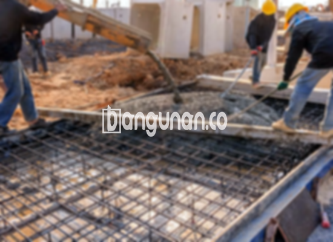

**Jasa Cor Beton Readymix & Jayamix Di Bayat Klaten** – Memastikan fondasi yang kokoh dan konstruksi yang tahan lama adalah kunci keberhasilan setiap proyek. Solusi praktis dan efisien untuk kebutuhan pengecoran di Bayat Klaten adalah beton readymix dari bangunan.co, atau campuran beton siap pakai. Dengan formulasi material yang teruji dan kontrol kualitas yang ketat, kami siap menyediakan beton siap digunakan langsung di lokasi proyek Anda, Mitra Bangunan.



## Pentingnya Pengadukan Beton Berkualitas dari bangunan.co di Bayat Klaten

Penggunaan adukan beton seperti ini bertujuan untuk mempercepat proses pembangunan dan memastikan kualitas yang terjamin. Hal ini memungkinkan Anda untuk fokus pada aspek penting lainnya dari proyek Anda. Dengan mutu yang terukur dan konsisten, bangunan.co dapat menjamin bahwa beton yang digunakan sesuai dengan standar kualitas yang diperlukan untuk konstruksi yang Anda rencanakan.

Beton Cor Readymix merupakan solusi ideal yang menawarkan berbagai pilihan mutu yang dapat disesuaikan dengan kebutuhan spesifik proyek Anda. Sering disebut juga sebagai beton cair siap pakai, beton ini telah melalui proses formulasi di pabrik pengolahan beton bangunan.co agar siap dituang dan diratakan langsung di lokasi proyek Anda. Dengan demikian, Anda tidak perlu lagi khawatir tentang pencampuran material di tempat, melainkan hanya mempersiapkan bekisting sebagai penahan beton.

Kualitas beton dikendalikan secara ketat oleh tim bangunan.co, mulai dari proses pengadukan hingga pengiriman. Pendekatan ini memastikan Anda mendapatkan solusi pengecoran yang efisien, hemat waktu, dan terjamin kualitasnya. Ini sangat membantu para pelaku konstruksi dalam menyelesaikan proyek tanpa menghabiskan waktu berharga untuk berfokus pada pencampuran material.

## Keunggulan dan Hal yang Perlu Dipertimbangkan dalam Memilih Beton Readymix bangunan.co

Beton yang diproduksi oleh pabrik pengolahan beton bangunan.co, atau dikenal sebagai *batching plant*, tentu memiliki keunggulan dan kekurangan dibandingkan dengan metode pencampuran manual tradisional. Berikut adalah beberapa pertimbangan penting:

Keunggulan utama beton bangunan.co meliputi:

1.  Komposisi campuran yang presisi dan konsisten, menjamin kekuatan dan daya tahan.
2.  Kualitas beton yang seragam karena proses pengadukan terstandarisasi, meminimalkan risiko kegagalan struktural.
3.  Penggunaan material berkualitas tinggi yang dipilih secara cermat oleh ahli bangunan.co.
4.  Efisiensi waktu dan biaya, serta penghematan tenaga kerja yang signifikan.
5.  Kepraktisan dan kemudahan karena Anda tidak perlu repot memikirkan peracikan campuran beton.

Meskipun demikian, ada beberapa hal yang perlu Anda pertimbangkan:

Pabrik pengolahan beton bangunan.co umumnya memerlukan pemesanan di muka, terutama untuk volume besar. Anda perlu menjadwalkan pesanan dan melakukan survei lokasi untuk memperkirakan kebutuhan kubikasi secara akurat. Tujuan dari pendekatan ini adalah untuk menghindari kelebihan produksi atau kekurangan pasokan saat beton tiba di lokasi pengecoran.

## Variasi Mutu Beton yang Umum Digunakan di Proyek Bayat Klaten

Salah satu mutu beton yang paling banyak diminati di Bayat Klaten adalah K225. Mutu ini sangat ideal untuk pengecoran lantai rumah atau lantai dua ke atas karena dirancang khusus untuk aplikasi tersebut. Selain itu, mutu beton K225 juga dapat digunakan untuk pengecoran jalan gang yang tidak dilalui kendaraan berat.

Pilihan populer lainnya adalah mutu beton K250 dan K300. Kedua mutu ini sering digunakan untuk pekerjaan pengecoran tiang, pondasi, atau cakar ayam, serta jalan pedesaan. Untuk kebutuhan yang lebih spesifik, mutu beton K350, K375, K400, atau bahkan K500 dapat dipilih. Beton dengan mutu tinggi ini sering digunakan untuk proyek-proyek yang memerlukan kekuatan ekstra dan waktu pengeringan yang singkat, seperti jalan tol atau area parkir yang menahan beban berat. Jenis beton ini sering disebut beton *fast track*.

## Komitmen bangunan.co terhadap Kualitas Beton untuk Proyek Anda



Untuk menghasilkan adukan beton *ready mix* yang optimal, perancangan yang cermat sangatlah penting. Beton berkualitas tinggi harus memiliki kekuatan dan kinerja yang baik, serta tahan lama. Komposisi material yang tepat dan sesuai dengan standar nasional (SNI) sangat krusial. Secara umum, komposisi yang direkomendasikan adalah 10% hingga 15% semen Portland, 60% hingga 75% agregat halus dan kasar (pasir dan split), dan 10% hingga 15% air. Sisanya adalah udara, karena beton padat tetap memerlukan rongga udara di dalamnya.

Kualitas beton yang superior dicapai dengan mengurangi rasio air terhadap semen sebanyak mungkin tanpa mengorbankan kemampuan kerja beton segar. Semakin sedikit air yang digunakan, semakin tinggi pula kualitas beton yang dihasilkan. Penting untuk selalu menggunakan air bersih yang bebas dari lumpur dan lumut. Penggunaan air yang kotor dapat menurunkan kualitas beton secara signifikan. Di bangunan.co, kami selalu memastikan kualitas air yang digunakan dalam produksi beton memenuhi standar tertinggi.

Seperti itulah, Mitra Bangunan, penjelasan dari Jasa Cor Beton Readymix & Jayamix Di Bayat Klaten yang disediakan oleh bangunan.co. Untuk informasi lebih lanjut mengenai harga masing-masing mutu, jangan ragu untuk menghubungi tim kami melalui WhatsApp. Kami siap membantu Anda mewujudkan proyek konstruksi yang solid dan awet.

**Ref by:** [Cor Beton Readymix & Jayamix Bayat Klaten](https://id.wikipedia.org/wiki/Cor)