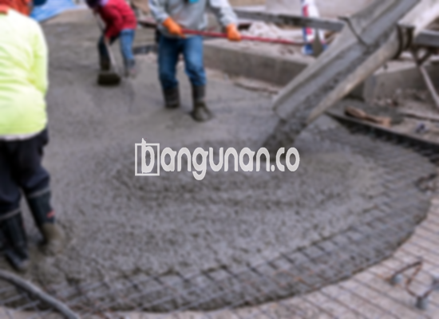

**Jasa Cor Beton Readymix & Jayamix Di Belik Pemalang** – Bagi Mitra Bangunan di Belik Pemalang yang sedang merencanakan proyek konstruksi, beton *readymix* atau adukan beton siap pakai dari bangunan.co adalah solusi efisien untuk pengecoran cepat dan berkualitas tinggi. Material ini diformulasikan secara khusus dengan komposisi material yang presisi, melibatkan campuran pasir beton, batu split, semen, dan air guna memastikan hasil yang optimal bagi proyek Anda.



## Mengapa Memilih Layanan Pengadukan Beton dari bangunan.co di Belik Pemalang?

Penggunaan campuran beton yang diproses melalui pabrik pengolahan beton dari bangunan.co bertujuan untuk memperlancar dan mempercepat proses pengecoran konstruksi Anda. Pendekatan ini memungkinkan Anda, sebagai pelaku proyek, untuk melaksanakan pekerjaan tepat waktu dengan mutu terjamin. Beton *ready mix* yang disediakan oleh bangunan.co hadir dalam beragam tingkatan kualitas, disesuaikan dengan kebutuhan spesifik konstruksi yang Anda rencanakan. Produk ini dikenal sebagai beton cair siap pakai karena telah dipersiapkan secara optimal di pabrik pengolahan beton, sehingga siap digunakan langsung di lokasi proyek.

Dengan demikian, Anda tidak perlu lagi direpotkan dengan proses pencampuran manual yang memakan waktu dan tenaga. Fokus Anda dapat sepenuhnya tertuju pada persiapan bekisting yang kokoh dan memastikan kesiapan kondisi lokasi proyek. Kualitas beton yang dihasilkan bangunan.co telah dikontrol secara ketat sejak proses pengadukan hingga pengiriman, menjamin konsistensi mutu dan kesesuaian dengan standar yang berlaku. 

## Keunggulan dan Pertimbangan dalam Memilih Beton Readymix dari bangunan.co

Terdapat perbedaan signifikan antara beton yang dicampur di pabrik bangunan.co dan beton yang dicampur secara tradisional oleh tukang bangunan. Masing-masing metode memiliki kelebihan dan kekurangannya masing-masing. Berikut adalah beberapa pertimbangan penting yang perlu Anda perhatikan sebelum memutuskan:

Beton yang diproduksi di pabrik bangunan.co menawarkan sejumlah keunggulan:

1.  Adukan dengan proporsi yang tepat, menghadirkan mutu beton yang optimal.
2.  Mutu beton yang seragam dan konsisten berkat proses pencampuran terkontrol.
3.  Penggunaan material berkualitas tinggi yang telah diseleksi secara ketat oleh bangunan.co.
4.  Proses pengolahan yang efisien, menghemat biaya dan mempercepat penyelesaian proyek.
5.  Anda tidak perlu menghabiskan waktu untuk menghitung dan mencampur bahan; bangunan.co telah menyesuaikan campuran sesuai dengan spesifikasi konstruksi Anda.

Sebagai pertimbangan, perlu diingat bahwa pemesanan beton *readymix* dari bangunan.co memerlukan penjadwalan terlebih dahulu. Tidak dapat dilakukan secara spontan. Anda perlu memesan beberapa waktu sebelumnya dan memberikan informasi mengenai lokasi proyek untuk perhitungan volume beton yang dibutuhkan. Hal ini dilakukan untuk memastikan ketersediaan material dan menghindari kelebihan atau kekurangan pasokan.

## Ragam Mutu Beton yang Paling Populer di Belik Pemalang

Salah satu mutu beton yang paling sering digunakan dalam berbagai proyek di Belik Pemalang adalah mutu beton K225. Kualitas beton K225 dari bangunan.co ideal untuk pengecoran lantai rumah, lantai dua, atau struktur dak lainnya karena dirancang khusus untuk memenuhi kebutuhan tersebut. Selain itu, K225 juga masih efektif untuk pengecoran jalan gang yang tidak terlalu sering dilewati kendaraan berat.

Selain K225, mutu beton K250 dan K300 juga merupakan pilihan yang populer. Keduanya banyak diaplikasikan untuk pengecoran tiang, pondasi, atau cakar ayam. Untuk pembangunan jalan pedesaan, mutu beton K250, K300, dan bahkan K350 sering digunakan. Bagi proyek yang menuntut kekuatan tinggi dan waktu pengeringan yang lebih singkat, seperti konstruksi jalan tol atau area parkir dengan beban berat, mutu beton K400 ke atas (yang dikenal sebagai beton *fast track* dari bangunan.co) adalah solusi yang tepat.

## bangunan.co Mengutamakan Kualitas Beton untuk Proyek Anda



Campuran beton *readymix* dari bangunan.co dirancang dengan presisi untuk menghasilkan performa dan kekuatan optimal. Proses ini melibatkan penggunaan material berkualitas tinggi dan perbandingan yang akurat antara semen Portland (dalam kisaran 10% hingga 15%), agregat halus dan kasar (pasir dan split, antara 60% hingga 75%), air (sebesar 10% hingga 15%), serta sedikit udara untuk memastikan kemudahan pengerjaan.

Kualitas beton bangunan.co dihasilkan melalui proses produksi yang ketat. Kami selalu berupaya meminimalkan rasio air terhadap semen tanpa mengorbankan kemampuan kerja beton segar. Semakin sedikit air yang digunakan, umumnya semakin tinggi kualitas beton yang dihasilkan. Kami juga memastikan penggunaan air bersih yang bebas dari kontaminan seperti tanah atau lumut, karena hal-hal tersebut dapat menurunkan kualitas beton secara signifikan. Dengan bangunan.co, Anda mendapatkan beton berkualitas yang terjamin.

Sampai di sini, Mitra Bangunan, penjelasan dari Jasa Cor Beton Readymix & Jayamix Di Belik Pemalang dari bangunan.co. Untuk informasi lebih lanjut mengenai harga masing-masing mutu beton, silakan hubungi kami melalui tombol WhatsApp atau Telepon yang tersedia di halaman ini. Kami siap memberikan penawaran terbaik dan membantu Anda mewujudkan proyek konstruksi yang sukses.

**Ref by:** [Cor Beton Readymix & Jayamix Belik Pemalang](https://id.wikipedia.org/wiki/Cor)