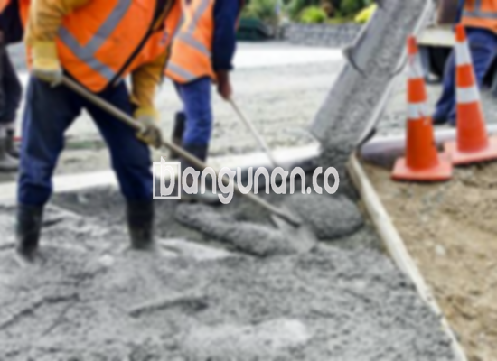

**Jasa Cor Beton Readymix & Jayamix Di Bendosari Sukoharjo** – Mengatasi tantangan konstruksi di Bendosari Sukoharjo menjadi lebih mudah dengan solusi beton siap pakai dari bangunan.co. Cor readymix atau adukan beton siap pakai merupakan formulasi material beton yang dirancang khusus untuk pengecoran cepat dan praktis. Pada dasarnya, komposisi materialnya sama dengan campuran beton konvensional, terdiri dari pasir beton, batu pecah, semen, dan air, dengan perbandingan yang sudah diatur untuk menghasilkan kualitas beton yang optimal. Mitra Bangunan hadir untuk menyediakan solusi beton berkualitas tinggi untuk berbagai kebutuhan konstruksi Anda.



## Mengapa Memilih Layanan Cor Readymix dari bangunan.co di Bendosari Sukoharjo?

Penggunaan campuran beton readymix dirancang untuk mempercepat progres konstruksi, memastikan kualitas yang konsisten, dan mempermudah proses pengecoran. Dengan mutu yang terjamin, Anda dapat mencapai kekuatan dan daya tahan bangunan yang sesuai dengan perencanaan. 

Beton readymix, atau beton siap pakai, merupakan campuran yang diformulasikan secara akurat di pabrik pengolahan beton. Hal ini memungkinkan Anda untuk langsung menggunakannya setelah pengiriman ke lokasi proyek. Anda tidak perlu lagi menghabiskan waktu dan tenaga untuk mencampur beton secara manual, serta memastikan proporsi yang tepat. Fokus Anda dapat dialihkan sepenuhnya ke persiapan konstruksi, seperti pembuatan bekisting.

Kualitas beton dijamin melalui kontrol mutu yang ketat selama proses produksi di pabrik pengolahan beton, mulai dari pemilihan material hingga pengiriman. Ini memberikan keyakinan bahwa beton yang Anda terima telah memenuhi standar kualitas yang berlaku, menjadikannya pilihan ideal bagi para profesional konstruksi yang mengutamakan efisiensi waktu dan kualitas.

## Keunggulan dan Hal yang Perlu Dipertimbangkan Saat Menggunakan Beton Readymix

Ada perbedaan mendasar antara beton yang dicampur di pabrik pengolahan beton dan beton yang dicampur secara manual oleh tukang bangunan. Keduanya memiliki kelebihan dan kekurangan masing-masing. Beberapa keunggulan beton readymix meliputi:

1.  Mutu yang konsisten dan terjamin.
2.  Kualitas beton yang merata karena prosedur pencampuran yang terstandarisasi.
3.  Penggunaan material pilihan dengan kualitas terbaik untuk menghasilkan beton berkualitas tinggi.
4.  Efisiensi waktu dan biaya dalam proses konstruksi.
5.  Kemudahan dalam mendapatkan campuran beton yang sesuai dengan kebutuhan spesifik proyek, tanpa perlu perhitungan manual.

Namun, penting untuk diingat bahwa pemesanan beton readymix memerlukan penjadwalan. Proses produksi dan pengiriman perlu diatur terlebih dahulu, karena tidak dapat dipesan secara instan. Survei lokasi juga diperlukan untuk memperkirakan volume beton yang dibutuhkan secara akurat, menghindari pemborosan atau kekurangan material.

## Pilihan Mutu Beton yang Paling Banyak Digunakan di Bendosari Sukoharjo

Salah satu mutu beton yang paling sering digunakan, khususnya untuk pengecoran dak rumah atau lantai dua ke atas, adalah K225. Mutu beton ini dirancang khusus untuk aplikasi dak. Selain itu, K225 juga cocok untuk pengecoran jalan setapak yang tidak sering dilalui kendaraan berat.

K250 dan K300 juga merupakan pilihan populer untuk pengecoran tiang, pondasi, atau cakar ayam. Untuk jalan pedesaan, mutu K250, K300, dan bahkan K350 sering digunakan. Untuk aplikasi yang lebih spesifik, mutu beton di atas K350, seperti K375, K400, dan K500, umumnya digunakan untuk beton *fast track* yang membutuhkan waktu pengeringan cepat. Jenis beton ini sering diterapkan pada proyek-proyek seperti jalan tol atau area parkir yang menahan beban berat, di mana waktu penyelesaian menjadi faktor penting.

## bangunan.co: Memprioritaskan Kualitas Beton untuk Proyek Anda di Bendosari Sukoharjo



Formulasi adukan beton ready mix atau *ready mix concrete* harus direncanakan dan dilaksanakan dengan cermat untuk memastikan daya kerja dan kekuatan yang optimal. Campuran yang tepat akan menghasilkan beton yang kuat, tahan lama, dan memenuhi standar kualitas nasional (SNI). Komposisi yang ideal terdiri dari 10% hingga 15% semen Portland, 60% hingga 75% agregat halus dan kasar (pasir dan split), serta 10% hingga 15% air. Sisanya adalah udara, yang berperan penting dalam menjaga kemampuan kerja beton.

Pencapaian beton berkualitas tinggi dicapai melalui pengurangan rasio air terhadap semen sebanyak mungkin, tanpa mengorbankan kemampuan kerja beton segar. Penggunaan air bersih sangat krusial. Hindari penggunaan air yang kotor atau mengandung lumpur, yang dapat menurunkan kualitas beton. Pastikan air yang digunakan memenuhi standar kebersihan untuk memastikan hasil beton yang optimal.

Dengan pemahaman ini, Anda dapat yakin bahwa proyek konstruksi Anda di Bendosari Sukoharjo menggunakan campuran beton yang tepat dan mencapai kualitas yang diharapkan, berkat layanan dari bangunan.co.

**Ref by:** [Cor Beton Readymix & Jayamix Bendosari Sukoharjo](https://id.wikipedia.org/wiki/Cor)

Mitra Bangunan dari bangunan.co siap menjadi mitra terpercaya Anda dalam menyediakan solusi beton readymix dan jayamix berkualitas tinggi di Bendosari Sukoharjo. Jangan ragu untuk menghubungi kami melalui tombol WhatsApp atau Telepon di halaman ini untuk mendapatkan informasi lebih lanjut dan penawaran harga terbaik. Kami berkomitmen untuk membantu Anda mewujudkan proyek konstruksi yang kokoh dan berkelanjutan.