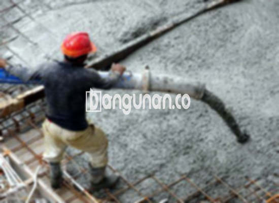

**Jasa Cor Beton Readymix & Jayamix Di Bener Purworejo** – Dalam setiap proyek konstruksi, fondasi yang kuat dan berkualitas adalah kunci utama. Bagi Mitra Bangunan yang berlokasi di Bener Purworejo, layanan cor beton readymix dan jayamix dari Bangunan.co hadir sebagai solusi praktis dan efisien untuk memenuhi kebutuhan pengecoran Anda. Kami menyediakan campuran beton siap pakai yang telah diformulasikan secara tepat, memastikan kualitas dan ketahanan bangunan Anda.



## Mengapa Memilih Layanan Pengadukan Beton dari Bangunan.co di Bener Purworejo?

Layanan pengadukan beton yang kami sediakan di Bangunan.co bertujuan untuk mempercepat proses konstruksi seraya menjamin kualitas bangunan yang stabil. Dengan memilih readymix, Anda bisa mendapatkan mutu beton yang tepat sesuai dengan kebutuhan proyek Anda. Beton ini tersedia dalam berbagai tingkatan kualitas yang disesuaikan dengan fungsi struktur bangunan. 

Sebagai beton cair siap pakai, readymix telah dipersiapkan secara khusus di pabrik pengolahan beton. Ini berarti Anda hanya perlu menyiapkan lokasi pengecoran – yaitu bekisting yang terpasang dengan kokoh. Setelah pengiriman, beton langsung bisa digunakan dan diratakan. Anda tidak perlu lagi membuang waktu dan tenaga untuk mengaduk dan mencampur beton secara manual.

Seluruh tahapan produksi, mulai dari pencampuran bahan hingga pengiriman, dikendalikan secara ketat oleh tim ahli di pabrik. Hal ini memberikan jaminan bagi para pelanggan di Bener Purworejo untuk mendapatkan produk beton yang berkualitas tinggi, tanpa perlu khawatir tentang masalah proporsi campuran atau konsistensi adukan.

## Keunggulan dan Pertimbangan Menggunakan Cor Readymix dari Bangunan.co di Bener Purworejo

Beton yang dihasilkan melalui pabrik pengolahan beton Bangunan.co tentu memiliki keunggulan dan kekurangan tersendiri jika dibandingkan dengan metode adukan manual tradisional. Berikut adalah perbandingan detailnya:

Keunggulan beton readymix:

1.  Adukan beton memiliki kualitas dan mutu yang terjamin dan konsisten.
2.  Mutu beton tersampur rata berkat proses pencampuran yang homogen di pabrik.
3.  Material yang digunakan selalu yang terbaik, dipilih untuk menghasilkan bangunan dengan mutu terjamin dan tahan lama.
4.  Proses pengolahan cepat, menekan biaya dan waktu pengerjaan.
5.  Anda tidak perlu berepikir tentang komposisi yang tepat untuk konstruksi, karena tim Bangunan.co sudah menyesuaikannya dengan standar.

Namun, ada beberapa hal yang perlu Anda pertimbangkan:

Pemesanan beton readymix membutuhkan penjadwalan. Tidak seperti adukan manual yang bisa dilakukan kapan saja, pesanan harus dilakukan beberapa waktu sebelumnya. Selain itu, diperlukan survei lokasi untuk menghitung kebutuhan volume beton yang tepat agar tidak terjadi kelebihan atau kekurangan saat pengiriman.

## Pilihan Mutu Beton yang Paling Banyak Digunakan di Bener Purworejo

Kwalitas beton K225 adalah salah satu jenis yang paling populer, sering digunakan untuk pengecoran dak rumah atau lantai dua ke atas. K225 juga merupakan pilihan yang tepat untuk jalan gang yang tidak dilalui kendaraan berat.

Selain itu, beton K250 dan K300 banyak digunakan untuk proyek tiang, pondasi, atau cakar ayam. K250, K300, dan bahkan K350 juga umum digunakan untuk jalan pedesaan. Kualitas beton yang lebih tinggi seperti K375, K400, K500, dan seterusnya sering digunakan untuk keperluan yang lebih besar seperti jalan tol atau pelataran parkir yang membutuhkan daya tahan tinggi. Beton mutu tinggi ini, yang disebut juga beton *fast track*, memungkinkan penyelesaian proyek lebih cepat karena proses pengeringan yang lebih singkat.

## Bangunan.co: Mengutamakan Mutu Beton Di Setiap Pengecoran di Bener Purworejo



Formulasi campuran beton readymix harus dipersiapkan secara teliti agar menghasilkan performa dan umur pakai yang optimal. Komposisi yang tepat akan menghasilkan beton yang kokoh, tahan lama, serta resisten terhadap abrasi dan kerusakan lainnya. Campuran yang disarankan adalah sekitar 10% hingga 15% bahan semen Portland, 60% hingga 75% agregat halus dan kasar (sand dan split), serta 10% hingga 15% air. Sisa proporsi adalah udara yang terperangkap dalam campuran.

Kualitas beton bergantung pada rasio air dan semen. Semakin kecil penggunaan air tanpa mengurangi potensi kerja yang baik pada adukan, semakin tinggi mutu beton. Penggunaan air bersih yang bebas sumur, dan kotoran sangat esensial. Hindari pemakaian air yang mengandung lumpur atau ganggang karena dapat menurunkan kualitas beton secara keseluruhan.

Mitra Bangunan yang sedang merencanakan proyek konstruksi di Bener Purworejo, jangan ragu untuk menghubungi Bangunan.co untuk berkonsultasi dan mendapatkan penawaran harga yang kompetitif.

**Ref by:** [Cor Beton Readymix & Jayamix Bener Purworejo](https://id.wikipedia.org/wiki/Cor)