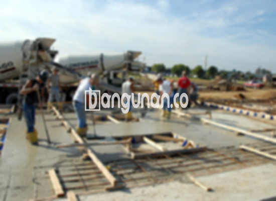

**Jasa Cor Beton Readymix & Jayamix Di Berbah Sleman** – Jika Anda membutuhkan solusi pengecoran yang efektif dan efisien untuk proyek konstruksi di Berbah Sleman, beton readymix dari Bangunan.co adalah jawaban yang tepat. Material siap pakai ini menghadirkan kemudahan, konsistensi mutu, dan ketepatan waktu pengerjaan. Bangunan.co berkomitmen menyediakan beton dengan komposisi yang terukur, memastikan kekuatan dan daya tahan bangunan yang optimal. Mitra Bangunan dapat mengandalkan kami untuk proyek-proyek Anda.



## Alasan Memilih Layanan Cor Beton Readymix & Jayamix dari Bangunan.co di Berbah Sleman

Penyediaan beton siap pakai ini dirancang untuk mempercepat penyelesaian proyek Anda. Dengan menggunakan layanan Bangunan.co, Anda dapat yakin bahwa campuran beton yang digunakan memenuhi standar kualitas yang dibutuhkan untuk konstruksi yang Anda rencanakan.

Beton cor readymix hadir dalam beragam mutu, memungkinkan Anda memilih yang paling sesuai dengan kebutuhan spesifik proyek Anda. Dikenal juga sebagai beton cair siap pakai, material ini diproduksi secara presisi di pabrik pengolahan beton, sehingga siap digunakan langsung di lokasi proyek. Anda tidak perlu lagi menghabiskan waktu dan tenaga untuk mencampur bahan secara manual; cukup siapkan bekisting sebagai cetakan beton.

Proses produksi beton, mulai dari pencampuran bahan hingga pengiriman, dikontrol dengan ketat oleh tim ahli Bangunan.co. Hal ini menjamin kualitas yang konsisten dan membantu para profesional konstruksi dalam memperoleh material yang andal tanpa membuang waktu berharga.

## Keunggulan dan Hal yang Perlu Diperhatikan dalam Penggunaan Cor Readymix

Ada perbedaan signifikan antara beton yang dicampur di pabrik pengolahan beton seperti Bangunan.co, dan campuran manual yang dibuat di lokasi proyek. Berikut adalah detail mengenai kelebihan dan pertimbangan penting:

Kelebihan beton dari Bangunan.co:

1.  Kualitas dan mutu terjamin sesuai dengan spesifikasi yang Anda butuhkan.
2.  Konsistensi campuran yang seragam, untuk kekuatan beton yang merata.
3.  Penggunaan material terbaik yang dipilih secara ketat untuk menghasilkan beton berkualitas tinggi.
4.  Efisiensi waktu dan biaya pengolahan yang signifikan.
5.  Anda tidak perlu lagi memusingkan perhitungan dan pencampuran manual yang rumit.

Meskipun demikian, beberapa hal perlu diperhatikan:

Pemesanan beton readymix memerlukan penjadwalan karena proses produksi dan pengiriman memerlukan koordinasi yang cermat. Selain itu, survei lokasi diperlukan untuk memperkirakan volume kubikasi yang dibutuhkan secara akurat, sehingga memastikan pasokan yang cukup tanpa pemborosan.

## Pilihan Mutu Beton yang Paling Sering Digunakan di Berbah Sleman

K225 adalah salah satu mutu beton yang paling sering digunakan, terutama untuk pengecoran dak rumah atau lantai dua ke atas. Mutu ini secara khusus dirancang untuk aplikasi pada struktur dak. Selain itu, K225 juga dapat digunakan untuk pengecoran jalan gang yang tidak menanggung beban lalu lintas berat.

K250 dan K300 juga sering dipilih untuk pengecoran tiang, pondasi, atau cakar ayam. Untuk pembangunan jalan pedesaan, mutu K250, K300, dan K350 merupakan pilihan yang umum digunakan. Mutu beton yang lebih tinggi, seperti K375, K400, dan K500, biasanya digunakan dalam proyek-proyek yang membutuhkan pengeringan cepat atau kekuatan lebih tinggi, misalnya jalan tol atau area parkir yang menahan beban berat. Mutu beton ini sering disebut sebagai beton *fast track*.

## Bangunan.co: Jasa Cor Beton Readymix & Jayamix Di Berbah Sleman yang Mengutamakan Kualitas



Pencampuran beton ready mix yang berkualitas tinggi memerlukan perencanaan matang untuk memastikan kinerja dan ketahanan optimal. Di Bangunan.co, kami berkomitmen untuk menciptakan adukan yang memenuhi standar nasional Indonesia (SNI). Komposisi ideal terdiri dari sekitar 10% hingga 15% semen Portland, 60% hingga 75% agregat halus dan kasar (pasir dan split), serta 10% hingga 15% air. Sisanya adalah ruang udara yang penting untuk memastikan beton dapat bekerja sebagaimana mestinya.

Untuk mencapai mutu beton yang optimal, Bangunan.co meminimalkan rasio air dan semen tanpa mengorbankan kemampuan kerja beton saat masih segar. Umumnya, beton dengan kualitas lebih baik memiliki kandungan air yang lebih rendah. Penggunaan air bersih bebas dari kotoran dan lumut sangat krusial, karena kualitas air memengaruhi kekuatan dan daya tahan beton secara signifikan.

Mitra Bangunan yang sedang mencari jasa cor beton readymix & jayamix di Berbah Sleman, jangan ragu untuk menghubungi kami melalui tombol WhatsApp atau Telepon di halaman ini untuk mendapatkan informasi lebih lanjut dan penawaran harga terbaik. Kami siap membantu Anda merealisasikan proyek konstruksi dengan hasil yang kokoh dan berkualitas!

**Ref by:** [Cor Beton Readymix & Jayamix Berbah Sleman](https://id.wikipedia.org/wiki/Cor)