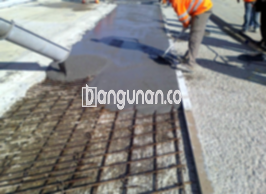

**Jasa Cor Beton Readymix & Jayamix Di Bergas Semarang** – Mencari solusi pengecoran praktis dan berkualitas untuk proyek konstruksi Anda di Bergas Semarang? Bangunan.co hadir sebagai penyedia jasa cor beton readymix dan jayamix, menghadirkan beton siap pakai yang diformulasikan khusus untuk memastikan efisiensi dan ketahanan. Mitra Bangunan menawarkan kemudahan dalam pengerjaan konstruksi, mulai dari pondasi hingga lantai, dengan komitmen pada kualitas terbaik dan layanan prima.



## Mengapa Memilih Layanan Cor Beton Readymix & Jayamix dari Bangunan.co di Bergas Semarang?

Adukan beton siap pakai yang kami sediakan dirancang untuk mempercepat tahapan pengecoran sekaligus menjamin mutu yang konsisten. Tujuan utama Bangunan.co adalah memberikan Anda kualitas beton yang terpercaya, memenuhi standar yang diharapkan, dan sesuai dengan spesifikasi konstruksi yang telah direncanakan dengan cermat. 

Cor readymix dikenal sebagai solusi beton cair siap pakai karena telah diproses secara optimal di pabrik pengolahan beton kami. Siap untuk langsung dicurahkan dan diratakan di lokasi proyek, material ini membebaskan Anda dari kerumitan pencampuran di tempat. Anda dapat fokus pada persiapan bekisting sebagai fondasi penopang beton yang kuat dan stabil.

Pengendalian mutu yang ketat dilakukan oleh tim ahli Bangunan.co, meliputi seluruh proses mulai dari pencampuran material hingga pengiriman. Hal ini menjamin kualitas beton yang seragam dan terpercaya, memberikan Anda ketenangan pikiran selama proses konstruksi.

## Keunggulan dan Hal yang Perlu Dipertimbangkan dalam Penggunaan Beton Readymix

Beton yang diproduksi oleh pabrik pengolahan Bangunan.co memiliki keunggulan tersendiri dibandingkan dengan beton yang dicampur secara manual. Berikut adalah beberapa keunggulan dan pertimbangan penting yang perlu Anda ketahui:

Keunggulan beton readymix dari Bangunan.co:

1.  **Kualitas yang Terukur:** Setiap adukan beton memiliki kualitas yang tepat dan konsisten.
2.  **Kualitas yang Merata:** Proses pencampuran yang teratur menjamin kualitas beton yang seragam di seluruh area pengecoran.
3.  **Material Unggulan:** Kami menggunakan material berkualitas tinggi untuk menghasilkan beton dengan kekuatan dan daya tahan optimal.
4.  **Efisiensi Waktu dan Biaya:** Proses produksi yang cepat menghasilkan penghematan waktu dan biaya operasional proyek Anda.
5.  **Kepraktisan dan Kemudahan:** Anda tidak perlu lagi khawatir tentang perhitungan adukan yang rumit, karena semuanya telah ditangani oleh tim ahli kami.

Meskipun demikian, perlu diingat beberapa hal:

Pemesanan beton readymix memerlukan penjadwalan yang matang karena proses produksi dan pengiriman membutuhkan persiapan. Kami juga memerlukan survei lokasi untuk menentukan perkiraan kebutuhan kubikasi beton yang akurat, sehingga dapat menghindari pemborosan atau kekurangan material saat pengiriman.

## Pilihan Mutu Beton yang Sering Digunakan di Bergas Semarang

Kebutuhan beton bervariasi tergantung pada jenis proyek konstruksi Anda. Salah satu mutu beton yang paling umum digunakan adalah K225, yang sangat cocok untuk pengecoran dak rumah, lantai dua, atau bahkan jalan gang yang tidak sering dilalui kendaraan berat.

Selain K225, mutu beton K250 dan K300 juga banyak diaplikasikan untuk pengecoran tiang, pondasi, atau cakar ayam. Untuk jalan pedesaan, mutu K250, K300, dan K350 dapat menjadi pilihan yang tepat. Mutu beton yang lebih tinggi, seperti K375, K400, dan K500, umumnya digunakan untuk beton *fast track* yang memerlukan waktu pengeringan yang singkat, misalnya untuk proyek jalan tol atau area parkir yang membutuhkan daya tahan terhadap beban berat.

## Bangunan.co: Jaminan Mutu Beton untuk Proyek Anda di Bergas Semarang



Campuran cor readymix atau *ready mix concrete* dari Bangunan.co dirancang dengan presisi untuk memastikan performa dan ketahanan yang optimal. Kami mengikuti standar adukan beton nasional (SNI) dengan komposisi yang teruji, terdiri dari 10% hingga 15% semen Portland, 60% hingga 75% agregat halus dan kasar (pasir dan split), serta 10% hingga 15% air, dengan sisanya merupakan kandungan udara.

Untuk menghasilkan mutu beton tinggi, kami meminimalkan rasio air dan semen tanpa mengurangi kemampuan kerja beton segar. Penggunaan air bersih dan bebas dari kontaminan sangat krusial untuk menjaga kualitas beton. Kami memastikan bahwa air yang digunakan bebas dari lumpur, lumut, atau bahan lain yang dapat menurunkan kualitas beton.

Sebagai penyedia jasa cor beton readymix & jayamix terpercaya di Bergas Semarang, Bangunan.co selalu berupaya memberikan produk dan layanan terbaik bagi Anda.

Demikian penjelasan dari Jasa Cor Beton Readymix & Jayamix Di Bergas Semarang yang telah kami sampaikan. Mitra Bangunan siap menjadi mitra Anda dalam mewujudkan proyek konstruksi yang kokoh dan berkualitas. Hubungi kami melalui WhatsApp untuk mendapatkan penawaran harga terbaik dan layanan konsultasi dari tim ahli kami. 

**Ref by:** [Cor Beton Readymix & Jayamix Bergas Semarang](https://id.wikipedia.org/wiki/Cor)