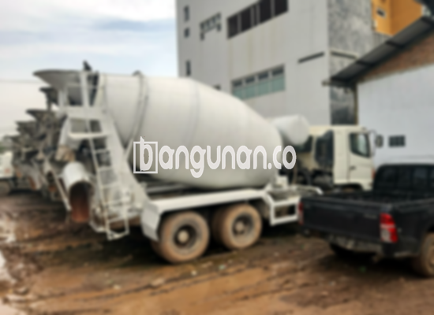

**Jasa Cor Beton Readymix & Jayamix Di Binangun Cilacap** – Mencari solusi konstruksi praktis dan berkualitas? Layanan cor readymix atau adukan beton siap pakai dari bangunan.co dirancang untuk pengecoran yang cepat dan presisi. Komposisi materialnya – meliputi pasir beton, batu split, semen, dan air – diolah dengan takaran yang telah terukur untuk menghasilkan mutu beton sesuai target. Mitra Bangunan hadir di Binangun Cilacap untuk mendukung kelancaran proyek Anda.



## Mengapa Memilih Layanan Pengadukan Beton bangunan.co di Binangun Cilacap?

Pengadukan beton kami bertujuan mempercepat progres pembangunan sekaligus menjamin kualitas yang stabil dan terpercaya. Dengan layanan ini, Anda dapat menyelesaikan pengecoran tepat waktu sesuai standar mutu yang diinginkan dan sesuai dengan desain konstruksi Anda.

Beton readymix menawarkan beragam pilihan mutu, disesuaikan dengan kebutuhan proyek Anda. Dikenal juga sebagai beton cair siap guna, beton ini diproduksi di pabrik pencampuran beton dengan formula yang presisi, siap langsung digunakan di lokasi proyek. Anda tidak perlu lagi pusing mencampur material di lokasi, karena kualitasnya sudah terkontrol. Cukup pastikan area pengecoran dan bekisting sudah siap.

Proses pengendalian kualitas dilakukan secara ketat oleh tim bangunan.co mulai dari pencampuran bahan hingga pengiriman. Dengan demikian, beton yang Anda terima selalu memenuhi standar kualitas yang Anda harapkan. Pilihan tepat bagi Anda yang mengedepankan kemudahan, efisiensi, dan jaminan kualitas dalam setiap proyek beton.

## Keunggulan dan Kekurangan Cor Readymix dari bangunan.co di Binangun Cilacap

Beton yang diproduksi melalui pabrik pengolahan beton bangunan.co, dibandingkan dengan metode pencampuran manual tradisional, memiliki kelebihan dan kekurangan masing-masing. Berikut penjabarannya:

Keunggulan beton bangunan.co meliputi:

1.  Pertama, komposisi campuran dirancang agar sesuai dengan mutu dan kualitas yang ideal.
2.  Kedua, kualitas beton lebih seragam karena proses pencampuran menggunakan mesin modern.
3.  Ketiga, material yang digunakan adalah bahan-bahan terbaik yang dipilih untuk mencapai mutu beton yang optimal.
4.  Keempat, waktu pengolahan lebih efisien, sehingga menghemat biaya dan waktu proyek Anda.
5.  Kelima, Anda tidak perlu lagi khawatir menentukan komposisi adukan beton yang tepat untuk konstruksi Anda, karena bangunan.co telah merancangnya secara presisi sesuai dengan kebutuhan proyek Anda.

Namun, perlu diingat beberapa kekurangan. Pemesanan beton readymix biasanya memerlukan penjadwalan. Prosesnya tidak instan seperti membeli material di toko bangunan. Anda perlu melakukan pemesanan dan survei lokasi untuk menghitung volume beton yang dibutuhkan dengan akurat sehingga tidak ada kelebihan atau kekurangan material.

## Jenis Mutu Beton yang Paling Banyak Digunakan di Binangun Cilacap

Mutu beton K225 merupakan pilihan paling populer di kalangan konsumen bangunan.co di Binangun Cilacap. Kualitas beton ini sangat sesuai untuk pengecoran dak rumah atau lantai 2 ke atas. Namun, K225 juga dapat digunakan untuk pengecoran jalan gang yang tidak menanggung beban berat kendaraan truk.

Pilihan lain yang populer adalah mutu beton K250 dan K300. K250 dan K300 umumnya digunakan untuk pengecoran tiang, pondasi, atau cakar ayam. Untuk jalan pedesaan, mutu K250, K300, dan bahkan K350 sering digunakan. Untuk aplikasi yang memerlukan kekuatan lebih tinggi, mutu beton seperti K375, K400, K500 dan seterusnya (sering disebut beton *fast track*) digunakan. Beton fast track ini ideal untuk proyek yang membutuhkan pengeringan atau pengerasan cepat dan kuat, seperti jalan tol atau area parkir dengan lalu lintas berat.

## Layanan Cor Beton Readymix & Jayamix Di Binangun Cilacap dari bangunan.co Mengutamakan Kualitas



Komposisi campuran adukan cor readymix atau *ready mix concrete* dari bangunan.co harus diformulasikan dengan cermat untuk memastikan kualitas, daya kerja, dan kekuatan yang optimal. Ini penting untuk mencegah beton mudah retak, hancur, atau terkelupas. Oleh karena itu, adukan material harus memenuhi standar mutu beton nasional (SNI). Komposisi ideal biasanya terdiri dari 10% hingga 15% semen Portland, 60% hingga 75% agregat halus dan kasar (pasir dan split), dan 10% hingga 15% air. Sisanya adalah udara, karena semua material padat memerlukan kandungan udara di dalamnya.

Beton berkualitas tinggi dihasilkan dengan meminimalkan rasio air terhadap semen tanpa mengorbankan kemudahan pengerjaan beton saat segar. Semakin sedikit air yang digunakan (dengan pengontrolan yang tepat), semakin tinggi mutu beton yang dihasilkan. Pastikan pula air yang digunakan bersih dan bebas dari kontaminan, seperti tanah atau lumut, yang dapat mengurangi kualitas beton.

Sebagai kesimpulan, layanan Cor Beton Readymix & Jayamix Di Binangun Cilacap dari bangunan.co menyajikan solusi konstruksi yang andal dan berkualitas. Untuk informasi harga masing-masing mutu, Anda dapat menghubungi kami untuk konsultasi lebih lanjut melalui WhatsApp.

**Ref by:** [Cor Beton Readymix & Jayamix Binangun Cilacap](https://id.wikipedia.org/wiki/Cor)

Mitra Bangunan yang sedang membutuhkan solusi pengecoran di Binangun Cilacap, percayakan kebutuhan beton Anda pada bangunan.co. Hubungi kami melalui tombol WhatsApp atau Telepon yang tersedia di halaman ini, dan tim kami akan siap membantu Anda dengan layanan berkualitas dan profesional.