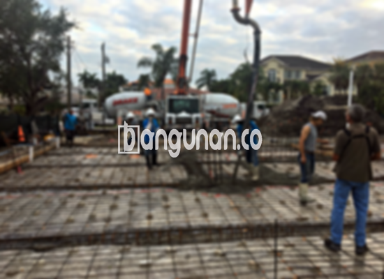

**Jasa Cor Beton Readymix & Jayamix Di Blora kota** – Membangun infrastruktur berkualitas di Blora kota membutuhkan material yang andal dan praktis. Mitra Bangunan hadir sebagai solusi dengan jasa cor beton readymix & jayamix, menawarkan adukan beton siap pakai yang dirancang untuk pengecoran cepat dan efisien. Dengan beton siap guna, Anda dapat menghemat waktu dan tenaga, serta memastikan mutu bangunan yang terjamin. Kami berkomitmen memberikan solusi konstruksi terbaik untuk setiap kebutuhan Anda.



## Pentingnya Pengadukan Beton Presisi dari Bangunan.co

Pengadukan beton yang tepat merupakan fondasi penting dalam setiap proyek konstruksi. Jasa Cor Beton Readymix & Jayamix dari Bangunan.co hadir untuk menyederhanakan proses ini, memastikan pelaksanaan pengecoran berjalan lancar dan tepat waktu. Tujuan utama dari penggunaan beton readymix adalah untuk mempercepat penyelesaian proyek tanpa mengorbankan kualitas beton yang dihasilkan. Dengan mutu yang terstandarisasi, Anda dapat membangun struktur yang kokoh dan tahan lama.

Cor readymix, atau beton siap pakai, menyediakan berbagai pilihan mutu yang sesuai dengan kebutuhan spesifik konstruksi Anda. Beton ini diproduksi dan diformulasikan secara khusus di pabrik pengolahan beton sehingga siap digunakan langsung di lokasi proyek. Anda tidak perlu lagi khawatir tentang proses pencampuran manual yang memakan waktu dan berpotensi mengurangi kualitas. Cukup tuangkan dan ratakan, dan fondasi bangunan Anda pun siap dibangun.

Kualitas beton secara ketat dikontrol mulai dari pemilihan material hingga proses pencampuran dan pengiriman. Hal ini memastikan bahwa setiap batch beton yang kami kirim memenuhi standar mutu yang diharapkan. Dengan demikian, Anda dapat fokus pada tahapan pembangunan lainnya tanpa perlu khawatir tentang konsistensi dan kekuatan beton.

## Kelebihan dan Kekurangan Penggunaan Cor Readymix

Terdapat perbedaan yang signifikan antara beton yang dicampur di pabrik pengolahan beton (batching plant) dengan adukan manual tradisional. Berikut adalah perbandingan kelebihan dan kekurangan masing-masing metode:

Kelebihan beton pabrikan:

1.  Kualitas dan mutu adukan terjamin presisi sesuai standar.
2.  Konsistensi kualitas beton yang merata karena proses pencampuran modern.
3.  Penggunaan material konstruksi terbaik yang telah dipilih secara ketat.
4.  Efisiensi waktu dan biaya, mengurangi kebutuhan tenaga kerja manual.
5.  Praktis, karena Anda tidak perlu repot menghitung dan mencampur material.

Namun, terdapat juga beberapa pertimbangan yang perlu diperhatikan:

Pemesanan beton readymix memerlukan perencanaan yang matang karena memerlukan penjadwalan dan survei lokasi untuk menghitung volume beton yang dibutuhkan secara akurat. Hal ini bertujuan untuk menghindari kelebihan atau kekurangan pasokan beton di lokasi proyek.

## Ragam Mutu Beton yang Paling Banyak Dibutuhkan di Blora kota

Salah satu jenis beton yang paling banyak digunakan di Blora kota adalah mutu K225. K225 sangat cocok untuk pengecoran dak rumah atau lantai dua, karena dirancang khusus untuk aplikasi tersebut. Selain itu, mutu beton ini juga dapat digunakan untuk pengecoran jalan gang kecil yang tidak menanggung beban berat.

Selain K225, mutu beton K250 dan K300 juga banyak digunakan dalam konstruksi. K250 dan K300 ideal untuk pengecoran tiang, pondasi atau cakar ayam. Untuk jalan pedesaan, mutu K250, K300, dan bahkan K350 sering diterapkan untuk memastikan daya tahan dan kekuatan jalan.

Untuk proyek yang membutuhkan pengeringan cepat, seperti jalan tol atau area parkir dengan beban berat, mutu beton yang lebih tinggi seperti K375, K400, K500, atau lebih tinggi sering digunakan. Beton dengan mutu tinggi ini dikenal sebagai beton *fast track*, karena dapat digunakan hanya dalam hitungan hari setelah pengecoran.

## Bangunan.co Memprioritaskan Mutu Cor Beton Readymix & Jayamix Di Blora kota



Formula adukan cor readymix haruslah dirancang secara cermat untuk memastikan kekuatan dan ketahanan yang optimal. Komposisi ideal terdiri dari 10% hingga 15% semen Portland, 60% hingga 75% agregat halus dan kasar (pasir dan split), serta 10% hingga 15% air. Sisanya adalah kandungan udara yang berperan penting dalam kemudahan pengerjaan beton segar.

Kualitas beton terbaik dicapai dengan meminimalkan rasio air terhadap semen tanpa mengurangi kemudahan pengerjaan. Penggunaan air bersih adalah kunci, hindari menggunakan air yang kotor, berlumpur, atau mengandung lumut karena dapat menurunkan mutu beton secara signifikan.

Sebagai penyedia jasa cor beton readymix & jayamix di Blora kota, Bangunan.co menjamin kualitas dan ketepatan waktu pengiriman. Anda dapat mempercayakan kebutuhan beton Anda kepada kami dan fokus pada penyelesaian proyek Anda.

**Ref by:** [Cor Beton Readymix & Jayamix Blora kota](https://id.wikipedia.org/wiki/Cor)

Mitra Bangunan berkomitmen untuk memberikan solusi beton terbaik bagi Anda di Blora kota. Hubungi kami melalui tombol WhatsApp atau Telepon yang tersedia di halaman ini untuk mendapatkan informasi lebih lanjut dan penawaran harga. Kami siap membantu Anda memilih mutu beton yang tepat dan memastikan proyek Anda sukses.