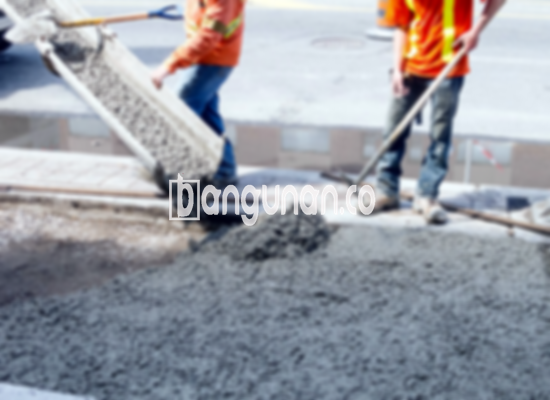

**Jasa Cor Beton Readymix & Jayamix Di Bobotsari Purbalingga** – Mitra Bangunan menawarkan solusi pengecoran modern untuk proyek konstruksi Anda di Bobotsari Purbalingga. Cor Readymix atau adukan beton siap pakai adalah campuran material beton yang dirancang khusus untuk pengecoran cepat dan tepat waktu. Komposisi utamanya terdiri dari pasir beton, batu pecah, semen, dan air, dengan takaran yang telah dihitung secara presisi untuk menghasilkan kualitas beton yang optimal.



## Mengapa Memilih Layanan Cor Readymix dari bangunan.co di Bobotsari Purbalingga?

Penggunaan adukan beton readymix bertujuan untuk mempercepat proses pengecoran dan memastikan kualitas yang terjamin. Dengan memilih layanan dari bangunan.co, Anda akan mendapatkan beton dengan mutu yang konsisten dan sesuai dengan standar yang ditetapkan untuk konstruksi Anda. Hal ini meminimalkan risiko kesalahan dan memastikan kekuatan struktur yang dibangun.

Beton cor readymix dikenal juga sebagai beton cair siap pakai karena diproduksi secara khusus di pabrik pencampuran beton. Proses ini memungkinkan kontrol kualitas yang lebih ketat dan memastikan bahwa beton siap digunakan langsung di lokasi proyek. Anda tidak perlu lagi repot mencampur sendiri material beton di lokasi, yang sering kali memakan waktu dan tenaga. Anda hanya perlu menyiapkan bekisting yang kokoh untuk menampung beton yang akan dituang.

Kualitas beton yang disediakan oleh bangunan.co dikendalikan secara menyeluruh, mulai dari pemilihan bahan baku hingga proses pencampuran dan pengiriman. Ini menjamin bahwa beton yang Anda terima memiliki mutu yang sesuai dengan spesifikasi proyek Anda. Dengan demikian, Anda dapat menghemat waktu dan biaya, serta memastikan kualitas konstruksi yang optimal.

## Keunggulan dan Hal yang Perlu Diperhatikan Saat Menggunakan Cor Readymix

Beton yang diproduksi di pabrik pengolahan beton memiliki keunggulan tersendiri dibandingkan dengan adukan manual yang dibuat di lokasi. Beberapa keunggulan utama meliputi:

1.  Kualitas beton yang seragam dan konsisten.
2.  Mutu beton yang terjamin berkat proses pencampuran yang presisi menggunakan mesin.
3.  Penggunaan material berkualitas tinggi yang telah melalui seleksi ketat.
4.  Efisiensi waktu dan biaya dengan mengurangi kebutuhan tenaga kerja dan waktu pengerjaan.
5.  Kepraktisan karena Anda tidak perlu khawatir tentang rumus pencampuran beton yang tepat.

Meskipun demikian, ada beberapa hal yang perlu Anda perhatikan. Pemesanan readymix dari bangunan.co biasanya memerlukan penjadwalan terlebih dahulu dan survei lokasi untuk menentukan jumlah kubikasi yang dibutuhkan. Hal ini dilakukan untuk memastikan ketersediaan material yang cukup dan menghindari pemborosan.

## Variasi Mutu Beton yang Paling Umum Digunakan di Bobotsari Purbalingga

Salah satu mutu beton yang paling sering digunakan adalah K225. Mutu beton ini sangat ideal untuk pengecoran dak rumah atau lantai dua ke atas, karena dirancang khusus untuk menahan beban yang sesuai dengan aplikasi tersebut. Selain itu, K225 juga dapat digunakan untuk pengecoran jalan gang yang tidak menampung lalu lintas kendaraan berat.

Pilihan yang populer lainnya termasuk mutu beton K250 dan K300, yang umum digunakan untuk pengecoran tiang, pondasi, atau cakar ayam. Untuk jalan pedesaan, K250, K300, dan K350 seringkali menjadi pilihan yang tepat. Mutu beton yang lebih tinggi, seperti K375, K400, dan K500, biasanya diperuntukkan bagi proyek-proyek yang membutuhkan kekuatan dan kecepatan pengerasan yang lebih cepat, seperti jalan tol atau area parkir yang menahan beban berat. Beton dengan mutu tinggi ini sering disebut sebagai beton *fast track*.

## bangunan.co: Jaminan Kualitas untuk Cor Beton Readymix di Bobotsari Purbalingga



Perancangan campuran beton readymix yang baik sangat penting untuk menghasilkan beton dengan kinerja dan ketahanan yang optimal. bangunan.co memastikan bahwa setiap campuran dirancang dengan cermat agar memenuhi standar mutu nasional (SNI).

Komposisi campuran beton yang ideal umumnya terdiri dari 10% hingga 15% semen Portland, 60% hingga 75% agregat halus dan kasar (pasir dan split), serta 10% hingga 15% air. Kualitas air yang digunakan juga sangat krusial. bangunan.co hanya menggunakan air bersih yang bebas dari kontaminan, seperti lumpur atau alga, yang dapat mengurangi kekuatan beton.

Mitra Bangunan dari bangunan.co siap membantu Anda memenuhi kebutuhan cor beton di Bobotsari Purbalingga. Untuk informasi harga yang sesuai dengan proyek Anda, jangan ragu untuk menghubungi kami melalui WhatsApp. Kami akan dengan senang hati memberikan penawaran terbaik.

**Ref by:** [Cor Beton Readymix & Jayamix Bobotsari Purbalingga](https://id.wikipedia.org/wiki/Cor)