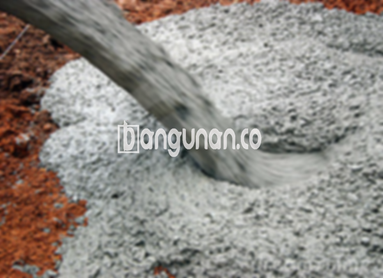

**Jasa Cor Beton Readymix & Jayamix Di Boja Kendal** – Bagi Mitra Bangunan yang membutuhkan solusi pengecoran praktis dan berkualitas tinggi, Bangunan.co hadir di Boja Kendal dengan layanan cor readymix dan jayamix. Kami memberikan kemudahan dalam setiap tahapan proyek konstruksi Anda, memastikan waktu pengerjaan efisien dan mutu beton terjamin sesuai standar. Dengan formula khusus yang kami terapkan, beton yang dihasilkan akan memiliki kekuatan dan daya tahan maksimal.



## Mengoptimalkan Pengerjaan Konstruksi dengan Layanan Cor Beton Readymix & Jayamix dari Bangunan.co di Boja Kendal

Mengapa memilih layanan pengadukan beton dari Bangunan.co di Boja Kendal? Solusi ini dirancang untuk mempercepat proses pengecoran sekaligus menjamin hasil yang konsisten. Dengan kualitas yang terjamin, Anda dapat fokus pada aspek lain dalam pembangunan proyek tanpa perlu khawatir tentang integritas struktur beton. Penggunaan beton readymix memungkinkan efisiensi waktu dan tenaga, sehingga proyek Anda dapat diselesaikan tepat waktu.

Beton ready mix menawarkan beragam pilihan mutu yang fleksibel, menyesuaikan dengan kebutuhan spesifik konstruksi Anda. Material ini sering disebut juga beton cair siap pakai karena telah diformulasikan secara akurat di pabrik pengolahan beton. Beton ini siap dituang dan diratakan langsung di lokasi proyek Anda, menghilangkan kebutuhan untuk mengaduk secara manual. Anda hanya perlu menyiapkan bekisting sebagai penopang, dan kami akan menangani sisanya.

Pengendalian mutu dilakukan secara ketat di setiap tahapan, mulai dari pencampuran material hingga proses pengiriman oleh tim Bangunan.co. Hal ini memastikan bahwa beton yang Anda terima memenuhi standar kualitas tertinggi, memberikan ketenangan pikiran dalam setiap proyek konstruksi Anda.

## Keunggulan dan Pertimbangan Penggunaan Beton Readymix dari Bangunan.co di Boja Kendal

Terdapat perbedaan signifikan antara beton yang diproduksi oleh pabrik pengolahan beton (sering disebut *batching plant*) dan metode pengadukan manual tradisional. Mari kita telaah kelebihan dan kekurangan masing-masing pendekatan:

Penggunaan beton yang dihasilkan melalui pabrik Bangunan.co menawarkan beberapa keuntungan utama:

1.  Aplikasi formulasi campuran yang tepat untuk mencapai kualitas optimal.
2.  Konsistensi kualitas yang merata berkat proses pencampuran terkontrol.
3.  Pemanfaatan material berkualitas tinggi yang dipilih secara selektif.
4.  Efisiensi waktu dan biaya operasional yang signifikan.
5.  Kemudahan penggunaan karena Anda tidak perlu memikirkan perbandingan material.

Namun, penting untuk mempertimbangkan beberapa hal:

Pemesanan beton readymix dari Bangunan.co memerlukan penjadwalan dan survei lokasi untuk menentukan volume yang dibutuhkan secara akurat. Dengan demikian, kami dapat menghindari kelebihan atau kekurangan material saat pengiriman ke lokasi proyek Anda.

## Ragam Mutu Beton yang Paling Sering Dipilih di Boja Kendal

Salah satu mutu beton yang paling banyak digunakan dalam berbagai proyek pembangunan di Boja Kendal adalah K225. Mutu ini ideal untuk pengecoran dak rumah atau lantai dua ke atas, karena dirancang khusus untuk aplikasi semacam itu. Selain itu, mutu K225 juga cocok untuk pengecoran jalan gang yang tidak menanggung beban lalu lintas berat.

Selain mutu K225, mutu beton K250 dan K300 juga menjadi pilihan populer. K250 dan K300 biasanya digunakan untuk pengecoran tiang, pondasi, atau cakar ayam bangunan. Untuk konstruksi jalan pedesaan, mutu K250, K300, dan K350 seringkali menjadi pilihan tepat. Sementara itu, mutu di atas K350, seperti K375, K400, dan K500, lazim digunakan untuk beton *fast track* yang memerlukan waktu pengeringan singkat, misalnya pada proyek jalan tol atau area parkir yang menahan beban berat.

## Bangunan.co: Jaminan Mutu pada Setiap Pengecoran Beton di Boja Kendal



Formulasi adukan beton ready mix atau *ready mix concrete* dari Bangunan.co harus dirancang dengan cermat untuk menjamin kinerja dan kekuatan optimal. Ini esensial untuk mencegah kerusakan seperti keropos, retak, atau pengelupasan pada beton. Oleh karena itu, adukan material harus selaras dengan Standar Nasional Indonesia (SNI). Komposisi umumnya terdiri dari 10% hingga 15% semen Portland, 60% hingga 75% agregat halus dan kasar (pasir dan split), serta 10% hingga 15% air, dengan proporsi sisanya berupa udara.

Beton berkualitas tinggi dihasilkan melalui proses yang meminimalkan rasio air terhadap semen tanpa mengorbankan kemampuan kerja beton segar. Penggunaan air bersih sangat penting untuk mencegah kontaminasi yang dapat menurunkan kualitas beton. Oleh karena itu, hindari penggunaan air yang kotor atau mengandung lumut.

Mitra Bangunan yang sedang mencari jasa cor beton readymix berkualitas di Boja Kendal, jangan ragu untuk menghubungi Bangunan.co melalui tombol WhatsApp atau Telepon yang tersedia di halaman ini. Kami siap memberikan solusi terbaik untuk kebutuhan konstruksi Anda.

**Ref by:** [Cor Beton Readymix & Jayamix Boja Kendal](https://id.wikipedia.org/wiki/Cor)