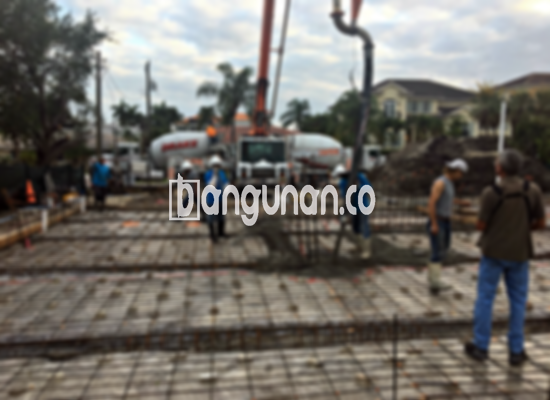

**Jasa Cor Beton Readymix & Jayamix Di Bojongsari Purbalingga** – Solusi pengecoran modern untuk proyek Anda di Bojongsari Purbalingga, dengan layanan cor readymix dan jayamix dari bangunan.co. Beton siap pakai kami dirancang untuk memberikan kekuatan, kecepatan, dan kemudahan dalam setiap pengerjaan konstruksi. Mitra Bangunan hadir untuk memastikan pondasi kokoh dan hasil yang tahan lama bagi bangunan Anda.



## Keuntungan Menggunakan Jasa Cor Beton Readymix & Jayamix dari bangunan.co di Bojongsari Purbalingga

Dengan menggunakan layanan kami, Anda mendapatkan lebih dari sekadar material konstruksi. bangunan.co memahami kebutuhan efisiensi dan kualitas dalam setiap proyek. Beton readymix dan jayamix yang kami sediakan dirancang untuk mempercepat proses pengecoran secara signifikan, memungkinkan Anda menyelesaikan proyek tepat waktu dan sesuai anggaran. Kualitas terjamin dan konsisten menjadi prioritas utama kami, memastikan setiap struktur yang Anda bangun berdiri kokoh dan aman.

Beton readymix juga menawarkan fleksibilitas dalam pemilihan mutu. Anda dapat memilih jenis beton yang paling sesuai untuk spesifikasi proyek Anda, dari K225 hingga K350 dan lebih tinggi. Kemudahan dalam penggunaan menjadi nilai tambah utama – beton siap langsung dicor setelah tiba di lokasi proyek, menghemat waktu dan tenaga kerja. Dengan demikian, Anda dapat fokus pada aspek penting lainnya dari konstruksi Anda.

Layanan pengadukan beton modern ini memungkinkan Anda untuk menghindari kerumitan pencampuran manual, termasuk pengukuran material yang akurat dan pencampuran yang konsisten. bangunan.co menjamin kualitas dan keseragaman beton di setiap pengiriman, memberikan Anda kepercayaan diri dalam setiap detail konstruksi.

## Memahami Kelebihan dan Kekurangan Beton Readymix

Meskipun beton readymix menawarkan banyak keuntungan, penting untuk memahami perbedaan antara beton yang diproduksi di pabrik pengolahan beton dengan metode tradisional. bangunan.co akan memberikan gambaran yang jelas tentang kelebihan dan kekurangan masing-masing pendekatan untuk membantu Anda membuat keputusan yang tepat.

Beton yang diproduksi di pabrik pengolahan beton unggul dalam beberapa hal:

1.  Precisi dalam pencampuran sesuai dengan mutu yang dipesan.
2.  Kualitas beton yang seragam dan konsisten, memastikan kekuatan optimal.
3.  Penggunaan material bangunan berkualitas tinggi yang telah teruji.
4.  Efisiensi waktu dan penghematan biaya karena proses yang terotomatisasi.
5.  Mengurangi kebutuhan tenaga kerja dan menyederhanakan proses konstruksi.

Namun, perlu dipertimbangkan bahwa pemesanan beton readymix memerlukan perencanaan yang matang. bangunan.co menyarankan untuk memesan beton jauh-jauh hari agar dapat menjadwalkan pengiriman sesuai kebutuhan proyek Anda. Survei lokasi juga penting untuk memastikan volume beton yang dipesan sesuai dengan kebutuhan sebenarnya.

## Mutu Beton yang Sering Dipakai di Proyek Bojongsari Purbalingga

Untuk tugas-tugas konstruksi ringan, seperti pengecoran lantai rumah atau jalan setapak, mutu K225 sering kali sudah memadai. mutu beton ini menawarkan keseimbangan antara kekuatan dan biaya, menjadikannya pilihan ekonomis untuk proyek-proyek kecil hingga menengah. Namun, ketika berbicara tentang pondasi atau struktur yang menahan beban lebih berat, mutu K250 hingga K350 menjadi pilihan yang lebih tepat.

K250 sangat cocok untuk pondasi bangunan bertingkat dan struktur yang membutuhkan kekuatan lebih. Selain itu, mutu K300 sering digunakan untuk konstruksi jalan pedesaan yang akan menerima lalu lintas kendaraan berat. Untuk proyek yang membutuhkan kekuatan dan kecepatan pengerasan yang lebih tinggi, seperti jalan tol, mutu K350 hingga K500 menjadi pilihan yang ideal.

Ketersediaan berbagai mutu beton dari bangunan.co memungkinkan Anda menyesuaikan pilihan dengan kebutuhan spesifik proyek Anda di Bojongsari Purbalingga. Kami siap membantu Anda dalam memilih mutu yang tepat dengan mempertimbangkan anggaran, persyaratan struktural, dan jangka waktu pengerjaan.

## bangunan.co: Jaminan Kualitas Beton untuk Proyek Anda



Sebagai penyedia layanan cor beton readymix dan jayamix, bangunan.co mengutamakan kualitas dalam setiap aspek produksi. Kami mengikuti standar nasional (SNI) dalam proses pencampuran, memastikan setiap batch beton memiliki kekuatan dan daya tahan yang optimal. Bahan baku yang digunakan berasal dari pemasok terpercaya, dan proses pengujian mutu dilakukan secara berkala untuk menjamin kualitas yang konsisten.

Komposisi beton yang ideal terdiri dari semen Portland, agregat halus (pasir), agregat kasar (split), dan air dalam proporsi yang tepat. bangunan.co juga memperhatikan kandungan udara dalam campuran beton, yang dapat memengaruhi kekuatan dan kemampuan kerja beton. Penggunaan air bersih dan bebas dari kontaminan sangat penting untuk memastikan proses hidrasi semen berlangsung optimal.

Dengan memilih bangunan.co, Anda dapat yakin bahwa beton yang Anda terima akan memenuhi standar kualitas tertinggi, memberikan fondasi yang kuat dan tahan lama bagi proyek konstruksi Anda. Kualitas beton ini bukan hanya tentang kekuatan, tetapi juga tentang keamanan dan keberlanjutan bangunan Anda.

**Ref by:** [Cor Beton Readymix & Jayamix Bojongsari Purbalingga](https://id.wikipedia.org/wiki/Cor)

Mitra Bangunan dari bangunan.co selalu siap membantu Anda dalam mewujudkan proyek konstruksi yang sukses di Bojongsari Purbalingga. Hubungi kami melalui tombol WhatsApp atau Telepon yang tersedia di halaman ini untuk mendapatkan penawaran harga terbaik dan layanan konsultasi yang profesional. Percayakan kebutuhan beton Anda kepada ahlinya dan nikmati kemudahan serta kualitas yang tak tertandingi dari bangunan.co.