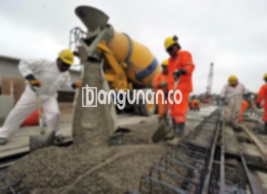

**Jasa Cor Beton Readymix & Jayamix Di Brangsong Kendal** – Solusi praktis dan efisien untuk konstruksi Anda, readymix atau campuran beton siap pakai adalah adukan material beton yang diformulasikan khusus untuk pengecoran instan. Komposisinya terdiri dari pasir beton, batu split, semen, dan air dengan takaran yang presisi untuk menghasilkan mutu beton yang diinginkan. Mitra Bangunan di Brangsong Kendal hadir sebagai penyedia jasa readymix yang terpercaya, siap mendukung kelancaran proyek Anda.



## Alasan Memilih Jasa Pengadukan Beton Readymix & Jayamix dari Bangunan.co di Brangsong Kendal

Penyediaan beton readymix oleh Bangunan.co bertujuan untuk mempercepat proses pengecoran serta menjamin kualitas beton yang optimal. Dengan layanan ini, Anda dapat menyelesaikan proyek konstruksi secara lebih efisien dan mendapatkan hasil yang sesuai dengan standar mutu yang ditetapkan. Kualitas menjadi prioritas utama kami dalam setiap tahapan produksi.

Beton readymix menawarkan fleksibilitas dengan beragam pilihan mutu yang dapat disesuaikan dengan berbagai kebutuhan konstruksi Anda. Beton ini diproduksi di pabrik pengolahan beton dan siap digunakan langsung di lokasi proyek setelah diangkut dengan truk molen. Hal ini menghilangkan kebutuhan untuk mencampur adukan sendiri di lokasi, menghemat waktu dan tenaga. Anda hanya perlu memastikan kesiapan bekisting sebagai cetakan beton.

Proses pengolahan beton di pabrik pengolahan (batching plant) kami dikendalikan secara ketat untuk memastikan konsistensi kualitas. Mulai dari penimbangan bahan baku hingga pencampuran dan pengiriman, setiap tahap diawasi dengan seksama. Hal ini memungkinkan Anda memperoleh beton berkualitas tinggi tanpa harus pusing memikirkan proses pencampuran manual.

## Keunggulan dan Kekurangan Menggunakan Cor Readymix dari Bangunan.co di Brangsong Kendal

Terdapat perbedaan signifikan antara beton yang diproses di pabrik pengolahan beton dengan beton yang dicampur secara manual. Berikut adalah analisis keunggulan dan kekurangannya:

Kelebihan beton readymix dari Bangunan.co meliputi:

1.  Konsistensi kualitas adukan beton yang selalu terjaga.
2.  Keseragaman kualitas beton karena proses pencampuran yang terstandarisasi.
3.  Penggunaan bahan material berkualitas tinggi untuk menghasilkan beton terbaik.
4.  Efisiensi waktu dan biaya karena proses pengolahan yang cepat dan terorganisir.
5.  Kepraktisan karena Anda tidak perlu lagi khawatir tentang komposisi adukan yang tepat.

Namun, terdapat juga beberapa kekurangan yang perlu dipertimbangkan:

Pemesanan beton readymix memerlukan penjadwalan sebelumnya. Kami tidak dapat melayani permintaan mendadak. Survei lokasi diperlukan untuk menghitung volume beton yang dibutuhkan secara akurat. Hal ini bertujuan untuk menghindari pemborosan atau kekurangan material pada saat pengiriman.

## Pilihan Mutu Beton yang Umum Digunakan di Brangsong Kendal

Mutu beton K225 adalah pilihan paling populer dan banyak digunakan dalam berbagai proyek konstruksi di Brangsong Kendal. Kualitas ini umumnya diaplikasikan pada pengecoran dak rumah atau lantai dua ke atas karena dirancang khusus untuk menahan beban tersebut. K225 juga cocok untuk pengecoran jalan gang yang tidak dilalui kendaraan berat.

Selain K225, mutu beton K250 dan K300 juga sering diaplikasikan. K250 dan K300 ideal untuk pengecoran tiang, pondasi, atau cakar ayam. Untuk proyek jalan pedesaan, mutu K250, K300, dan bahkan K350 sering digunakan. Untuk aplikasi khusus yang membutuhkan kekuatan tinggi dan waktu pengeringan cepat, mutu beton di atas K350, seperti K375, K400, atau K500 (disebut beton *fast track*), dapat menjadi pilihan terbaik. Beton *fast track* sering digunakan pada jalan tol atau area parkir yang memerlukan ketahanan tinggi dan waktu pengeringan minimal.

## Bangunan.co Mengutamakan Kualitas Beton dalam Setiap Pengecoran di Brangsong Kendal



Formulasi adukan beton readymix harus dirancang secara teliti agar menghasilkan kekuatan dan daya tahan optimal. Secara umum, komposisi ideal terdiri dari 10% hingga 15% semen Portland, 60% hingga 75% agregat halus dan kasar (pasir dan split), serta 10% hingga 15% air. Sisanya merupakan udara, yang tetap memegang peranan penting dalam campuran beton.

Meminimalkan rasio air terhadap semen adalah kunci untuk menghasilkan beton bermutu tinggi tanpa mengurangi kemampuan kerja beton saat masih segar. Semakin sedikit air yang digunakan, semakin tinggi pula kualitas beton yang dihasilkan. Penggunaan air bersih juga sangat penting untuk mencegah kontaminasi yang dapat menurunkan mutu beton. Air yang digunakan sebaiknya bebas dari lumpur ataupun lumut.

Mitra Bangunan dari Bangunan.co berkomitmen untuk menyediakan beton readymix berkualitas tinggi dan layanan yang profesional untuk semua proyek Anda di Brangsong Kendal. Kami memahami bahwa kualitas beton adalah fondasi dari setiap bangunan yang kokoh dan tahan lama.

**Ref by:** [Cor Beton Readymix & Jayamix Brangsong Kendal](https://id.wikipedia.org/wiki/Cor)