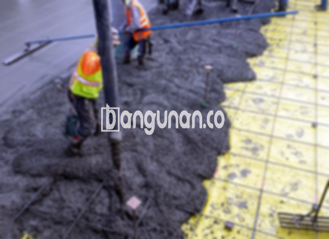

**Jasa Cor Beton Readymix & Jayamix Di Brati Grobogan** – Memastikan kelancaran konstruksi dengan adukan beton berkualitas adalah prioritas bagi para profesional. Di Brati Grobogan, **bangunan.co** hadir sebagai solusi terpercaya untuk penyediaan beton siap pakai (readymix) dan jayamix. Dengan layanan Kami, Mitra Bangunan dapat menikmati efisiensi pengecoran, konsistensi mutu, dan penyelesaian proyek yang lebih cepat. Beton siap pakai adalah pilihan ideal untuk berbagai aplikasi konstruksi, memungkinkan Anda untuk fokus pada aspek-aspek penting lainnya dari proyek Anda.



## Mengapa Memilih Layanan Cor Beton Readymix & Jayamix dari bangunan.co di Brati Grobogan?

Penyediaan adukan beton dengan sistem ready mix bertujuan untuk mempercepat tahapan pembangunan dan menjamin mutu yang terstandarisasi. Dengan formulasi yang telah dirancang secara presisi, mutu beton yang dihasilkan akan sesuai dengan spesifikasi proyek Anda.

Beton ready mix sering dikenal sebagai beton cair siap pakai, diproduksi di pabrik dengan kontrol kualitas yang ketat. Beton ini siap langsung digunakan di lokasi proyek, cukup dengan melakukan pengecoran dan perataan. Anda tidak perlu lagi khawatir tentang proses pencampuran manual yang memakan waktu dan berpotensi mengurangi kualitas.

Kualitas beton secara menyeluruh diawasi oleh tim pengolahan beton, mulai dari pemilihan material hingga proses pengiriman. Proses ini memastikan bahwa Anda menerima beton dengan mutu yang terjamin dan sesuai dengan kebutuhan proyek Anda.

## Keunggulan dan Pertimbangan Penggunaan Beton Readymix Menurut bangunan.co Di Brati Grobogan

Beton yang diproduksi di pabrik pengolahan beton (batching plant) memiliki perbedaan signifikan dibandingkan dengan adukan manual tradisional. Berikut adalah perbandingan kelebihan dan kekurangannya:

Kelebihan:

1.  Komposisi campuran yang presisi untuk mutu dan kualitas yang optimal.
2.  Kualitas beton yang seragam karena proses pencampuran yang terkontrol.
3.  Penggunaan bahan baku berkualitas tinggi yang telah diseleksi secara ketat.
4.  Efisiensi waktu dan biaya dalam proses pengolahan dan konstruksi.
5.  Kemudahan karena Anda tidak perlu memikirkan perbandingan campuran yang tepat.

Kekurangan:

Pemesanan beton ready mix memerlukan perencanaan dan penjadwalan yang cermat. Anda perlu memesan beberapa waktu sebelumnya dan menginformasikan kebutuhan volume yang tepat. Hal ini untuk memastikan ketersediaan material dan kelancaran pengiriman ke lokasi proyek Anda.

## Jenis Mutu Beton yang Paling Banyak Digunakan di Brati Grobogan

K225 adalah salah satu mutu beton yang paling populer dan sering digunakan, terutama untuk pengecoran lantai rumah atau lantai dua ke atas. Mutu ini sangat ideal untuk aplikasi pengecoran dak. Selain itu, K225 juga bisa digunakan untuk pengecoran jalan gang yang tidak menanggung beban kendaraan berat.

K250 dan K300 merupakan pilihan yang sering ditemukan dalam proyek konstruksi. Kedua mutu ini umumnya digunakan untuk pondasi, tiang, atau cakar ayam. Untuk jalan pedesaan, K250, K300, dan bahkan K350 seringkali menjadi pilihan yang sesuai. Apabila Anda memerlukan pengerasan yang lebih cepat, mutu beton yang lebih tinggi seperti K400 atau lebih tinggi (yang dikenal sebagai beton *fast track*) bisa menjadi pilihan. Mutu ini sering digunakan untuk proyek jalan tol, area parkir, atau aplikasi lain yang membutuhkan kekuatan dan kekerasan tinggi dalam waktu singkat.

## bangunan.co: Komitmen Kami Terhadap Kualitas Beton yang Terbaik di Brati Grobogan



Formulasi campuran beton ready mix sangat penting untuk menentukan kekuatan dan ketahanan beton. Di **bangunan.co**, Kami merancang campuran beton dengan cermat, memastikan adukan material memenuhi standar mutu nasional (SNI). Komposisi umumnya terdiri dari 10% hingga 15% semen Portland, 60% hingga 75% agregat halus dan kasar (pasir dan split), serta 10% hingga 15% air. 

Untuk menghasilkan beton berkualitas tinggi, Kami meminimalkan rasio air terhadap semen tanpa mengorbankan kemampuan kerja beton. Penggunaan air bersih yang bebas dari kotoran dan kontaminan lainnya juga merupakan prioritas utama Kami. Dengan proses yang terstandardisasi, Anda dapat yakin bahwa beton yang Kami sediakan akan memenuhi semua persyaratan proyek Anda di Brati Grobogan.

Dengan begitu, Mitra Bangunan dapat mengandalkan layanan dari **bangunan.co** untuk mendapatkan beton readymix dan jayamix yang berkualitas tinggi, tepat waktu, dan sesuai kebutuhan proyek Anda di Brati Grobogan. Hubungi Kami untuk mendapatkan penawaran terbaik dan layanan yang profesional.

**Ref by:** [Cor Beton Readymix & Jayamix Brati Grobogan](https://id.wikipedia.org/wiki/Cor)