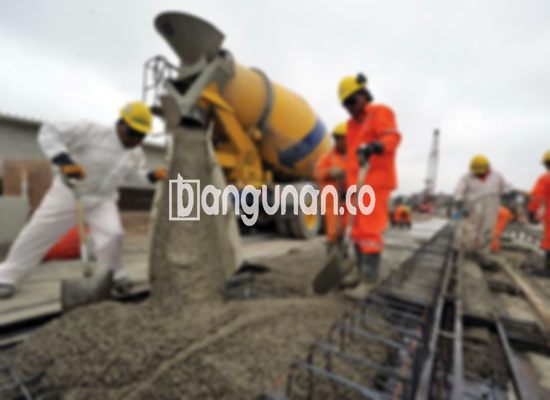

**Jasa Cor Beton Readymix & Jayamix Di Bruno Purworejo** – Solusi pengecoran beton modern dan praktis kini tersedia di Bruno Purworejo. Mitra Bangunan menghadirkan layanan cor readymix atau adukan beton siap pakai yang dirancang khusus untuk memenuhi kebutuhan konstruksi Anda dengan cepat dan efisien. Terdiri dari campuran material pilihan seperti pasir, batu split, semen, dan air dengan proporsi yang telah terkalibrasi, beton ini menjamin kekuatan dan kualitas yang konsisten.



## Mengapa Memilih Jasa Pengadukan Beton Readymix dari Bangunan.co di Bruno Purworejo?

Layanan pengadukan beton readymix dari Bangunan.co menawarkan solusi cerdas untuk mempercepat proses pembangunan Anda. Dengan memilih layanan kami, Anda tidak perlu lagi bersusah payah mencampur beton secara manual di lokasi proyek. Beton siap pakai ini memberikan kepastian kualitas, konsistensi, dan efisiensi waktu yang signifikan. Bagi Anda yang membutuhkan beton berkualitas tinggi dengan cepat, Bangunan.co adalah mitra terpercaya Anda di Bruno Purworejo.

Beton cor readymix hadir dalam berbagai spesifikasi mutu, disesuaikan dengan kebutuhan unik proyek Anda. Sebagai beton cair yang siap digunakan, produk kami telah diproses secara optimal di pabrik pengolahan beton, sehingga Anda dapat langsung menuangkannya dan meratakannya di lokasi konstruksi. Dengan demikian, Anda dapat fokus pada tahap-tahap penting lainnya dalam proyek Anda tanpa terbebani oleh proses pencampuran beton yang rumit.

Kualitas beton kami dikendalikan secara ketat di setiap tahap produksi, mulai dari pemilihan material hingga proses pencampuran dan pengiriman. Pabrik pengolahan beton (batching plant) kami dilengkapi dengan teknologi modern dan diawasi oleh tenaga ahli yang berpengalaman, menjamin bahwa setiap batch beton yang kami hasilkan memenuhi standar kualitas tertinggi.

## Keunggulan dan Pertimbangan Penggunaan Cor Readymix dari Bangunan.co di Bruno Purworejo

Terdapat perbedaan signifikan antara beton yang dicampur di pabrik pengolahan beton dan beton yang dicampur secara manual oleh tukang bangunan. Masing-masing metode memiliki kelebihan dan kekurangannya tersendiri. Berikut adalah perbandingan rinci yang dapat membantu Anda membuat keputusan yang tepat.

Beton yang diproduksi oleh pabrik pengolahan beton menawarkan keuntungan berikut:

1.  Kualitas dan mutu beton yang akurat dan terjamin konsistensinya.
2.  Kualitas adonan yang seragam karena proses pencampuran menggunakan mesin.
3.  Material baku yang digunakan merupakan pilihan terbaik untuk menghasilkan beton berkualitas tinggi.
4.  Proses pengolahan yang cepat dan efisien, menghemat waktu dan biaya operasional.
5.  Anda tidak perlu khawatir memikirkan komposisi campuran beton yang tepat, karena kami sudah menyesuaikannya dengan standar konstruksi yang berlaku.

Namun demikian, penting untuk diperhatikan bahwa pemesanan beton readymix memerlukan perencanaan yang matang. Proses pemesanan tidak dapat dilakukan secara spontan dan memerlukan penjadwalan terlebih dahulu. Sebelum memesan, kami akan melakukan survei lokasi untuk menghitung volume beton yang dibutuhkan secara akurat. Hal ini bertujuan untuk mencegah pemborosan atau kekurangan pasokan beton.

## Ragam Mutu Beton yang Paling Banyak Digunakan di Bruno Purworejo

Mutu beton K225 merupakan salah satu jenis beton yang paling sering digunakan di Bruno Purworejo. Mutu ini ideal untuk pengecoran lantai rumah atau lantai dua. K225 memberikan kekuatan dan daya tahan yang cukup untuk menopang beban struktural bangunan Anda.

Selain itu, mutu beton K250 dan K300 juga banyak diaplikasikan dalam berbagai proyek konstruksi. Keduanya sangat cocok untuk pengecoran tiang, pondasi, atau cakar ayam. Untuk proyek jalan pedesaan, mutu K250, K300, dan K350 seringkali menjadi pilihan terbaik. 

Mutu beton di atas K350, seperti K375, K400, dan K500, umumnya digunakan untuk proyek-proyek khusus yang membutuhkan kekuatan dan kecepatan pengeringan tinggi, seperti pembangunan jalan tol atau area parkir yang menahan beban berat. Beton jenis ini dikenal sebagai beton *fast track* karena mampu mengering dengan cepat, memungkinkan penggunaan struktur beton dalam waktu singkat setelah pengecoran.

## Jasa Cor Beton Readymix & Jayamix Di Bruno Purworejo Menjamin Kualitas Beton Unggul



Formulasi campuran beton readymix yang optimal merupakan kunci untuk menghasilkan beton dengan kinerja dan daya tahan yang superior. Bangunan.co selalu berupaya merancang campuran beton yang tepat dengan memperhatikan standar mutu beton nasional (SNI). Komposisi campuran umumnya terdiri dari 10% hingga 15% semen Portland, 60% hingga 75% agregat halus dan kasar (pasir dan split), serta 10% hingga 15% air. Penambahan udara dalam campuran juga penting untuk meningkatkan kemampuan kerja beton.

Beton berkualitas tinggi diproduksi dengan meminimalkan rasio air terhadap semen tanpa mengurangi kemampuan kerja beton segar. Penggunaan air bersih sangat krusial; air yang terkontaminasi lumpur, tanah, atau lumut dapat menurunkan kualitas beton secara signifikan.

Mitra Bangunan berkomitmen untuk memberikan solusi beton berkualitas terbaik bagi proyek Anda di Bruno Purworejo. Kami mengutamakan kualitas produk, ketepatan waktu pengiriman, dan kepuasan pelanggan sebagai prioritas utama. 

**Ref by:** [Cor Beton Readymix & Jayamix Bruno Purworejo](https://id.wikipedia.org/wiki/Cor)