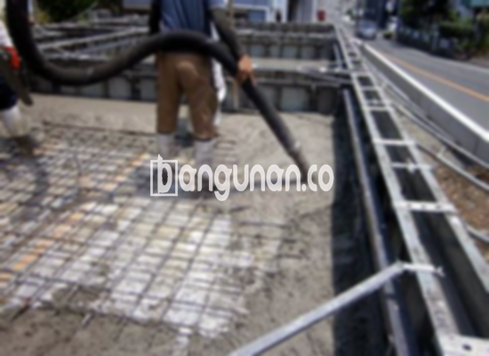

**Jasa Cor Beton Readymix & Jayamix Di Bukateja Purbalingga** – Mencari solusi pengecoran yang cepat, efisien, dan berkualitas di Bukateja Purbalingga? Bangunan.co hadir sebagai penyedia jasa cor beton readymix dan jayamix terpercaya. Beton siap pakai ini adalah adukan campuran bahan material beton yang dirancang khusus untuk pengecoran dengan waktu yang tepat, dan memastikan proyek Anda berjalan lancar. Bagi Mitra Bangunan di wilayah ini, kami menawarkan kemudahan dan kualitas unggul untuk setiap kebutuhan konstruksi.



## Mengapa Memilih Layanan Cor Beton Readymix & Jayamix dari Bangunan.co di Bukateja Purbalingga?

Bangunan.co menyediakan adukan beton readymix dengan tujuan utama mempercepat proses pengecoran seraya menjamin kualitas yang konsisten. Beton yang diproduksi secara modern ini dirancang dengan takaran material yang akurat, mengikuti standar mutu konstruksi yang berlaku. Dengan mempercayakan proyek Anda kepada kami, Anda berinvestasi dalam fondasi yang kokoh dan tahan lama untuk bangunan Anda.

Beton readymix dari Bangunan.co tersedia dalam berbagai pilihan mutu, disesuaikan dengan kebutuhan spesifik proyek Anda. Sering disebut juga beton cair siap pakai, produk ini sudah dipersiapkan secara optimal di pabrik pengolahan beton kami. Anda hanya perlu menyiapkan lokasi pengecoran dan bekisting, sementara tim kami akan mengantarkan beton siap pakai langsung ke lokasi proyek di Bukateja Purbalingga.

Seluruh proses, mulai dari pencampuran material hingga pengiriman, dikendalikan oleh pabrik pengolahan beton Bangunan.co untuk menjamin kualitas yang terjamin. Hal ini mempermudah Anda dalam pembangunan tanpa perlu membuang waktu untuk mencampur beton secara manual atau khawatir akan kualitas bahan baku yang digunakan.

## Keunggulan dan Kekurangan Cor Readymix Dibandingkan Metode Tradisional

Terdapat perbedaan signifikan dalam keunggulan dan kekurangan antara beton yang diproduksi di pabrik pengolahan beton Bangunan.co dan pencampuran manual yang umum dilakukan oleh tukang bangunan.  Memahami perbedaan ini akan membantu Anda membuat keputusan yang tepat untuk proyek Anda.

Beton yang diproduksi melalui pabrik kami memiliki beberapa keunggulan utama:

1.  Kualitas mutu yang terjamin akurat dan sesuai dengan spesifikasi yang diinginkan.
2.  Konsistensi kualitas yang merata berkat proses pencampuran menggunakan teknologi mesin modern.
3.  Penggunaan bahan material berkualitas terbaik yang dipilih secara ketat untuk menghasilkan mutu beton optimal.
4.  Efisiensi waktu dan biaya substansial karena proses pengolahan yang cepat dan terstruktur.
5.  Anda tidak perlu repot memikirkan formulasi campuran beton yang tepat, sebab tim ahli Bangunan.co telah menangani semuanya sesuai dengan standar.

Meskipun demikian, beton readymix dari Bangunan.co juga memiliki beberapa pertimbangan: 

Pemesanan beton readymix membutuhkan penjadwalan yang tepat karena proses produksinya tidak instan. Anda perlu melakukan pemesanan terlebih dahulu dan melakukan survei lokasi untuk menentukan volume beton yang dibutuhkan, agar kami dapat menyediakan pasokan yang sesuai dengan kebutuhan proyek Anda.

## Jenis Kualitas Beton yang Paling Sering Digunakan di Bukateja Purbalingga

Di area Bukateja Purbalingga, mutu beton K225 adalah yang paling banyak diaplikasikan, terutama untuk pengecoran dak rumah atau lantai dua ke atas. Mutu ini dirancang secara khusus untuk kebutuhan pengecoran dak. Akan tetapi, mutu ini juga bisa digunakan untuk pengecoran jalan gang yang tidak dilewati kendaraan berat secara rutin.

Pilihan lainnya, mutu beton K250 dan K300, sering digunakan untuk pengecoran tiang, pondasi, atau cakar ayam. Untuk jalan pedesaan, mutu K250, K300, dan K350 adalah pilihan umum. Untuk mutu yang lebih tinggi, seperti K375, K400, K500, dan seterusnya, biasanya dipergunakan untuk beton *fast track* yang memerlukan pengerasan cepat, seperti konstruksi jalan tol atau lahan parkir yang dirancang untuk menahan beban berat atau membutuhkan waktu penyelesaian yang singkat.

## Bangunan.co: Menjamin Kualitas Beton untuk Proyek Anda di Bukateja Purbalingga



Campuran beton readymix dari Bangunan.co harus dirancang dengan cermat untuk memastikan daya kerja dan kekuatan yang optimal. Tujuannya adalah untuk menghasilkan beton yang tahan lama, tidak mudah retak, dan memiliki daya tahan yang tinggi terhadap berbagai kondisi lingkungan. Komposisi campuran yang ideal umumnya terdiri dari 10% hingga 15% semen Portland, 60% hingga 75% agregat halus dan kasar (pasir dan split), serta 10% hingga 15% air. Sisanya adalah udara, karena beton tetap memerlukan rongga udara untuk memastikan kualitas yang optimal.

Beton berkualitas tinggi dari Bangunan.co diproduksi dengan meminimalkan rasio air terhadap semen, tanpa mengorbankan kemampuan kerja beton segar. Penggunaan air bersih sangat penting dalam proses produksi kami. Kami menghindari penggunaan air yang kotor, berlumpur, atau mengandung lumut, karena dapat menurunkan kualitas beton secara signifikan.

Mitra Bangunan yang sedang mencari solusi pengecoran beton berkualitas di Bukateja Purbalingga, jangan ragu untuk menghubungi Bangunan.co. Kami siap membantu Anda memilih mutu beton yang tepat dan memberikan layanan terbaik sesuai kebutuhan proyek Anda. Segera hubungi kami untuk konsultasi gratis dan penawaran harga terbaik. 

**Ref by:** [Cor Beton Readymix & Jayamix Bukateja Purbalingga](https://id.wikipedia.org/wiki/Cor)