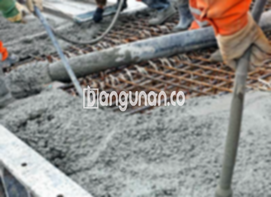

**Jasa Cor Beton Readymix & Jayamix Di Bulu Rembang** – Bagi Mitra Bangunan yang sedang mempersiapkan pembangunan di Bulu Rembang, beton readymix dari bangunan.co menawarkan solusi praktis dan andal. Campuran beton siap pakai ini dirancang untuk mempercepat proses pengecoran sekaligus menjamin kualitas yang konsisten. Komposisi materialnya, terdiri dari pasir beton, batu split, semen, dan air, telah diformulasikan secara presisi untuk memenuhi standar mutu yang Anda butuhkan.



## Alasan Memilih Layanan Pengadukan Beton bangunan.co di Bulu Rembang

Penggunaan beton readymix dari bangunan.co bertujuan untuk menyederhanakan eksekusi pengecoran, memastikan kecepatan, dan menjaga kualitas yang terstandarisasi. Dengan mutu yang tepat, konstruksi Anda di Bulu Rembang akan memiliki fondasi yang kokoh dan tahan lama. Beton readymix tersedia dalam berbagai tingkatan kualitas, memungkinkan Anda memilih yang paling sesuai dengan kebutuhan proyek Anda. Dijuluki sebagai beton cair siap pakai, material ini sudah diproses di pabrik pengolahan beton agar siap digunakan langsung di lokasi proyek. Ini berarti Anda hanya perlu mempersiapkan bekisting sebagai cetakan beton, sementara kualitas beton sudah terjamin oleh bangunan.co.

Pihak bangunan.co bertanggung jawab penuh terhadap mutu beton, mulai dari pencampuran bahan hingga pengiriman. Proses ini diatur secara ketat untuk memastikan kualitas yang optimal. Ini memberikan kemudahan bagi para pelaku konstruksi di Bulu Rembang dalam melaksanakan pengecoran tanpa perlu khawatir tentang kualitas material yang digunakan.

## Keunggulan dan Pertimbangan Cor Readymix dari bangunan.co di Bulu Rembang

Beton yang dicampur di pabrik pengolahan beton (batching plant) bangunan.co memiliki keunggulan yang jelas dibandingkan dengan beton yang dicampur secara manual. Masing-masing metode memiliki kelebihan dan kekurangan tersendiri, tetapi beton readymix menawarkan sejumlah manfaat signifikan:

Kelebihan beton readymix dari bangunan.co:

1.  Komposisi yang diformulasikan secara presisi sesuai standar kualitas.
2.  Kualitas beton yang seragam berkat proses pencampuran yang konsisten.
3.  Penggunaan material berkualitas tinggi yang dipilih secara cermat.
4.  Proses pengolahan yang efisien, menghemat waktu dan biaya proyek Anda.
5.  Anda tidak perlu repot menghitung dan mencampur adukan beton; bangunan.co sudah melakukannya untuk Anda.

Kekurangan beton readymix:

Pemesanan beton readymix dari bangunan.co memerlukan penjadwalan dan survei lokasi untuk menentukan volume yang dibutuhkan. Hal ini penting untuk memastikan ketersediaan beton yang cukup tanpa adanya kelebihan produksi yang tidak diperlukan.

## Beragam Mutu Beton yang Sering Dipakai di Proyek Bulu Rembang

Di Bulu Rembang, mutu beton K225 merupakan pilihan umum, khususnya untuk pengecoran dak rumah atau lantai 2 ke atas. Mutu ini sangat sesuai untuk aplikasi tersebut dan telah terbukti kehandalannya. K225 juga dapat digunakan untuk pengecoran jalan gang yang tidak sering dilalui oleh kendaraan berat.

Selain K225, mutu beton K250 dan K300 juga populer digunakan di wilayah Bulu Rembang. K250 dan K300 seringkali menjadi pilihan untuk pengecoran tiang, pondasi, atau cakar ayam. Untuk proyek jalan pedesaan, K250, K300, dan K350 sering digunakan. Sementara itu, mutu yang lebih tinggi seperti K375, K400, dan K500 umumnya digunakan untuk beton *fast track* yang memerlukan waktu pengeringan cepat, seperti pada proyek jalan tol atau lahan parkir yang menahan beban berat.

## bangunan.co: Menjamin Mutu Beton untuk Proyek Anda



Campuran beton readymix dari bangunan.co diformulasikan dengan sangat hati-hati untuk memastikan daya kerja dan daya tahan yang optimal. Untuk mencapai kualitas tinggi, beton diproduksi dengan meminimalkan rasio air-semen tanpa mengorbankan kemudahan pengerjaan. Penggunaan air bersih yang bebas dari kotoran dan lumut sangat penting dalam proses pencampuran. Komposisi ideal meliputi 10% hingga 15% semen Portland, 60% hingga 75% agregat halus dan kasar (pasir dan split), serta 10% hingga 15% air, dengan sisanya berupa udara yang dibutuhkan dalam campuran. 

Anda dapat sepenuhnya mempercayakan kualitas beton yang disediakan oleh bangunan.co karena kami selalu mengutamakan standar kualitas SNI. Dengan begitu, Anda akan mendapatkan material konstruksi yang terjamin kekuatannya dan dapat diandalkan untuk berbagai aplikasi pembangunan.

**Ref by:** [Cor Beton Readymix & Jayamix Bulu Rembang](https://id.wikipedia.org/wiki/Cor)

Mitra Bangunan yang sedang mencari jasa cor beton readymix di Bulu Rembang, segera hubungi kami melalui tombol WhatsApp atau Telepon yang tersedia di halaman ini. bangunan.co siap memberikan solusi beton terbaik untuk mendukung keberhasilan proyek Anda.