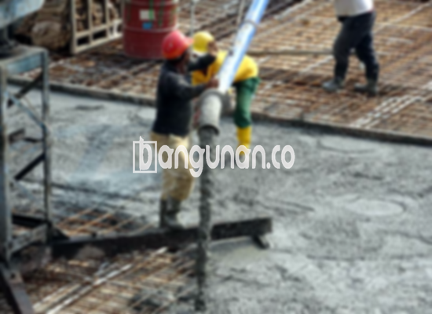

**Jasa Cor Beton Readymix & Jayamix Di Bulu Temanggung** – Bagi Mitra Bangunan yang sedang mempersiapkan proyek konstruksi di Bulu Temanggung, solusi beton readymix dari bangunan.co menawarkan kemudahan dan efisiensi. Beton siap pakai ini merupakan campuran komposisi material beton yang diformulasikan khusus untuk pengecoran cepat dan akurat, memastikan mutu bangunan Anda memenuhi standar yang diharapkan. Secara esensial, material penyusunnya sama dengan adukan beton tradisional: pasir beton, kerikil, semen, dan air, namun dengan proporsi yang telah dikalkulasi secara presisi.



## Mengapa Layanan Pengadukan Beton Readymix & Jayamix dari bangunan.co di Bulu Temanggung adalah Pilihan Tepat?

Memilih jasa pengadukan beton readymix dan jayamix dari bangunan.co bertujuan untuk memperlancar jalannya pekerjaan pengecoran dan menjamin hasil yang berkualitas. Dengan mutu beton yang sesuai, Anda dapat memastikan bahwa konstruksi yang Anda bangun telah memenuhi standar mutu yang diharapkan dan sesuai dengan perencanaan yang telah dibuat.

Beton ready mix dari bangunan.co menghadirkan berbagai pilihan mutu, disesuaikan dengan kebutuhan spesifik proyek Anda. Karena diproduksi secara siap pakai di pabrik pengolahan, beton ini sangat praktis – siap langsung digunakan setelah pengiriman ke lokasi proyek Anda. Dengan ini, Anda tidak perlu lagi memusingkan proses pencampuran manual dan memastikan kualitas adukan yang tepat. Tugas Anda hanyalah mempersiapkan bekisting sebagai penopang beton.

Kualitas beton dijaga ketat oleh tim bangunan.co melalui proses kontrol yang komprehensif di pabrik pengolahan (batching plant), mulai dari pemilihan material hingga pengiriman ke lokasi. Hal ini mempermudah Anda dalam memperoleh material berkualitas tinggi untuk proyek Anda tanpa memakan waktu dan tenaga dalam proses pencampuran.

## Keunggulan dan Beberapa Pertimbangan dalam Penggunaan Beton Readymix

Tentu saja, terdapat perbedaan karakteristik antara beton yang dicampur di pabrik bangunan.co dengan beton yang dicampur secara manual di lapangan. Masing-masing memiliki kelebihan dan kekurangannya:

Beton yang dicampur di pabrik bangunan.co memiliki beberapa keunggulan yang signifikan:

1.  Komposisi campuran yang presisi dan konsisten.
2.  Mutu beton yang merata berkat proses pencampuran yang akurat.
3.  Kualitas bahan material terjamin, karena bangunan.co hanya menggunakan material pilihan.
4.  Efisiensi waktu dan biaya serta proses yang lebih praktis.
5.  Anda tidak perlu khawatir dengan perhitungan proporsi campuran yang tepat, karena semuanya telah ditangani oleh bangunan.co.

Namun, perlu diingat beberapa pertimbangan:

Pemesanan beton readymix dari bangunan.co memerlukan penjadwalan dan survei lokasi untuk menentukan volume kubikasi beton yang dibutuhkan. Hal ini penting untuk memastikan ketersediaan pasokan yang memadai dan menghindari pemborosan material.

## Ragam Mutu Beton yang Sering Digunakan dalam Proyek di Bulu Temanggung

Mutu beton K225 merupakan pilihan yang sangat populer di area Bulu Temanggung, terutama untuk aplikasi pengecoran dak rumah atau lantai dua. Kualitas ini sangat ideal untuk konstruksi tersebut. Mutu beton ini juga dapat diterapkan untuk pekerjaan pengecoran jalan gang yang tidak menanggung beban lalu lintas berat seperti truk atau mobil.

Selain itu, mutu beton K250 dan K300 juga banyak digunakan. K250 dan K300 sangat cocok untuk pengecoran tiang pancang, pondasi bangunan, atau cakar ayam. Penggunaan K250, K300, dan K350 juga umum untuk pengecoran jalan pedesaan. Untuk mutu yang lebih tinggi dari K350 (seperti K375, K400, K500 dan seterusnya), biasanya digunakan untuk proyek-proyek yang membutuhkan beton *fast track* – yaitu beton yang mengering dengan cepat. Contohnya termasuk pembangunan jalan tol, area parkir yang menahan beban berat, atau struktur yang membutuhkan waktu penyelesaian yang singkat. Dalam kasus seperti ini, mutu beton K400 ke atas adalah pilihan yang tepat.

## bangunan.co: Jaminan Kualitas pada Setiap Pengecoran di Bulu Temanggung



Formulasi campuran cor readymix dari bangunan.co dibuat dengan sangat cermat untuk memastikan setiap material bekerja secara optimal, menghasilkan beton dengan kinerja dan daya tahan maksimal. Kami selalu berpedoman pada standar campuran beton nasional (SNI). Komposisinya terdiri dari sekitar 10% hingga 15% semen Portland, 60% hingga 75% agregat halus dan kasar (pasir dan split), serta 10% hingga 15% air. Sisanya adalah kandungan udara; walaupun padat, beton tetap membutuhkan sedikit udara sebagai bagian integral dari strukturnya.

Beton berkualitas tinggi diproduksi dengan meminimalkan rasio air/semen tanpa mengurangi kemampuan kerja beton segar. Semakin sedikit air yang digunakan, semakin tinggi mutu beton yang dihasilkan. bangunan.co memastikan penggunaan air bersih dan bebas kontaminan. Air yang kotor atau mengandung lumut dapat menurunkan kualitas beton secara signifikan.

Mitra Bangunan, untuk kebutuhan cor beton readymix dan jayamix yang terpercaya di Bulu Temanggung, bangunan.co siap menjadi mitra Anda. Kami berkomitmen memberikan solusi beton berkualitas tinggi yang sesuai dengan kebutuhan konstruksi Anda.

**Ref by:** [Cor Beton Readymix & Jayamix Bulu Temanggung](https://id.wikipedia.org/wiki/Cor)