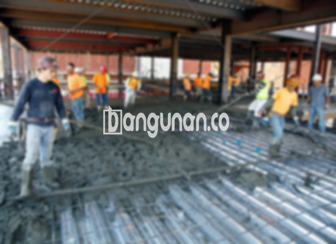

**Jasa Cor Beton Readymix & Jayamix Di Bulukerto Wonogiri** – Apakah Anda sedang merencanakan proyek konstruksi di Bulukerto Wonogiri dan membutuhkan solusi beton yang praktis dan terpercaya? Mitra Bangunan hadir sebagai penyedia jasa cor beton *readymix* dan *jaymix* terdepan, menawarkan kemudahan dan kualitas terjamin untuk berbagai kebutuhan pembangunan Anda. Kami menyediakan beton siap pakai yang dirancang khusus untuk memastikan kekuatan dan durabilitas struktur yang Anda impikan.



## Mengoptimalkan Waktu dan Sumber Daya dengan Layanan Cor Beton Readymix dari Bangunan.co

Salah satu alasan utama memilih layanan beton *readymix* dari Bangunan.co adalah efisiensi waktu dan sumber daya yang ditawarkan. Dengan menggunakan beton siap pakai, Anda dapat mempercepat proses pengecoran dan mengurangi biaya tenaga kerja. Layanan kami dirancang untuk memenuhi kebutuhan proyek konstruksi Anda dengan cepat dan tepat, memastikan kualitas beton yang konsisten dan sesuai dengan standar yang Anda harapkan.

Beton *ready mix* hadir dalam berbagai pilihan mutu, memungkinkan Anda untuk memilih jenis yang paling sesuai dengan peruntukan konstruksi Anda. Dikenal juga sebagai beton cair siap guna, beton ini telah dipersiapkan dengan cermat di pabrik pengolahan beton kami, siap untuk langsung dituang dan diratakan di lokasi proyek Anda. Hal ini menghilangkan kebutuhan untuk mencampur adukan secara manual, yang seringkali memakan waktu dan tenaga.

Kualitas beton yang kami hasilkan dikendalikan secara ketat dari awal hingga akhir proses, mulai dari pemilihan bahan baku hingga pengiriman ke lokasi Anda. Tim ahli kami di *batching plant* memastikan setiap campuran beton memenuhi standar kualitas tertinggi, memberikan Anda keyakinan akan kekuatan dan ketahanan struktur yang Anda bangun.

## Kelebihan dan Kekurangan Penggunaan Beton Cor Readymix: Analisis Mendalam

Perbandingan antara beton yang dicampur di pabrik pengolahan beton (seperti Bangunan.co) dengan adukan manual yang dibuat oleh tukang bangunan mengungkapkan kelebihan dan kekurangan masing-masing. Memahami perbedaan ini akan membantu Anda membuat keputusan yang tepat untuk proyek Anda.

**Kelebihan:**

1.  Konsistensi mutu dan kualitas yang terjamin dalam setiap pengiriman.
2.  Keunggulan homogenitas beton karena proses pencampuran menggunakan mesin modern.
3.  Penggunaan material berkualitas tinggi yang dipilih secara ketat oleh tim ahli Bangunan.co.
4.  Efisiensi waktu dan biaya dengan proses pengolahan yang cepat dan teroptimasi.
5.  Kepraktisan dan kemudahan karena Anda tidak perlu memikirkan formulasi adukan yang tepat.

**Kekurangan:**

Pemesanan beton *readymix* memerlukan perencanaan yang matang. Sistem pemesanan kami tidak memungkinkan permintaan mendadak; diperlukan penjadwalan dan survei lokasi untuk menentukan volume beton yang dibutuhkan. Hal ini untuk memastikan ketersediaan material dan menghindari pemborosan atau kekurangan beton di lokasi pengecoran.

## Pilihan Mutu Beton Struktur Populer di Bulukerto Wonogiri

Di Bulukerto Wonogiri, mutu beton K225 adalah yang paling banyak digunakan, terutama untuk pengecoran dak rumah atau lantai dua ke atas. Mutu ini dirancang khusus untuk memenuhi kebutuhan struktur dak, memberikan kekuatan dan ketahanan yang optimal. Selain itu, K225 juga cocok untuk pengecoran jalan gang yang tidak dilalui kendaraan berat.

Pilihan populer lainnya termasuk mutu K250 dan K300, yang umumnya digunakan untuk pengecoran tiang, pondasi, atau cakar ayam. Untuk proyek jalan pedesaan, mutu K250, K300, dan K350 sering direkomendasikan. Mutu yang lebih tinggi, seperti K375, K400, dan K500, sering digunakan dalam aplikasi *fast track*, di mana beton harus mengering dan mengeras dengan cepat (misalnya, jalan tol atau area parkir dengan beban berat).

## Bangunan.co: Prioritas Utama pada Kualitas dan Keandalan Beton



Kunci untuk menghasilkan beton berkualitas tinggi terletak pada perancangan adukan yang tepat. Di Bangunan.co, kami memastikan adukan beton *ready mix* dirancang dengan cermat untuk mencapai kinerja dan daya tahan yang optimal. Komposisi material kami mengikuti Standar Nasional Indonesia (SNI), terdiri dari komposisi yang seimbang antara semen Portland (10% - 15%), agregat halus dan kasar (pasir dan split, 60% - 75%), dan air (10% - 15%). Sisa volume diisi oleh udara, yang merupakan komponen penting dalam campuran beton.

Kami meminimalkan rasio air terhadap semen dalam proses pencampuran untuk meningkatkan kekuatan dan kualitas beton. Penggunaan air bersih yang bebas dari lumpur atau lumut sangat penting untuk menghindari kontaminasi yang dapat menurunkan mutu beton. Setiap langkah produksi diawasi ketat oleh tim ahli kami untuk memastikan kualitas beton sesuai dengan standar yang ditetapkan.

Dengan demikian, Anda dapat mengandalkan Bangunan.co untuk menyediakan solusi beton yang andal dan efisien untuk proyek Anda di Bulukerto Wonogiri.

**Ref by:** [Cor Beton Readymix & Jayamix Bulukerto Wonogiri](https://id.wikipedia.org/wiki/Cor)

Mitra Bangunan siap menjadi mitra terpercaya Anda dalam membangun infrastruktur yang kokoh dan tahan lama di Bulukerto Wonogiri. Hubungi kami melalui tombol WhatsApp atau Telepon yang tersedia di situs web kami untuk mendapatkan penawaran harga terbaik dan layanan konsultasi gratis. Kami berkomitmen untuk memberikan solusi beton yang sesuai dengan kebutuhan dan anggaran Anda.