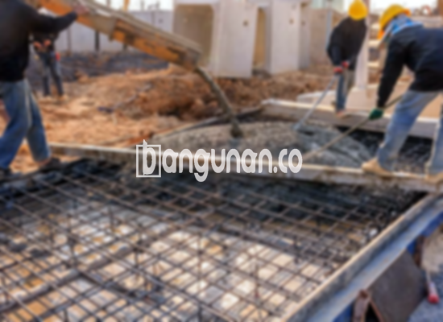

**Jasa Cor Beton Readymix & Jayamix Di Buluspesantren Kebumen** – Bagi Mitra Bangunan yang tengah merencanakan proyek konstruksi, beton readymix atau adukan beton siap guna adalah solusi praktis dan efisien. Produk ini dirancang sebagai komposisi material beton yang telah diformulasikan secara khusus, memungkinkan pengecoran cepat dan instan. Pada dasarnya, komposisi material yang digunakan serupa dengan adukan beton konvensional, terdiri dari pasir beton, batu kerikil, semen, dan air – namun dengan takaran dan pengaturan yang presisi untuk mencapai mutu beton yang diinginkan.



## Memaksimalkan Efisiensi Pengecoran dengan Jasa Cor Beton Readymix & Jayamix dari bangunan.co di Buluspesantren Kebumen

Penyediaan beton siap pakai dari bangunan.co bertujuan untuk memperlancar dan mempercepat proses konstruksi Anda. Dengan memanfaatkan layanan kami, Anda dapat memprioritaskan aspek-aspek penting lainnya dari proyek Anda tanpa terbebani oleh persiapan material. Fokus utama kami adalah menyediakan beton dengan kualitas yang optimal, yang sesuai dengan persyaratan spesifik dari konstruksi yang Anda rencanakan dan standar yang berlaku. 

Beton ready mix tersedia dalam berbagai mutu kualitas, memungkinkan Anda memilih opsi yang paling sesuai dengan kebutuhan proyek Anda. Sering disebut juga beton cair siap pakai, produk ini telah melalui proses persiapan intensif di pabrik pengolahan beton bangunan.co, sehingga langsung siap untuk dituang dan diratakan di lokasi proyek Anda. Ini berarti Anda tidak perlu lagi menghabiskan waktu dan sumber daya untuk mencampur beton secara manual, karena konsistensi dan kualitas telah terjamin.

Kualitas beton yang kami hasilkan dipantau secara ketat selama seluruh proses, mulai dari pencampuran bahan hingga pengiriman. Tim ahli bangunan.co memastikan bahwa setiap batch memenuhi standar mutu yang ditetapkan, memberikan Anda kepastian atas kinerja dan daya tahan beton. Pendekatan ini menyederhanakan proses pengadaan beton, memungkinkan Anda untuk fokus pada penyelesaian proyek tepat waktu dan sesuai anggaran.

## Keunggulan dan Pertimbangan dalam Menggunakan Cor Readymix dari bangunan.co di Buluspesantren Kebumen

Terdapat perbedaan signifikan antara beton yang diproduksi di pabrik pengolahan beton bangunan.co dan beton yang dicampur secara manual di lokasi proyek. Masing-masing metode memiliki kelebihan dan kekurangan yang perlu dipertimbangkan. Berikut adalah analisis mendalamnya:

Beton yang diproduksi di pabrik pengolahan beton bangunan.co menawarkan beberapa keunggulan utama:

1.  Presisi dalam Pencampuran Mutu: Komposisi beton diatur dengan tepat untuk mencapai mutu yang diinginkan.
2.  Konsistensi Mutu: Proses pencampuran yang terotomatisasi memastikan mutu beton merata secara konsisten.
3.  Bahan Material Berkualitas: Hanya bahan material terbaik yang dipilih untuk menghasilkan beton dengan kualitas optimal.
4.  Efisiensi Waktu dan Biaya: Proses pengolahan yang cepat mempersingkat waktu proyek dan mengurangi biaya tenaga kerja.
5.  Kemudahan Penggunaan: Anda tidak perlu memikirkan detail pencampuran beton, karena semuanya telah diurus oleh bangunan.co.

Namun, ada beberapa hal yang perlu Anda pertimbangkan. Pemesanan beton readymix memerlukan perencanaan yang matang dan penjadwalan yang tepat. Hal ini diperlukan untuk memastikan ketersediaan material dan koordinasi pengiriman yang efisien. Survei lokasi juga penting untuk menentukan volume beton yang dibutuhkan dengan akurat, sehingga menghindari pemborosan atau kekurangan material.

## Ragam Mutu Beton yang Umum Digunakan di Buluspesantren Kebumen

Di antara berbagai jenis beton yang tersedia, mutu K225 merupakan salah satu yang paling sering diaplikasikan. Kualitas beton ini sangat cocok untuk pengecoran dak rumah atau lantai dua ke atas, karena dirancang untuk menahan beban yang sesuai dengan aplikasi tersebut. Penggunaan K225 juga efektif untuk pengecoran jalan gang yang tidak sering dilalui kendaraan bermotor berat.

Selain K225, mutu K250 dan K300 juga populer digunakan pada proyek konstruksi. K250 dan K300 umumnya diaplikasikan untuk pengecoran tiang, pondasi, atau cakar ayam. Mutu K250, K300, serta K350 juga sering digunakan pada pengecoran jalan pedesaan. Untuk kebutuhan yang lebih spesifik, kualitas beton yang lebih tinggi seperti K375, K400, K500, dan seterusnya juga tersedia. Mutu beton ini sering disebut sebagai beton *fast track*, yang dirancang untuk pengeringan cepat. Penggunaan beton *fast track* ideal untuk proyek seperti jalan tol atau lahan parkir yang membutuhkan waktu pengerjaan singkat.

## bangunan.co: Jaminan Kualitas pada Setiap Layanan Cor Beton Readymix & Jayamix Di Buluspesantren Kebumen



Formulasi adukan beton cor readymix atau *ready mix concrete* dari bangunan.co harus dirancang dengan cermat untuk memastikan daya kerja dan kekuatan yang optimal. Komposisi campuran material beton yang ideal mencakup sekitar 10% hingga 15% semen Portland, 60% hingga 75% agregat halus dan kasar (pasir dan split), dan 10% hingga 15% air. Sisanya terdiri dari udara, yang berperan penting dalam memberikan kemampuan kerja beton yang baik. 

Beton berkualitas tinggi diproduksi dengan mengurangi rasio air terhadap semen seminimal mungkin, tanpa mengorbankan kemampuan kerja yang dibutuhkan. Umumnya, semakin rendah rasio air terhadap semen, semakin tinggi mutu beton yang dihasilkan. Penggunaan air bersih sangat penting; air yang mengandung lumpur atau kotoran dapat menurunkan kualitas beton secara signifikan. 

Sebagai penyedia jasa cor beton readymix dan jayamix terpercaya di Buluspesantren Kebumen, bangunan.co menjamin kualitas beton terbaik untuk setiap proyek Anda.

**Ref by:** [Cor Beton Readymix & Jayamix Buluspesantren Kebumen](https://id.wikipedia.org/wiki/Cor)

Mitra Bangunan, jika Anda sedang mencari solusi pengecoran beton yang andal dan efisien di Buluspesantren Kebumen, jangan ragu untuk menghubungi kami. Kami siap memberikan konsultasi gratis dan penawaran harga terbaik. Hubungi bangunan.co melalui tombol WhatsApp atau Telepon yang tersedia di halaman ini. Dengan layanan kami, Anda dapat fokus pada penyelesaian proyek Anda dengan keyakinan akan kualitas dan keandalan beton yang digunakan.