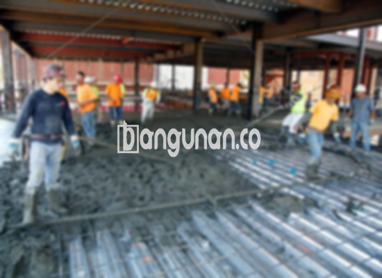

**Jasa Cor Beton Readymix & Jayamix Di Bumijawa Tegal** – Mencari solusi pengecoran yang cepat, efisien, dan terpercaya di Bumijawa Tegal? Bangunan.co hadir dengan layanan beton readymix atau adukan beton siap guna yang dirancang khusus untuk mempercepat konstruksi Anda dan memastikan kualitas yang konsisten. Material inovatif ini menghilangkan kebutuhan pencampuran manual, memberikan Anda ketenangan pikiran dan hasil yang optimal. Mitra Bangunan siap melayani kebutuhan beton Anda langsung di lokasi proyek.



## Pentingnya Menggunakan Jasa Cor Beton Readymix & Jayamix Dari Bangunan.co di Bumijawa Tegal

Layanan adukan beton dari Bangunan.co dirancang untuk meningkatkan efisiensi dan kualitas proyek konstruksi Anda. Dengan mutu yang terstandarisasi, Anda dapat yakin bahwa beton yang digunakan sesuai dengan spesifikasi yang dibutuhkan untuk konstruksi di Bumijawa Tegal. Kami memahami betul kebutuhan Anda akan material yang andal dan terpercaya.

Beton ready mix menawarkan berbagai pilihan mutu, disesuaikan dengan berbagai aplikasi konstruksi. Konsep siap pakai merupakan keunggulan utamanya; beton dicampur di pabrik kami dan diantarkan langsung ke lokasi proyek Anda, siap untuk dituang dan diratakan. Ini membebaskan Anda dari kerumitan pencampuran manual, menjamin konsistensi, dan mengurangi potensi kesalahan. Fokus Anda bisa sepenuhnya pada persiapan lokasi dan bekisting yang tepat.

Proses pengendalian kualitas dilakukan secara ketat di pabrik pengolahan beton (batching plant) Bangunan.co, mulai dari pemilihan material hingga proses pengiriman. Hal ini memastikan kualitas yang terjamin dan memberikan Anda kepercayaan penuh dalam setiap proyek.  Bagi Anda yang berada di Bumijawa Tegal, kami adalah solusi ideal untuk kebutuhan beton Anda.

## Keunggulan dan Pertimbangan Penggunaan Beton Cor Readymix

Terdapat perbedaan signifikan antara beton yang diproduksi oleh pabrik pengolahan beton seperti Bangunan.co dan beton yang dicampur secara manual. Berikut adalah perbandingan kelebihan dan kekurangan yang perlu Anda pertimbangkan:

Kelebihan beton readymix dari Bangunan.co:

1.  Campuran yang tepat dan akurat, menghasilkan kualitas beton yang konsisten.
2.  Kualitas beton yang seragam karena proses pencampuran yang terkontrol.
3.  Penggunaan material berkualitas tinggi yang dipilih secara cermat.
4.  Efisiensi waktu dan biaya pelaksanaan proyek Anda.
5.  Anda tidak perlu khawatir tentang merumuskan campuran beton yang tepat – kami sudah melakukannya untuk Anda.

Kekurangan yang perlu diperhatikan:

Pemesanan beton readymix memerlukan perencanaan dan penjadwalan karena proses produksi tidak bisa langsung dilakukan.  Survey lokasi juga diperlukan untuk menentukan volume beton yang tepat, menghindari potensi pemborosan atau kekurangan material.

## Ragam Mutu Beton yang Umum Digunakan di Bumijawa Tegal

Salah satu mutu beton yang paling banyak digunakan di Bumijawa Tegal adalah K225. Kualitas ini sangat cocok untuk pengecoran dak rumah atau lantai 2, karena dirancang khusus untuk aplikasi tersebut. K225 juga dapat digunakan untuk pengecoran jalan gang yang tidak menanggung beban lalu lintas berat.

Pilihan populer lainnya adalah K250 dan K300, yang umumnya digunakan untuk pengecoran tiang, pondasi cakar ayam, dan jalan pedesaan. Mutu yang lebih tinggi seperti K350, K375, K400, dan K500 (sering disebut beton *fast track*) digunakan untuk proyek yang membutuhkan kekuatan tinggi dan waktu pengeringan yang lebih cepat, misalnya untuk jalan tol, area parkir, atau struktur yang menahan beban berat. 

## Bangunan.co Memprioritaskan Kualitas Beton Anda



Adukan beton ready mix dari Bangunan.co dirancang dengan cermat untuk memastikan kekuatan, daya tahan, dan kemudahan aplikasi yang optimal. Komposisi yang tepat, sesuai dengan Standar Nasional Indonesia (SNI), sangat penting untuk mencegah keropos, retak, atau pengelupasan.  Secara umum, campuran terdiri dari 10-15% semen Portland, 60-75% agregat halus dan kasar (pasir dan split), 10-15% air, dan sisanya adalah udara.

Beton berkualitas tinggi diproduksi dengan meminimalkan rasio air dan semen tanpa mengurangi kemampuan kerja beton segar. Kami menggunakan air bersih yang bebas dari lumpur atau lumut untuk menjaga kualitas beton.  Penggunaan air yang tepat sangat krusial untuk kekuatan dan ketahanan beton jangka panjang.

Mitra Bangunan di Bumijawa Tegal selalu mengutamakan kualitas dan kepuasan pelanggan.  Kami berkomitmen untuk menyediakan beton readymix yang memenuhi standar tertinggi dan sesuai dengan kebutuhan spesifik proyek Anda. Silahkan hubungi kami untuk mendapatkan penawaran harga terbaik dan layanan konsultasi.

**Ref by:** [Cor Beton Readymix & Jayamix Bumijawa Tegal](https://id.wikipedia.org/wiki/Cor)