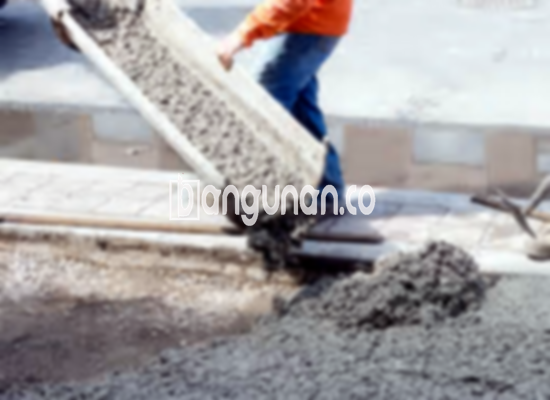

**Jasa Cor Beton Readymix & Jayamix Di Butuh Purworejo** – Mitra Bangunan hadir sebagai solusi konstruksi modern bagi Anda yang membutuhkan beton berkualitas tinggi dengan cepat dan efisien. Beton cor readymix, atau campuran beton siap pakai, adalah formula material beton yang dirancang secara khusus untuk pengecoran instan dan presisi. Bahan-bahan dasar yang digunakan – pasir beton, batu split, semen, dan air – diracik dengan proporsi yang tepat untuk menghasilkan mutu beton yang sesuai kebutuhan bangunan Anda. 



## Mengapa Memilih Layanan Cor Readymix dari Bangunan.co di Butuh Purworejo?

Penggunaan campuran beton siap pakai ini ditujukan untuk memperlancar proses pembangunan dengan harapan dapat memberikan hasil pengecoran yang cepat, efisien, dan tetap berkualitas. Dengan kualitas yang terjamin, Anda dapat memastikan bahwa mutu beton yang dihasilkan sesuai dengan standar yang diharapkan dan sesuai dengan rencana konstruksi yang telah ditetapkan.

Cor readymix menawarkan berbagai pilihan mutu beton yang dapat disesuaikan dengan tujuan konstruksi Anda. Jenis beton ini juga dikenal dengan istilah beton cair siap guna karena telah disiapkan secara komprehensif di pabrik pengolahan beton untuk memastikan kesiapan penggunaan. Beton ini dirancang agar mudah dituangkan dan diratakan segera setelah diangkut dari pabrik ke lokasi proyek. Dengan demikian, Anda tidak perlu lagi khawatir tentang proses pencampuran beton secara manual di lokasi, yang seringkali memakan waktu dan tenaga.

Kualitas beton dikontrol secara ketat oleh pihak pengolahan beton atau *batching plant*, mulai dari tahap pencampuran material hingga proses pengiriman. Hal ini memberikan kepastian bahwa beton yang Anda terima memenuhi standar kualitas yang telah ditetapkan. 

## Keunggulan dan Kekurangan Menggunakan Beton Readymix

Berbeda dengan proses pencampuran beton secara manual yang umum dilakukan oleh tukang bangunan, beton yang diproduksi melalui pabrik pengolahan beton memiliki kelebihan dan kekurangan tersendiri. Berikut adalah penjelasannya:

Keunggulan beton *readymix* meliputi:

1.  Adukan beton yang tepat dan sesuai dengan mutu yang diinginkan.
2.  Kualitas beton yang merata karena proses pencampuran yang konsisten dan terkontrol.
3.  Penggunaan material berkualitas tinggi yang dipilih secara cermat untuk menghasilkan mutu beton yang optimal.
4.  Efisiensi waktu dan biaya karena proses pengolahan yang cepat dan efisien.
5.  Anda tidak perlu memikirkan peracikan adukan beton yang tepat, karena semuanya telah ditangani oleh pihak pabrik pengolahan beton.

Namun, perlu diingat bahwa pemesanan beton *readymix* membutuhkan koordinasi dan penjadwalan yang baik. Anda tidak dapat memesan beton secara spontan; perlu dilakukan survei lokasi terlebih dahulu untuk memperkirakan volume kubikasi beton yang dibutuhkan. Hal ini bertujuan untuk menghindari kelebihan atau kekurangan pasokan beton di lokasi pengecoran.

## Pilihan Mutu Beton yang Umum Digunakan di Butuh Purworejo

Di wilayah Butuh Purworejo, terdapat beberapa jenis mutu beton yang paling banyak digunakan dalam berbagai proyek konstruksi. Mutu beton K225 adalah pilihan yang umum untuk pengecoran dak rumah atau lantai dua, karena dirancang khusus untuk aplikasi tersebut. Namun, mutu beton ini juga dapat digunakan untuk pengecoran jalan gang yang tidak sering dilalui kendaraan berat.

Pilihan populer lainnya adalah mutu beton K250 dan K300, yang sering digunakan untuk pengecoran tiang, pondasi, atau cakar ayam. Untuk konstruksi jalan pedesaan, sering digunakan mutu beton K250, K300, dan K350. Mutu beton yang lebih tinggi, seperti K375, K400, dan K500, biasanya digunakan untuk beton *fast track* – beton yang membutuhkan waktu pengeringan yang sangat singkat. Beton *fast track* sering digunakan untuk proyek-proyek seperti jalan tol atau area parkir yang membutuhkan struktur yang kuat dan cepat selesai.

## Bangunan.co Mengutamakan Kualitas Beton yang Terjamin



Untuk menghasilkan campuran beton yang berkualitas tinggi, proses perancangan adukan beton *readymix* harus dilakukan dengan cermat. Beton dengan kualitas yang baik memiliki daya tahan dan kinerja yang optimal. Komposisi ideal adukan beton terdiri dari sekitar 10-15% semen Portland, 60-75% agregat halus dan kasar (pasir dan split), dan 10-15% air. Sisanya adalah udara yang terdapat dalam campuran.

Salah satu kunci utama dalam menghasilkan beton berkualitas tinggi adalah dengan meminimalkan rasio air terhadap semen tanpa mengorbankan kemampuan kerja beton saat masih segar. Semakin sedikit air yang digunakan, semakin tinggi pula kualitas beton yang dihasilkan. Penting juga untuk memastikan bahwa air yang digunakan bersih dan tidak mengandung kotoran, lumut, atau bahan lain yang dapat menurunkan kualitas beton. Air yang digunakan harus bebas dari kontaminan yang dapat bereaksi dengan bahan beton dan merusak integritasnya. 

Hingga saat ini, Mitra Bangunan, melalui layanan Bangunan.co di Butuh Purworejo, telah memberikan penjelasan lengkap mengenai jasa cor beton readymix dan jayamix. Perlu diingat bahwa harga masing-masing mutu beton bervariasi. Silakan hubungi kami melalui tombol WhatsApp atau Telepon yang tersedia di halaman ini untuk mendapatkan informasi harga terkini dan penawaran terbaik. Kami siap membantu Anda dalam mewujudkan proyek konstruksi yang kokoh dan berkualitas.

**Ref by:** [Cor Beton Readymix & Jayamix Butuh Purworejo](https://id.wikipedia.org/wiki/Cor)