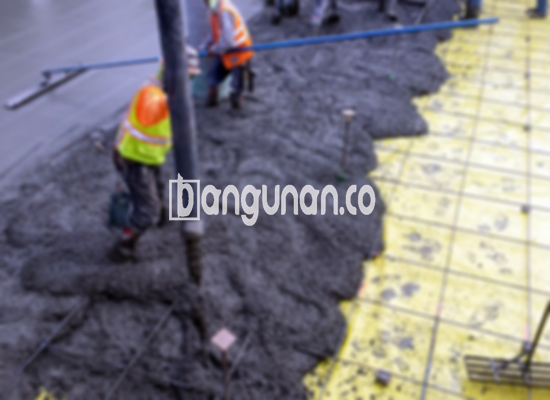

**Jasa Cor Beton Readymix & Jayamix Di Candimulyo Magelang** – Mencari solusi konstruksi yang cepat, efisien, dan terpercaya? Layanan beton cor readymix atau adukan beton siap pakai dari bangunan.co adalah jawaban tepat. Diformulasikan secara khusus untuk kebutuhan pengecoran instan dengan mutu terjamin, kami hadir untuk mendukung kelancaran proyek Mitra Bangunan di Candimulyo Magelang. Terdiri dari campuran pasir beton, batu pecah, semen, dan air dalam komposisi yang telah terukur, kami memastikan kualitas optimal untuk setiap aplikasinya.



## Mengapa Memilih Jasa Pengadukan Beton Readymix & Jayamix dari bangunan.co di Candimulyo Magelang?

Penggunaan adukan beton siap pakai bertujuan untuk mempercepat proses pembangunan dengan tetap memastikan kualitas yang konsisten. Dengan mutu yang tepat, Anda dapat membangun struktur yang andal dan tahan lama sesuai dengan standar yang diharapkan. 

Beton readymix dari bangunan.co menawarkan berbagai pilihan kualitas sesuai dengan kebutuhan proyek Anda. Dikenal juga sebagai beton cair siap pakai, produk ini telah diproses di pabrik pengolahan beton sehingga siap untuk digunakan langsung di lokasi. Anda tidak perlu lagi meluangkan waktu dan tenaga untuk mencampur bahan-bahan secara manual. Cukup siapkan bekisting dan beton siap dicurahkan.

Proses kontrol kualitas dilakukan secara ketat oleh tim bangunan.co, mulai dari pemilihan material hingga proses pencampuran dan pengiriman. Hal ini memastikan mutu beton yang dihasilkan selalu memenuhi standar terbaik, memberikan Anda ketenangan pikiran dan hasil yang memuaskan.

## Kelebihan dan Pertimbangan dalam Penggunaan Beton Readymix

Terdapat perbedaan yang signifikan antara beton yang diproses melalui pabrik pengolahan beton (batching plant) dari bangunan.co dan pencampuran manual konvensional. Mari kita telaah kelebihan dan kekurangannya:

Kelebihan beton pabrikan, seperti yang diproduksi oleh bangunan.co:

1.  Adukan dengan komposisi yang presisi dan kualitas yang optimal.
2.  Kualitas beton yang seragam berkat penggunaan mesin pencampur modern.
3.  Penggunaan bahan material berkualitas tinggi yang telah diseleksi dengan cermat.
4.  Efisiensi waktu dan biaya karena proses produksi yang cepat dan terukur.
5.  Anda tidak perlu repot menentukan proporsi campuran yang tepat karena bangunan.co telah merancang formula yang sesuai dengan berbagai kebutuhan konstruksi. 

Namun, ada beberapa aspek yang perlu diperhatikan:

Pemesanan beton readymix dari bangunan.co umumnya memerlukan jadwal yang terencana dan inspeksi lokasi untuk menghitung volume yang dibutuhkan. Hal ini bertujuan untuk memastikan ketersediaan material yang tepat dan menghindari pemborosan atau kekurangan.

## Pilihan Kualitas Beton yang Paling Banyak Digunakan di Candimulyo Magelang

Kualitas beton K225 adalah yang paling banyak digunakan di wilayah Candimulyo Magelang, terutama untuk pengecoran dak rumah atau lantai dua ke atas. K225 memiliki kekuatan yang memadai untuk menahan beban standar pada aplikasi tersebut. Selain itu, kualitas ini juga cocok untuk pengecoran jalan gang yang tidak sering dilalui kendaraan berat.

Kualitas beton K250 dan K300 juga sering dipilih, terutama untuk pengecoran tiang, fondasi, atau cakar ayam. Untuk jalan desa, K250, K300, dan bahkan K350 dapat menjadi pilihan yang tepat. Untuk aplikasi yang membutuhkan kekuatan lebih tinggi, seperti beton *fast track* yang mengandalkan pengerasan cepat (misalnya jalan tol atau area parkir), kualitas di atas K350 seperti K375, K400, dan K500 lebih direkomendasikan.

## Jasa Cor Beton Readymix & Jayamix Di Candimulyo Magelang: Dedikasi pada Kualitas Unggul dari bangunan.co



Formulasi adukan beton readymix harus dirancang dengan cermat untuk memastikan daya kerja dan ketahanan yang optimal. Penggunaan campuran material yang sesuai Standar Nasional Indonesia (SNI) sangatlah penting. Komposisi yang ideal mencakup 10% hingga 15% semen Portland, 60% hingga 75% agregat halus dan kasar (pasir dan split), serta 10% hingga 15% air. Sisanya merupakan ruang udara, karena keberadaan udara di dalam beton sangat penting untuk perawatan dan kekuatan.

Beton berkualitas tinggi diproduksi dengan meminimalkan rasio air terhadap semen tanpa mengurangi kemampuan kerja beton segar. Penggunaan air bersih yang bebas dari kontaminan adalah kunci. Hindari penggunaan air yang mengandung lumpur atau lumut, karena dapat menurunkan kualitas beton secara signifikan. bangunan.co hanya mengandalkan air bersih yang memenuhi standar kualitas. 

Dengan demikian, sebagai Mitra Bangunan yang mencari solusi pengecoran beton terbaik di Candimulyo Magelang, bangunan.co siap memberikan layanan yang responsif, berkualitas, dan terpercaya. Hubungi tim kami untuk mendapatkan penawaran harga yang kompetitif dan dukungan yang Anda butuhkan untuk keberhasilan proyek Anda.

**Ref by:** [Cor Beton Readymix & Jayamix Candimulyo Magelang](https://id.wikipedia.org/wiki/Cor)