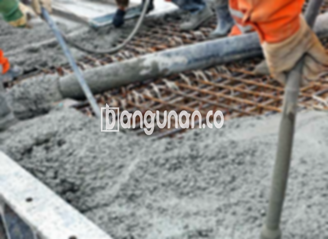

**Jasa Cor Beton Readymix & Jayamix Di Candiroto Temanggung** – Penggunaan adukan beton siap pakai atau cor readymix menawarkan kemudahan dan efisiensi dalam pembangunan. Di Candiroto Temanggung, layanan dari bangunan.co menyediakan solusi beton berkualitas tinggi yang diformulasikan khusus untuk pengecoran cepat dan instan. Pada dasarnya, komposisi material yang digunakan serupa dengan campuran beton konvensional, yaitu terdiri dari pasir beton, batu split, semen, dan air. Dengan proporsi dan takaran yang tepat, bangunan.co memastikan kualitas beton yang sesuai dengan kebutuhan proyek Anda. Mitra Bangunan siap mendukung kelancaran konstruksi Anda.



## Mengoptimalkan Pengerjaan dengan Pengcampuran Beton dari bangunan.co di Candiroto Temanggung

Penyediaan material beton siap pakai ini bertujuan untuk mempercepat proses pengecoran dan memastikan kualitas yang konsisten. Dengan kualitas yang terjamin, Anda sebagai kontraktor atau pemilik proyek dapat fokus pada tahapan pembangunan lainnya, tanpa perlu khawatir tentang kualitas adukan. Beton yang sudah sesuai standar ini membantu menciptakan struktur bangunan yang kuat dan tahan lama.

Beton ready mix dari bangunan.co menawarkan beragam pilihan mutu yang sesuai dengan aplikasi konstruksi yang berbeda. Juga dikenal sebagai beton cair siap guna, produk ini telah dirancang secara presisi di pabrik pengolahan beton modern bangunan.co. Hal ini memungkinkan beton langsung dituang dan diratakan di lokasi proyek setelah tiba, menghilangkan kebutuhan pencampuran manual yang memakan waktu dan berpotensi menimbulkan variasi kualitas. Anda sebagai pengguna hanya perlu memastikan bekisting telah siap untuk menerima pengecoran.

Kontrol kualitas yang ketat diterapkan oleh bangunan.co, mulai dari pemilihan material hingga pengiriman ke lokasi proyek. Proses ini mencakup pengujian berkelanjutan guna memastikan setiap batch beton memenuhi standar mutu yang ditetapkan agar sesuai dengan spesifikasi proyek Anda. Hal ini mempermudah Anda dalam mendapatkan material yang andal dan berkualitas tanpa kerumitan tambahan.

## Menimbang Kelebihan dan Kekurangan Penggunaan Cor Readymix dari bangunan.co di Candiroto Temanggung

Terdapat perbedaan karakteristik antara beton yang dicampur dengan teknologi batching plant dari bangunan.co dan beton konvensional yang dicampur secara manual. Masing-masing memiliki kelebihan dan kekurangan yang perlu Anda evaluasi sebelum membuat keputusan. Berikut adalah perbandingan rinci dari kedua pendekatan tersebut:

Keunggulan beton yang dicampur di pabrik bangunan.co:

1.  Komposisi campuran yang presisi dan konsisten, sesuai dengan kelas kekuatan yang dipesan.
2.  Kualitas beton yang lebih merata, berkat proses pencampuran yang menggunakan mesin modern.
3.  Penggunaan material konstruksi berkualitas tinggi yang dipilih secara ketat oleh bangunan.co.
4.  Efisiensi waktu yang signifikan, menghemat biaya tenaga kerja dan mempercepat penyelesaian proyek.
5.  Anda tidak perlu khawatir tentang perhitungan dan pencampuran mutu beton yang kompleks, karena bangunan.co telah melakukan optimasi formulasi sesuai standar.

Sebagai pertimbangan, kekurangan beton readymix dari bangunan.co adalah:

Proses pemesanan melalui bangunan.co mengharuskan penjadwalan terlebih dahulu. Pemesanan tidak dapat dilakukan secara spontan dan memerlukan waktu untuk pengaturan pengiriman. Selain itu, survei lokasi perlu dilakukan oleh tim bangunan.co untuk memperkirakan volume beton yang dibutuhkan, guna menghindari kelebihan atau kekurangan material.

## Ragam Mutu Beton yang Paling Banyak Diminati di Candiroto Temanggung dari bangunan.co

Dari berbagai pilihan mutu beton, K225 merupakan yang paling sering digunakan untuk pengecoran dak rumah atau lantai 2 ke atas. Mutu beton K225 dari bangunan.co dirancang khusus untuk memenuhi kebutuhan aplikasi dak, menawarkan kekuatan dan ketahanan yang optimal. Namun, mutu ini juga dapat dimanfaatkan untuk pengecoran jalan gang yang tidak dilalui kendaraan berat secara rutin.

Pilihan populer lainnya adalah mutu beton K250 dan K300 yang disediakan oleh bangunan.co, yang sering digunakan untuk pengecoran tiang, pondasi atau cakar ayam. Untuk proyek jalan pedesaan, bangunan.co dapat menyediakan beton dengan mutu K250, K300, atau bahkan K350. Mutu beton yang lebih tinggi, seperti K375, K400, dan K500 yang ditawarkan oleh bangunan.co, umumnya diaplikasikan pada konstruksi *fast track* atau proyek yang memerlukan pengeringan cepat, seperti jalan tol atau area parkir dengan beban berat.

## bangunan.co Memprioritaskan Kualitas Beton untuk Proyek Anda di Candiroto Temanggung



Formulasi adukan beton readymix dari bangunan.co harus dirancang dengan teliti untuk memastikan kemampuan kerja dan kekuatan yang optimal. Komposisi campuran yang tepat akan menghasilkan beton yang tahan lama dan sesuai dengan standar mutu nasional (SNI). Komposisi ideal umumnya terdiri dari 10% hingga 15% semen Portland, 60% hingga 75% agregat halus dan kasar (pasir dan split), serta 10% hingga 15% air, dengan sisanya berupa kandungan udara.

Beton berkualitas tinggi dari bangunan.co dibuat dengan meminimalkan rasio air terhadap semen tanpa mengorbankan kemudahan proses pengerjaan beton segar. Penggunaan air bersih dan bebas kontaminan sangat penting untuk menjaga kualitas beton. Air yang mengandung lumpur atau lumut dapat mengurangi kekuatan dan daya tahan beton. 

Mitra Bangunan, demikian penjelasan dari layanan Jasa Cor Beton Readymix & Jayamix Di Candiroto Temanggung dari bangunan.co yang telah Kami sampaikan. Untuk informasi harga setiap mutu beton, jangan ragu untuk menghubungi Kami melalui saluran WhatsApp yang tersedia.

**Ref by:** [Cor Beton Readymix & Jayamix Candiroto Temanggung](https://id.wikipedia.org/wiki/Cor)