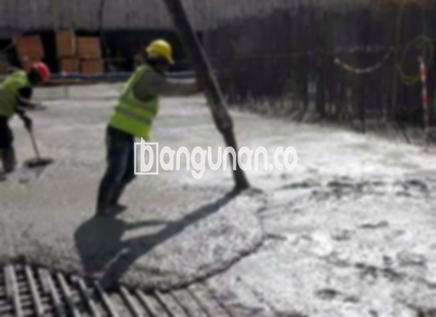

**Jasa Cor Beton Readymix & Jayamix Di Candisari Kota Semarang** – Mencari solusi pengecoran beton yang praktis dan berkualitas di Candisari Kota Semarang? Bangunan.co hadir sebagai penyedia jasa cor readymix dan jayamix yang terpercaya. Dengan layanan ini, Mitra Bangunan dapat menikmati efisiensi waktu, kepastian mutu, dan kemudahan dalam setiap proyek konstruksi.



## Memaksimalkan Efisiensi Konstruksi dengan Jasa Cor Beton Readymix & Jayamix Di Candisari Kota Semarang

Layanan cor readymix dari Bangunan.co di Candisari Kota Semarang dirancang untuk menghadirkan kemudahan dan efisiensi dalam setiap tahap konstruksi. Dengan memanfaatkan beton siap pakai, Anda tidak perlu lagi repot mengaduk beton secara manual di lokasi proyek, sehingga dapat mengalokasikan sumber daya untuk fokus pada aspek-aspek penting lainnya. Beton yang diproduksi dengan standar mutu tinggi ini memungkinkan Anda untuk mencapai hasil yang optimal.

Aduk beton siap pakai memberikan fleksibilitas dalam memilih mutu yang sesuai dengan kebutuhan spesifik proyek Anda. Dihasilkan di pabrik pengolahan beton modern, beton ini sudah diformulasikan dengan proporsi yang tepat, sehingga siap digunakan segera setelah pengiriman. Proses ini membebaskan tim proyek dari tugas pencampuran manual yang memakan waktu dan tenaga, yang memungkinkan mereka untuk mempercepat penyelesaian pekerjaan dan memastikan kualitas yang konsisten.

Pengendalian mutu yang ketat dilakukan di seluruh proses produksi, mulai dari pemilihan bahan baku hingga pengiriman ke lokasi proyek. Hal ini memastikan bahwa setiap pengiriman beton readymix dari Bangunan.co memenuhi standar kualitas yang telah ditetapkan, memberikan Anda ketenangan pikiran dan kepercayaan terhadap kekuatan serta daya tahan struktur bangunan Anda.

## Keunggulan dan Pertimbangan Cor Readymix dari Bangunan.co di Candisari Kota Semarang

Beton yang diproses di pabrik pengolahan beton, atau biasa disebut *batching plant*, memiliki karakteristik yang berbeda dibandingkan dengan adukan manual tradisional. Berikut adalah analisis keunggulan dan pertimbangannya:

Kelebihan beton readymix dari Bangunan.co:

1.  Campuran yang presisi dan konsisten sesuai dengan mutu yang dipesan, menjamin kualitas yang seragam.
2.  Kualitas beton yang merata berkat proses pencampuran yang optimal dan terkontrol.
3.  Penggunaan material berstandar tinggi yang dipilih dengan cermat untuk mencapai mutu beton terbaik.
4.  Proses produksi yang cepat dan efisien, menghemat waktu dan biaya konstruksi Anda.
5.  Pembebasan dari kerumitan perhitungan dan pencampuran manual, memungkinkan Anda fokus pada aspek strategis proyek.

Namun, ada beberapa hal yang perlu dipertimbangkan:

Pemesanan beton readymix dari Bangunan.co membutuhkan perencanaan yang matang. Karena proses produksinya memerlukan penjadwalan, Anda perlu memesan beberapa waktu sebelumnya dan memberikan informasi yang akurat mengenai volume yang dibutuhkan. Hal ini penting untuk memastikan ketersediaan material yang tepat waktu dan mencegah kekurangan atau kelebihan pasokan.

## Ragam Mutu Beton yang Sering Dipilih di Candisari Kota Semarang

K225 adalah salah satu jenis beton yang paling umum digunakan di Candisari Kota Semarang, khususnya untuk aplikasi seperti pengecoran lantai dan dak rumah. Mutu ini sudah memenuhi standar kekuatan yang diperlukan untuk menahan beban umum pada struktur bangunan.

Selain itu, K250 dan K300 juga merupakan pilihan yang populer untuk proyek-proyek yang lebih berat, seperti pengecoran pondasi, tiang, dan jalan pedesaan. Mutu yang lebih tinggi ini memberikan daya tahan dan kekuatan yang lebih besar, memastikan keamanan dan ketahanan struktur bangunan Anda.

Untuk kebutuhan khusus yang memerlukan kekuatan beton yang sangat tinggi, seperti konstruksi gedung bertingkat atau jalan dengan lalu lintas berat, mutu beton K350 atau lebih tinggi dapat menjadi pilihan yang tepat. Beton Fast Track dengan mutu K400 atau lebih tinggi juga tersedia bagi proyek-proyek yang membutuhkan waktu pengeringan yang sangat cepat.

## Bangunan.co: Jaminan Kualitas untuk Cor Beton Readymix & Jayamix di Candisari Kota Semarang



Formulasi campuran cor readymix atau *ready mix concrete* merupakan aspek krusial dalam menentukan kualitas dan performa beton. Bangunan.co menerapkan formula yang telah teruji dan memenuhi standar kualitas nasional (SNI), memastikan beton yang dihasilkan memiliki kekuatan, daya tahan, dan kemampuan kerja yang optimal.

Komposisi ideal campuran beton terdiri dari proporsi semen Portland (10-15%), agregat halus dan kasar (60-75%), air (10-15%), dan udara. Penggunaan air bersih dan bebas kontaminan sangat penting untuk menjaga kualitas beton. Rasio air terhadap semen yang rendah menghasilkan beton yang lebih kuat dan tahan lama.

Bangunan.co berkomitmen untuk menyediakan beton berkualitas tinggi yang diproduksi dengan proses terkontrol. Setiap batch beton menjalani pengujian ketat untuk memastikan konsistensi mutu dan memenuhi spesifikasi yang Anda butuhkan.

Mitra Bangunan yang sedang mencari jasa cor beton readymix dan jayamix di Candisari Kota Semarang, hubungi Bangunan.co melalui tombol WhatsApp atau Telepon yang tersedia di halaman ini. Tim kami siap membantu Anda dalam memilih mutu beton yang tepat dan memberikan penawaran harga yang kompetitif.

**Ref by:** [Cor Beton Readymix & Jayamix Candisari Kota Semarang](https://id.wikipedia.org/wiki/Cor)