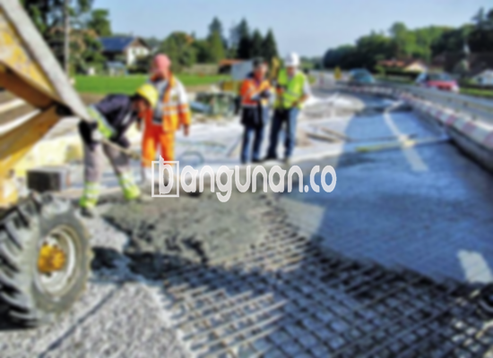

**Jasa Cor Beton Readymix & Jayamix Di Cangkringan Sleman** – Bagi Mitra Bangunan yang sedang merencanakan pembangunan di wilayah Cangkringan Sleman, solusi pengecoran yang praktis dan efisien adalah dengan menggunakan beton readymix atau jayamix dari Bangunan.co. Beton siap pakai ini menawarkan kemudahan, kecepatan, dan kualitas terjamin untuk berbagai proyek konstruksi Anda. Kami hadir sebagai penyedia jasa cor beton readymix dan jayamix terpercaya di wilayah ini.



## Pentingnya Memilih Jasa Cor Beton Readymix & Jayamix Terpercaya di Cangkringan Sleman

Penyediaan adukan beton berkualitas tinggi melalui jasa readymix bertujuan untuk mempercepat proses konstruksi sekaligus memastikan kualitas yang konsisten. Dengan komposisi yang telah diformulasikan secara presisi, beton yang dihasilkan memenuhi standar mutu yang diperlukan, sejalan dengan spesifikasi desain bangunan Anda. 

Beton readymix, atau beton siap pakai, diproduksi secara sentral di pabrik pengolahan beton dengan takaran material yang akurat. Hal ini memastikan kualitas yang stabil dan memudahkan proses pengecoran di lokasi proyek Anda. Anda tidak perlu lagi repot mencampur adukan secara manual, yang seringkali rentan terhadap kesalahan takaran dan variasi kualitas. Cukup siapkan bekisting yang kuat dan kokoh untuk menampung beton yang akan dituang.

Keunggulan utama beton readymix terletak pada kontrol kualitas yang ketat sepanjang proses produksi. Mulai dari pemilihan bahan baku hingga pencampuran dan pengiriman, setiap tahapan diawasi dengan cermat oleh tenaga ahli di batching plant. Hal ini menjamin bahwa beton yang Anda terima memiliki mutu yang seragam dan sesuai dengan pesanan Anda, sehingga meminimalkan risiko kegagalan struktural. Dengan demikian, Anda dapat lebih fokus pada aspek-aspek konstruksi lainnya, sekaligus menghemat waktu dan biaya.

## Keunggulan dan Pertimbangan dalam Menggunakan Cor Readymix di Cangkringan Sleman

Terdapat perbedaan signifikan antara beton yang dicampur langsung di lokasi proyek dengan beton yang diproduksi di pabrik pengolahan beton (batching plant). Masing-masing metode memiliki kelebihan dan kekurangan yang perlu Anda pertimbangkan sebelum membuat keputusan.

Berikut adalah keunggulan penggunaan beton readymix:

1.  Kualitas adukan yang terjamin konsistensinya dan sesuai spesifikasi.
2.  Mutu beton merata karena proses pencampuran yang terkendali dan terotomatisasi.
3.  Penggunaan material berkualitas tinggi yang telah teruji dan disertifikasi.
4.  Efisiensi waktu dan tenaga kerja, memungkinkan penyelesaian proyek lebih cepat.
5.  Minimnya risiko kesalahan pencampuran yang sering terjadi saat pengadukan manual.

Namun, ada beberapa hal yang perlu diperhatikan. Pemesanan beton readymix memerlukan perencanaan yang matang dan jadwal yang jelas karena proses produksinya membutuhkan waktu. Pihak pabrik perlu melakukan survei lokasi untuk memperkirakan volume beton yang dibutuhkan, sehingga dapat dipastikan pasokan yang tepat dan menghindari pemborosan atau kekurangan material.

## Ragam Mutu Beton yang Umum Digunakan dalam Proyek di Cangkringan Sleman

Di Cangkringan Sleman, mutu beton K225 merupakan salah satu pilihan yang paling populer. Kualitas ini sangat cocok untuk pengecoran dak rumah, lantai dua, atau area yang tidak menahan beban terlalu berat. K225 juga sering diaplikasikan untuk pengecoran jalan gang perumahan yang tidak dilalui kendaraan berat.

Selain itu, mutu beton K250 dan K300 juga banyak digunakan dalam berbagai proyek konstruksi. K250 dan K300 umumnya dipakai untuk pengecoran fondasi, tiang, kolong, atau cakar ayam. Untuk jalan desa atau area yang membutuhkan kekuatan lebih tinggi, mutu beton K300 atau K350 bahkan bisa menjadi pilihan yang ideal. Mutu beton di atas K350, seperti K400, K500, atau lebih tinggi, biasanya digunakan untuk proyek-proyek besar yang membutuhkan kekuatan dan kecepatan pengerasan ekstra, contohnya jalan tol, jembatan, atau area parkir yang menahan beban berat.

## Bangunan.co: Jasa Cor Beton Readymix & Jayamix Terpercaya di Cangkringan Sleman



Proses pembuatan adukan cor readymix berkualitas tinggi memerlukan perancangan yang cermat dan ketelitian dalam pemilihan material. Beton yang berkualitas akan memberikan kekuatan, ketahanan, dan keamanan yang optimal untuk struktur bangunan Anda. Komposisi adukan beton haruslah sesuai dengan standar nasional (SNI), dengan proporsi yang tepat antara semen Portland (10-15%), agregat halus dan kasar (pasir dan split 60-75%), air (10-15%), serta sedikit kandungan udara untuk meningkatkan kemampuan kerja beton. 

Kualitas beton sangat dipengaruhi oleh rasio air dan semen. Penggunaan air yang terlalu banyak dapat menurunkan kekuatan beton, sementara kekurangan air dapat mengganggu proses pengerasan. Oleh karena itu, kami selalu menjaga keseimbangan yang tepat dalam pencampuran air, dengan tetap memastikan beton tetap mudah dikerjakan. Air yang digunakan juga harus bersih dan bebas dari kontaminan yang dapat merusak kualitas beton.

Sebagai penyedia jasa cor beton readymix dan jayamix di Cangkringan Sleman, Bangunan.co berkomitmen untuk menyediakan produk berkualitas tinggi dan layanan yang profesional. Hubungi kami untuk mendapatkan penawaran terbaik dan solusi konstruksi yang sesuai dengan kebutuhan Anda, Mitra Bangunan.

**Ref by:** [Cor Beton Readymix & Jayamix Cangkringan Sleman](https://id.wikipedia.org/wiki/Cor)