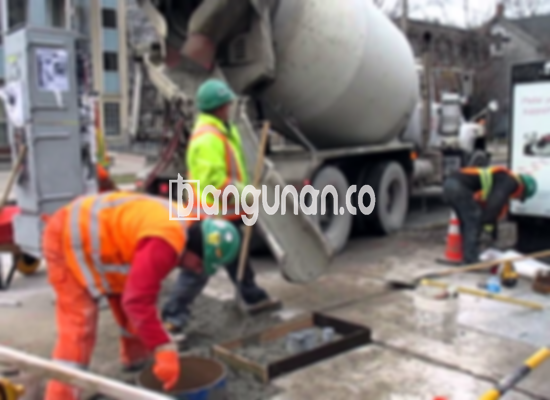

**Jasa Cor Beton Readymix & Jayamix Di Ceper Klaten** – Memastikan fondasi yang kokoh dan konstruksi yang tahan lama adalah kunci utama keberhasilan setiap proyek pembangunan. Solusi praktis dan efisien untuk kebutuhan pengecoran di Ceper Klaten hadir melalui layanan beton readymix dan jayamix dari Bangunan.co. Kami menghadirkan adukan beton siap pakai yang diformulasikan secara khusus untuk pengecoran instan, dengan komposisi material baku yang terstandarisasi: pasir beton, agregat batu pecah, semen berkualitas, dan air bersih. Dengan layanan kami, Mitra Bangunan, Anda dapat mewujudkan proyek konstruksi yang berkualitas tinggi dengan lebih mudah dan cepat.



## Mengoptimalkan Pengadukan Beton Bersama Jasa Cor Beton Readymix & Jayamix Di Ceper Klaten

Penggunaan adukan beton siap pakai seperti yang kami tawarkan bertujuan untuk mempercepat proses konstruksi sekaligus menjamin kualitas yang seragam dan terukur. Dengan memilih mutu beton yang tepat, Anda dapat memastikan bahwa konstruksi yang dibangun sesuai dengan standar yang diharapkan dan mampu menahan beban yang diperkirakan. Beton readymix tersedia dalam berbagai tingkatan kualitas untuk memenuhi kebutuhan spesifik proyek Anda.

Beton cor readymix atau beton siap pakai dikenal karena kepraktisannya; beton ini diproduksi di instalasi batching plant yang modern dan dikirim langsung ke lokasi proyek Anda dalam keadaan siap digunakan. Anda tidak perlu lagi memikirkan proses pencampuran manual yang memakan waktu dan berpotensi mengurangi kualitas beton. Cukup siapkan area bekisting sebagai penahan beton selama proses pengecoran.

Proses pengadukan dan pengendalian kualitas beton dilakukan secara ketat di pabrik pengolahan beton, mulai dari penimbangan material hingga pengujian kekuatan beton. Hal ini memastikan konsistensi kualitas setiap batch beton yang diproduksi, memberikan Anda keyakinan penuh terhadap kekuatan dan durabilitas struktur yang Anda bangun. Dengan layanan Bangunan.co, Anda tidak perlu khawatir tentang kualitas bahan atau ketepatan campuran.

## Keunggulan dan Pertimbangan Penggunaan Beton Cor Readymix

Terdapat perbedaan yang signifikan antara beton yang dicampur di lokasi proyek dengan beton yang diproduksi di pabrik pengolahan beton (batching plant). Berikut ini adalah perbandingan kelebihan dan kekurangan dari masing-masing metode:

Kelebihan penggunaan beton readymix:

1.  Komposisi material yang presisi dan terjamin kualitasnya.
2.  Pencampuran yang merata, menghasilkan kekuatan beton yang homogen.
3.  Penggunaan bahan baku berkualitas tinggi yang telah melalui proses seleksi ketat.
4.  Efisiensi waktu dan biaya, karena Anda tidak perlu menyediakan tenaga kerja dan peralatan pengadukan.
5.  Kepastian mutu beton sesuai dengan standar yang telah ditetapkan.

Namun, penting juga untuk mempertimbangkan beberapa hal sebelum memilih beton readymix:

Pemesanan beton readymix memerlukan perencanaan yang matang dan penjadwalan yang tepat. Anda perlu memperkirakan volume beton yang dibutuhkan dan memesannya beberapa hari sebelumnya agar beton dapat dikirim tepat waktu. Hal ini juga memungkinkan pabrik pengolahan beton untuk mempersiapkan material yang diperlukan.

## Ragam Mutu Beton yang Paling Banyak Dicari di Ceper Klaten

Kualitas K225 adalah salah satu mutu beton yang paling sering digunakan di Ceper Klaten, terutama untuk pengecoran dak rumah atau lantai 2 ke atas. K225 dirancang khusus untuk menahan beban yang umumnya terdapat pada struktur dak. Selain itu, mutu beton ini juga cocok untuk pengecoran jalan setapak atau gang kecil yang tidak dilalui kendaraan berat.

Pilihan mutu beton lainnya yang populer adalah K250 dan K300. K250 dan K300 sering digunakan untuk pengecoran tiang, pondasi, atau cakar ayam. Untuk jalan pedesaan, mutu K250, K300, dan bahkan K350 seringkali menjadi pilihan yang tepat. Untuk aplikasi yang memerlukan kekuatan beton yang lebih tinggi dan waktu pengeringan yang lebih cepat, mutu beton di atas K350 seperti K375, K400, dan K500 dapat digunakan. Beton dengan mutu tinggi ini sering disebut sebagai beton *fast track* dan biasanya digunakan untuk proyek-proyek seperti jalan tol atau area parkir yang memerlukan beban berat dan waktu penyelesaian yang singkat.

## Bangunan.co: Jaminan Kualitas Beton untuk Proyek Anda



Pencampuran beton *ready mix* memerlukan perancangan yang cermat dan pemahaman mendalam tentang karakteristik material yang digunakan. Hal ini bertujuan untuk menghasilkan beton yang memiliki kinerja optimal, kekuatan yang handal, dan durabilitas yang tinggi. Komposisi ideal terdiri dari sekitar 10% hingga 15% semen Portland, 60% hingga 75% agregat halus dan kasar (pasir dan split), serta 10% hingga 15% air. Penggunaan air yang bersih dan bebas dari kontaminan sangat krusial untuk menjaga kualitas beton.

Beton bermutu tinggi diproduksi dengan meminimalkan rasio air terhadap semen tanpa mengorbankan kemampuan kerja beton segar. Artinya, air digunakan dalam jumlah yang tepat dan terkontrol. Anda dapat mengandalkan layanan Bangunan.co untuk mendapatkan beton berkualitas tinggi dengan mutu yang terjamin. Kami memastikan setiap campuran memenuhi standar nasional (SNI) untuk kekuatan, ketahanan, dan umur panjang.

Dengan memilih Bangunan.co sebagai mitra Anda, Anda akan mendapatkan solusi beton yang andal dan efisien untuk proyek konstruksi Anda di Ceper Klaten. Kami berkomitmen untuk memberikan layanan terbaik dan produk berkualitas tinggi yang sesuai dengan kebutuhan Anda. 

Sampai di sini, Mitra Bangunan, penjelasan dari Jasa Cor Beton Readymix & Jayamix Di Ceper Klaten yang telah kami sampaikan. Untuk mendapatkan informasi harga yang lebih detail dan penawaran khusus, silakan hubungi tim kami melalui WhatsApp atau Telepon yang tertera di halaman ini. Kami akan dengan senang hati membantu Anda.

**Ref by:** [Cor Beton Readymix & Jayamix Ceper Klaten](https://id.wikipedia.org/wiki/Cor)