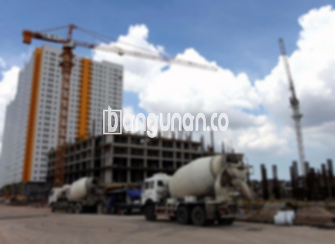

**Jasa Cor Beton Readymix & Jayamix Di Cepiring Kendal** – Bagi Mitra Bangunan yang membutuhkan solusi pengecoran praktis dan berkualitas tinggi, bangunan.co hadir di Cepiring Kendal dengan layanan cor readymix dan jayamix. Kami melayani pengiriman readymix dengan truk molen untuk berbagai proyek konstruksi Anda, memastikan efisiensi dan kekuatan optimal pada setiap tahapan pembangunan. Beton siap pakai ini didesain untuk memberikan kemudahan dan hasil yang presisi sesuai kebutuhan proyek Anda.



## Mengapa Memilih Layanan Cor Beton Readymix & Jayamix dari bangunan.co di Cepiring Kendal?

Penyediaan adukan beton siap pakai merupakan solusi efektif untuk mempercepat proses konstruksi sekaligus memastikan kualitas yang terjamin. Dengan memilih mutu beton yang tepat, Anda dapat membangun struktur yang kokoh dan tahan lama sesuai dengan perencanaan awal. bangunan.co menyediakan berbagai pilihan mutu readymix yang bisa disesuaikan dengan jenis dan skala proyek yang dikerjakan. Beton ini, yang sering disebut beton cair siap guna, sudah diformulasikan secara presisi di pabrik pengolahan beton, sehingga siap digunakan langsung di lokasi proyek. Ini membebaskan Anda dari kerumitan pencampuran manual dan menjamin konsistensi kualitas yang superior.

Kualitas beton kami dikontrol secara ketat mulai dari pemilihan bahan baku hingga proses pencampuran dan pengiriman. Hal ini memberikan keyakinan kepada Anda karena mutu beton yang digunakan telah diuji dan terjamin sesuai standar. Dengan begitu, Anda dapat fokus pada aspek-aspek penting lainnya dalam konstruksi tanpa perlu khawatir tentang kualitas bahan dasar yang digunakan. Solusi terbaik untuk proyek konstruksi Anda di Cepiring Kendal.

## Keunggulan dan Pertimbangan dalam Penggunaan Beton Readymix dari bangunan.co

Beton yang diproduksi melalui pabrik pengolahan beton (batching plant) memiliki karakteristik yang berbeda dengan beton yang dicampur secara manual di lokasi proyek. Masing-masing metode ini memiliki kelebihan dan kekurangan masing-masing. Berikut adalah beberapa pertimbangan penting yang perlu Anda pahami:

Kelebihan beton yang diproduksi di pabrik pengolahan beton:

1.  Campuran material yang presisi sesuai dengan mutu yang dipesan.
2.  Kualitas beton yang seragam dan konsisten karena proses pencampuran yang terkontrol.
3.  Penggunaan bahan material berkualitas tinggi yang telah melalui seleksi ketat.
4.  Proses produksi yang efisien, menghemat waktu dan biaya.
5.  Menghilangkan kerumitan dalam proses pencampuran adukan beton di lokasi.

Sebagai pertimbangan, pemesanan beton readymix memerlukan perencanaan yang matang karena tidak dapat dilakukan secara instan. Anda perlu melakukan penjadwalan pemesanan dan survei lokasi untuk menentukan volume yang dibutuhkan, memastikan bahwa beton tersedia saat dibutuhkan dan menghindari pemborosan materi.

## Jenis Mutu Beton yang Paling Sering Digunakan di Area Cepiring Kendal

Di area Cepiring Kendal, salah satu jenis mutu beton yang paling banyak digunakan dalam konstruksi adalah K225. Mutu beton ini sangat ideal untuk pengecoran dak rumah atau lantai dua ke atas, karena dirancang khusus untuk menahan beban yang cukup besar dan memberikan kekuatan yang memadai. K225 juga menjadi pilihan tepat untuk pengecoran jalan gang kecil yang tidak dilalui oleh kendaraan berat.

Selain K225, mutu beton K250 dan K300 juga sangat populer untuk pengecoran tiang, pondasi, atau cakar ayam. Untuk proyek konstruksi yang membutuhkan kekuatan yang lebih tinggi, seperti jalan pedesaan, mutu beton K350 dapat menjadi solusi yang lebih optimal. Mutu beton yang lebih tinggi dari K350, seperti K400, K500, dan seterusnya, umumnya digunakan untuk pengecoran *fast track* yang menuntut waktu pengeringan yang cepat. Contohnya adalah proyek jalan tol atau lahan parkir yang harus segera digunakan.

## bangunan.co: Jasa Cor Beton Readymix & Jayamix di Cepiring Kendal yang Prioritaskan Kualitas Beton



Peracikan beton *ready mix* haruslah dilakukan secara hati-hati dan akurat untuk menjamin performa dan ketahanan beton yang optimal. Komposisi bahan yang tepat, sesuai dengan Standar Nasional Indonesia (SNI), sangat penting untuk mencegah kerusakan dini dan memastikan hasil pengecoran yang tahan lama. Komposisi ideal adukan beton terdiri dari sekitar 10% hingga 15% semen Portland, 60% hingga 75% agregat halus dan kasar (pasir dan split), serta 10% hingga 15% air. 

Untuk mencapai mutu beton yang tinggi, rasio air terhadap semen harus diminimalkan tanpa mengorbankan kemampuan kerja beton segar. Penggunaan air bersih sangatlah krusial; hindari penggunaan air yang terkontaminasi oleh tanah, lumpur, atau lumut, karena hal tersebut dapat menurunkan kualitas beton secara signifikan. Pastikan air yang digunakan adalah air bersih dan tidak mengandung material asing yang dapat mengganggu proses pengerasan beton.

Mitra Bangunan, demikian penjelasan lengkap dari layanan Jasa Cor Beton Readymix & Jayamix Di Cepiring Kendal dari bangunan.co yang telah kami sampaikan. Untuk informasi harga masing-masing mutu beton, silakan hubungi tim kami untuk mendapatkan penawaran terbaik melalui saluran komunikasi yang tersedia.

**Ref by:** [Cor Beton Readymix & Jayamix Cepiring Kendal](https://id.wikipedia.org/wiki/Cor)