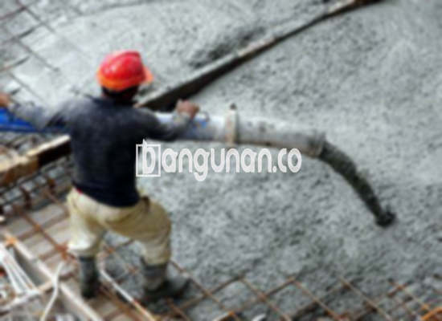

**Jasa Cor Beton Readymix & Jayamix Di Cilacap Selatan Cilacap** – Mencari solusi pengecoran beton yang praktis, efisien, serta menjamin kualitas konstruksi? Mitra Bangunan, penyedia jasa cor beton readymix dan jayamix terpercaya di Cilacap Selatan Cilacap, hadir untuk memenuhi kebutuhan proyek Anda. Kami menyediakan adukan beton siap pakai dengan formulasi yang presisi, memungkinkan Anda mengoptimalkan waktu dan sumber daya, sehingga proyek konstruksi Anda berjalan lancar dan tepat sasaran.



## Mengapa Memilih Layanan Pengadukan Beton dari bangunan.co di Cilacap Selatan Cilacap

Pengadukan beton yang terstandarisasi menjadi inti dari layanan kami, yang dirancang untuk mempercepat progres pengecoran sembari memastikan kualitas beton yang konsisten. Dengan mengandalkan beton siap pakai dari bangunan.co, Anda dapat menghemat waktu dan tenaga, memungkinkan penyelesaian proyek tepat waktu dan sesuai dengan standar kualitas yang ditetapkan. Kualitas beton yang terjamin akan memastikan kekuatan dan ketahanan optimal pada setiap struktur yang Anda bangun.

Beton readymix yang kami sediakan menawarkan berbagai pilihan mutu yang dapat disesuaikan dengan kebutuhan proyek Anda. Anda dapat memilih kelas kekuatan yang paling sesuai dengan jenis konstruksi yang sedang dikerjakan. Beton ini, sering disebut juga sebagai beton cair siap pakai, diproduksi di pabrik pengolahan beton dengan formulasi khusus untuk memastikan kesiapan penggunaan. Hal ini menghilangkan kerumitan pencampuran di lokasi proyek, sehingga Anda dapat fokus pada persiapan bekisting dan memastikan kondisi konstruksi yang ideal.

Kualitas beton kami dikendalikan secara ketat, mulai dari pemilihan material hingga proses pencampuran dan pengiriman. Kami memastikan bahwa setiap batch beton memenuhi standar kualitas yang tinggi, memberikan Anda ketenangan pikiran selama proses konstruksi. Memilih bangunan.co berarti memilih solusi konstruksi yang efisien dan andal untuk proyek Anda di Cilacap Selatan Cilacap.

## Keunggulan dan Pertimbangan dalam Menggunakan Beton readymix dari bangunan.co

Tentu saja, terdapat perbedaan antara beton yang dicampur di pabrik pengolahan beton (batching plant) seperti bangunan.co dan beton yang dicampur secara manual di lapangan. Setiap metode memiliki kelebihan dan kekurangan masing-masing. Mari kita telaah lebih jauh:

Beton yang dicampur oleh pabrik pengolahan beton memiliki beberapa keunggulan utama:

1.  Pertama, komposisi campuran yang akurat dan optimal untuk mencapai kekuatan mutu yang diinginkan.
2.  Kedua, kualitas beton yang seragam dan konsisten karena proses pencampuran yang terkontrol.
3.  Ketiga, penggunaan material bangunan berkualitas tinggi yang diseleksi secara ketat untuk menghasilkan beton dengan mutu terbaik.
4.  Keempat, efisiensi waktu dan biaya karena proses pengolahan yang cepat dan terotomatisasi.
5.  Kelima, kemudahan dalam pengelolaan proyek karena Anda tidak perlu khawatir tentang pencampuran adukan beton – bangunan.co sudah menanganinya.

Meskipun demikian, perlu diingat beberapa hal terkait sistem pemesanan di bangunan.co. Pemesanan beton readymix tidak dapat dilakukan secara instan; diperlukan penjadwalan dan survei lokasi untuk menentukan volume beton yang dibutuhkan secara akurat. Hal ini bertujuan untuk memastikan ketersediaan material yang cukup dan mencegah pemborosan.

## Jenis Mutu Beton yang Umum Digunakan di Cilacap Selatan Cilacap

Di antara berbagai jenis mutu beton yang tersedia, mutu beton struktural K225 merupakan pilihan yang paling populer dan banyak digunakan. Mutu K225 sangat ideal untuk pengecoran lantai rumah, lantai dua, dan struktur serupa karena dirancang khusus untuk aplikasi tersebut. Beton ini juga cocok untuk pengecoran jalan gang yang tidak menanggung beban lalu lintas berat.

Pilihan lain yang umum adalah mutu beton K250 dan K300. Mutu ini sering digunakan untuk pengecoran tiang, fondasi, dan cakar ayam. Untuk proyek jalan pedesaan, mutu beton K250, K300, dan K350 juga sering dijumpai. Untuk kebutuhan akan kekuatan yang lebih tinggi, mutu beton seperti K375, K400, dan K500 bisa menjadi pilihan yang tepat, terutama untuk beton *fast track* yang memerlukan waktu pengeringan cepat. Beton jenis ini sangat cocok untuk proyek-proyek infrastruktur seperti jalan tol atau lahan parkir yang membutuhkan daya tahan tinggi dalam waktu singkat.

## bangunan.co Mengutamakan Mutu Beton untuk Keberhasilan Proyek Anda



Formulasi adukan beton readymix yang tepat sangatlah penting untuk mencapai kinerja dan kekuatan yang optimal. Campuran yang terukur dan terkendali akan menghasilkan beton yang kokoh, tahan lama, dan tidak mudah rusak. Komposisi ideal biasanya terdiri dari 10% hingga 15% semen Portland, 60% hingga 75% agregat halus dan kasar (pasir dan split), serta 10% hingga 15% air. Sisanya merupakan ruang udara yang terperangkap dalam campuran.

Untuk memastikan kualitas beton yang unggul, bangunan.co selalu menggunakan bahan-bahan berkualitas tinggi dan proses pencampuran yang tepat. Penggunaan air bersih dan bebas dari kontaminan seperti lumpur atau alga sangat penting. Anda, sebagai pelanggan, dapat yakin bahwa beton yang kami suplai telah memenuhi standar kualitas yang ketat.

Sebagai penyedia layanan yang terpercaya di Cilacap Selatan Cilacap, kami berkomitmen untuk menyediakan beton readymix berkualitas tinggi yang memenuhi standar nasional (SNI). Dengan pengalaman dan keahlian kami, kami siap mendukung kesuksesan proyek konstruksi Anda.

**Ref by:** [Cor Beton Readymix & Jayamix Cilacap Selatan Cilacap](https://id.wikipedia.org/wiki/Cor)

Mitra Bangunan siap menjawab kebutuhan cor beton readymix Anda di Cilacap Selatan Cilacap. Jangan ragu untuk menghubungi kami melalui tombol WhatsApp atau Telepon yang tersedia di halaman ini untuk mendapatkan informasi lebih lanjut dan penawaran harga yang kompetitif. Kami berkomitmen untuk menjadi mitra terpercaya dalam setiap tahapan proyek konstruksi Anda.