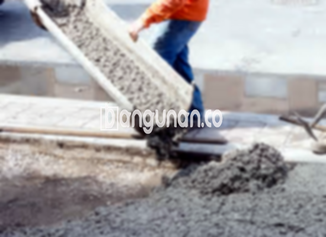

**Jasa Cor Beton Readymix & Jayamix Di Cilacap Tengah Cilacap** – Mencari solusi konstruksi yang praktis, efisien, dan berkualitas tinggi? Layanan cor readymix atau adukan beton siap pakai dari bangunan.co adalah pilihan tepat untuk proyek Anda. Beton siap pakai ini dirancang khusus untuk pengecoran instan, memastikan kemudahan dan kecepatan dalam setiap tahapan pembangunan. Mitra Bangunan di Cilacap Tengah Cilacap hadir untuk memenuhi kebutuhan konstruksi Anda dengan mutu terjamin.



## Mengapa Memilih Layanan Cor Readymix dari bangunan.co di Cilacap Tengah Cilacap?

Salah satu alasan utama memilih layanan cor readymix dari bangunan.co adalah efisiensi waktu dan tenaga. Dengan beton siap pakai, Anda tidak perlu lagi repot mencampur material di lokasi proyek. Layanan ini dirancang untuk mempercepat proses konstruksi tanpa mengorbankan kualitas mutu beton yang Anda butuhkan.

Cor readymix bangunan.co menawarkan berbagai pilihan mutu beton yang dapat disesuaikan dengan spesifikasi proyek Anda. Beton ini diformulasikan secara khusus di pabrik pengolahan beton, sehingga siap digunakan langsung di lokasi. Cukup siapkan bekisting dan Anda dapat langsung menuangkan beton, menghemat waktu dan tenaga yang berharga.

Kualitas dan konsistensi beton readymix dari bangunan.co menjadi prioritas utama. Proses pengolahan mutu beton diawasi dengan ketat, mulai dari pemilihan material hingga pengiriman ke lokasi proyek. Hal ini memastikan bahwa Anda mendapatkan beton dengan mutu yang terjamin dan sesuai dengan standar konstruksi yang berlaku.

## Keunggulan dan Manfaat Menggunakan Cor Readymix bangunan.co

Beton yang diproduksi di pabrik pengolahan beton bangunan.co memiliki keunggulan signifikan dibandingkan dengan beton yang dicampur secara manual di lokasi. Berikut beberapa keunggulannya:

1.  **Kualitas Terjaga:** Campuran material yang tepat dan terkontrol memastikan mutu beton yang konsisten dan terpercaya.
2.  **Keseragaman Mutu:** Proses pencampuran yang merata menghasilkan beton dengan karakteristik yang seragam di seluruh bagian.
3.  **Material Unggul:** Hanya material berkualitas tinggi yang digunakan untuk menjamin kekuatan dan daya tahan beton.
4.  **Efisiensi Waktu dan Biaya:** Proses pengolahan yang cepat dan efisien membantu menghemat waktu dan biaya proyek Anda.
5.  **Praktis dan Mudah Digunakan:** Anda tidak perlu khawatir tentang komposisi campuran beton karena semuanya sudah diformulasikan secara tepat oleh bangunan.co.

Perlu diingat, pemesanan readymix bangunan.co memerlukan penjadwalan terlebih dahulu dan survei lokasi untuk menghitung kebutuhan volume beton yang akurat. Hal ini dilakukan untuk memastikan ketersediaan pasokan yang tepat sesuai dengan kebutuhan proyek Anda.

## Ragam Mutu Beton yang Umum Digunakan Di Cilacap Tengah Cilacap

Untuk berbagai aplikasi konstruksi di Cilacap Tengah Cilacap, bangunan.co menyediakan berbagai pilihan mutu beton yang sesuai dengan kebutuhan Anda. Beberapa jenis mutu beton yang paling banyak digunakan meliputi:

*   **K225:** Sering digunakan untuk pengecoran dak rumah, lantai 2, atau jalan gang yang tidak menahan beban berat.
*   **K250 & K300:** Ideal untuk pengecoran tiang, pondasi, atau cakar ayam. K250, K300, dan K350 juga sering digunakan untuk jalan pedesaan yang memerlukan kekuatan lebih.
*   **K350 ke atas (K375, K400, K500):** Cocok untuk konstruksi yang membutuhkan kekuatan tinggi dan pengeringan cepat, seperti jalan tol, jembatan, atau lahan parkir. Jenis beton ini dikenal sebagai beton *fast track*.

## Komitmen bangunan.co Terhadap Kualitas Beton Di Cilacap Tengah Cilacap



Campuran beton cor readymix dari bangunan.co dirancang dengan cermat dan menggunakan material pilihan untuk memastikan kinerja dan daya tahan yang optimal. Kami selalu mengutamakan standar nasional (SNI) dalam setiap proses produksi. Komposisi campuran ideal kami terdiri dari sekitar 10% hingga 15% semen Portland, 60% hingga 75% agregat halus dan kasar (pasir dan split), serta 10% hingga 15% air, dengan sisanya berupa udara.

Untuk menghasilkan beton yang berkualitas tinggi, bangunan.co menjaga rasio air terhadap semen serendah mungkin tanpa mengurangi kemampuan kerja beton. Penggunaan air bersih dan bebas dari kontaminan juga menjadi prioritas utama kami. Air yang mengandung lumpur atau lumut tidak digunakan karena dapat menurunkan kualitas beton.

Dengan komitmen pada kualitas dan standar yang ketat, bangunan.co siap menjadi mitra terpercaya Anda dalam setiap proyek konstruksi di Cilacap Tengah Cilacap. Keandalan dan kualitas beton kami terjamin, memberikan Anda ketenangan pikiran selama proses pembangunan.

**Ref by:** [Cor Beton Readymix & Jayamix Cilacap Tengah Cilacap](https://id.wikipedia.org/wiki/Cor)

Mitra Bangunan siap mendukung kesuksesan proyek Anda dengan layanan cor beton readymix dan jayamix di Cilacap Tengah Cilacap. Jangan ragu untuk menghubungi kami melalui tombol WhatsApp atau Telepon di halaman ini untuk mendapatkan informasi harga dan penawaran terbaik. Percayakan kebutuhan konstruksi Anda kepada bangunan.co, dan rasakan kemudahan serta kualitas yang memuaskan.