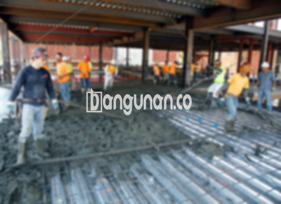

**Jasa Cor Beton Readymix & Jayamix Di Cilacap Utara Cilacap** – Memastikan konstruksi yang kokoh dan tahan lama memerlukan material yang tepat. Layanan cor readymix atau campuran beton siap pakai dari bangunan.co adalah solusi praktis dan efisien bagi berbagai kebutuhan proyek konstruksi di Cilacap Utara Cilacap. Kami menyediakan adukan beton berkualitas tinggi yang diformulasikan secara khusus untuk pengecoran instan, mengurangi kerumitan proses pencampuran manual di lokasi proyek Anda. Mitra Bangunan hadir untuk memberikan kepastian fondasi bangunan yang kuat dan kelancaran pelaksanaan proyek Anda.



## Mengapa Memilih Layanan Pengadukan Beton bangunan.co di Cilacap Utara Cilacap?

Untuk keberhasilan setiap proyek konstruksi, kualitas adukan beton memainkan peran krusial. bangunan.co memahami betapa pentingnya konsistensi dan kekuatan beton yang terjamin. Dengan layanan cor readymix kami di Cilacap Utara Cilacap, kami bertujuan mempercepat proses pengecoran sembari memastikan kualitas yang sesuai standar konstruksi. Anda akan membangun dengan keyakinan dan efisiensi berkat mutu beton yang kami tawarkan. 

Beton siap pakai memberikan berbagai pilihan mutu yang bisa disesuaikan dengan kebutuhan proyek Anda. Dirancang untuk pengecoran cepat dan akurat, beton ini langsung dikirim dari pabrik pengolahan beton ke lokasi proyek Anda. Anda tidak perlu lagi memusingkan persiapan pencampuran di lokasi; tim kami memastikan bekisting siap digunakan ketika beton tiba.

Proses pengendalian mutu di pabrik kami, yang kami sebut _batching plant_, memeriksa setiap tahap mulai dari pencampuran hingga pengiriman. Ini menjamin kualitas seragam dan stabil, memberikan Anda ketenangan pikiran terkait material yang digunakan dan memastikan kepuasan hasil pengecoran. Dengan layanan ini, Anda dapat fokus pada penyelesaian proyek tepat waktu dan sesuai anggaran.

## Keunggulan dan Pertimbangan Penggunaan Beton Readymix dari bangunan.co

Beton yang dicampur oleh pabrik pengolahan beton bangunan.co, berbeda dengan adukan manual tradisional, memiliki kelebihan dan kekurangan yang perlu Anda pertimbangkan:

Beton yang diproduksi oleh pabrik menawarkan keuntungan berikut:

1.  Presisi dan konsistensi dalam campuran dan mutu beton yang dihasilkan.
2.  Keseragaman kualitas beton karena proses pengadukan yang terkontrol.
3.  Pemilihan bahan material terbaik untuk mencapai mutu beton optimal.
4.  Efisiensi waktu dan biaya dalam proses pengolahan.
5.  Jaminan mutu beton yang sesuai dengan spesifikasi konstruksi proyek Anda.

Penting untuk diingat bahwa pemesanan beton readymix memerlukan penjadwalan. Pemesanan tidak bisa dilakukan secara spontan, dan survei lokasi diperlukan untuk memperkirakan volume kubikasi yang dibutuhkan. Hal ini bertujuan mencegah pemborosan material dan memastikan pasokan yang mencukupi saat beton tiba di lokasi.

## Jenis Kualitas Beton yang Paling Banyak Digunakan di Cilacap Utara Cilacap

Di Cilacap Utara Cilacap, mutu beton K225 merupakan pilihan yang paling umum, terutama untuk pengecoran lantai atau dak rumah bertingkat. K225 dirancang khusus untuk pengecoran dak dan mampu menahan beban yang diperlukan. Selain itu, mutu ini juga cocok untuk pengecoran jalan gang yang tidak menampung lalu lintas berat secara teratur.

K250 dan K300 juga sering digunakan untuk aplikasi yang lebih berat, seperti pengecoran tiang, fondasi, atau cakar ayam. Untuk jalan pedesaan, mutu K250, K300, dan K350 umumnya digunakan untuk menjamin daya tahan terhadap lalu lintas yang lebih berat. Untuk proyek-proyek yang menuntut kekuatan tinggi dan kecepatan pengecoran, seperti jalan tol atau area parkir yang menahan beban berat, mutu beton K400 ke atas (sering disebut beton _fast track_) adalah solusi yang ideal. Beton ini mengering dengan cepat sehingga siap digunakan dalam waktu singkat.

## Layanan Cor Beton Readymix & Jayamix bangunan.co Mengutamakan Kualitas



Dalam memproduksi beton readymix atau _ready mix concrete_, bangunan.co fokus pada perancangan campuran yang optimal. Dengan demikian, beton yang dihasilkan memiliki kekuatan, daya tahan, dan kemampuan kerja yang sesuai dengan standar yang Anda harapkan. Adonan beton berkualitas akan menghasilkan beton yang tahan terhadap kerusakan, retak, dan pengelupasan.

Komposisi ideal campuran beton terdiri dari sekitar 10% hingga 15% semen Portland, 60% hingga 75% agregat halus dan kasar (pasir dan split), serta 10% hingga 15% air. Sisanya adalah udara yang terperangkap di dalam adonan. Semakin sedikit air yang digunakan tanpa mengurangi kemampuan kerja beton, semakin tinggi kualitas beton tersebut. 

Kami memastikan semua air yang digunakan dalam campuran bersih dan bebas dari kotoran, tanah, atau lumut. Hal ini mencegah penurunan kualitas beton. bangunan.co berkomitmen untuk selalu menghasilkan beton berkualitas tinggi.

Mitra Bangunan siap mendukung kesuksesan proyek Anda dengan menyediakan beton readymix berkualitas di Cilacap Utara Cilacap. Hubungi kami melalui tombol WhatsApp atau Telepon di halaman ini untuk mendapatkan informasi lebih lanjut dan penawaran harga terbaik.

**Ref by:** [Cor Beton Readymix & Jayamix Cilacap Utara Cilacap](https://id.wikipedia.org/wiki/Cor)