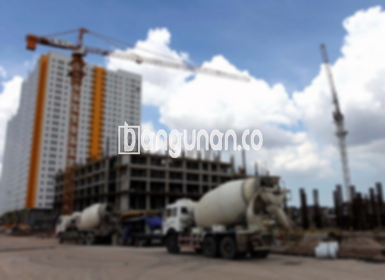

**Jasa Cor Beton Readymix & Jayamix Di Cimanggu Cilacap** – Cor Readymix atau adukan beton siap pakai adalah formulasi material beton yang dirancang khusus untuk pengecoran instan atau cepat. Pada dasarnya, jenis material yang digunakan serupa dengan campuran beton konvensional, yakni terdiri dari pasir beton, batu split, semen, dan air. Komposisi dan takaran yang tepat memastikan kualitas beton sesuai target spesifikasi. Sebagai Mitra Bangunan yang terpercaya di Cimanggu Cilacap, kami menyediakan solusi pengecoran praktis dan berkualitas tinggi.



## Mengapa Memilih Layanan Cor Beton dari bangunan.co di Cimanggu Cilacap?

Pengadukan beton dengan teknologi modern bertujuan untuk mempercepat progres konstruksi serta menjamin mutu yang konsisten. Dengan layanan dari bangunan.co, Anda dapat fokus pada aspek penting lain dari proyek Anda. Mutu beton yang terstandarisasi memastikan hasil sesuai dengan standar kualitas yang diinginkan, sesuai dengan rencana konstruksi.

Cor Readymix merupakan jenis beton siap pakai karena telah dipersiapkan secara cermat di pabrik pengolahan beton. Beton ini siap dituang dan diratakan langsung di lokasi, meminimalkan proses persiapan yang memakan waktu. Anda tidak perlu lagi khawatir tentang pencampuran manual yang berpotensi menurunkan kualitas. Cukup siapkan bekisting yang kokoh untuk menampung beton yang akan dituang.

Kualitas beton dijaga melalui pengawasan ketat di pabrik pengolahan beton, mulai dari penimbangan material hingga pengiriman. Proses ini memastikan mutu beton terjamin dan konsisten, membebaskan Anda dari kerumitan memastikan kualitas bahan dan pencampuran yang tepat. Dengan demikian, Anda dapat mengoptimalkan waktu dan biaya proyek.

## Keunggulan dan Pertimbangan Beton Readymix dari bangunan.co di Cimanggu Cilacap

Beton yang diproduksi di pabrik pengolahan beton, seperti bangunan.co, memiliki keunggulan dibandingkan dengan campuran manual tradisional. Berikut perbandingan keunggulan dan pertimbangan penggunaan beton readymix:

Keunggulan beton readymix:

1.  Campuran presisi untuk kualitas dan mutu yang optimal.
2.  Kualitas beton yang merata berkat proses pencampuran terstandarisasi.
3.  Penggunaan material berkualitas tinggi, dipilih secara selektif untuk menghasilkan beton terbaik.
4.  Proses pengolahan yang cepat dan efisien, menghemat biaya serta waktu pengerjaan.
5.  Anda tidak perlu repot menentukan campuran mutu beton yang tepat, karena formulasi telah disesuaikan dengan kebutuhan konstruksi Anda.

Sedangkan, pertimbangan penggunaan beton readymix:

Pemesanan beton readymix memerlukan penjadwalan dan survei lokasi untuk menentukan volume yang dibutuhkan. Hal ini memastikan ketersediaan material dan mencegah kelebihan atau kekurangan pasokan saat pengiriman.

## Jenis Kualitas Beton yang Paling Banyak Digunakan di Cimanggu Cilacap

Kualitas beton K225 adalah yang paling banyak digunakan, khususnya untuk pengecoran dak rumah atau lantai dua ke atas. K225 dirancang untuk aplikasi ini, memberikan kekuatan dan daya tahan yang memadai. Namun, mutu ini juga bisa diaplikasikan untuk pengecoran jalan gang yang tidak dilalui kendaraan berat.

Mutu beton K250 dan K300 juga populer untuk pengecoran tiang, pondasi, atau cakar ayam. Untuk jalan pedesaan, mutu K250, K300, dan K350 sering digunakan. Mutu yang lebih tinggi dari K350, seperti K375, K400, K500, dan seterusnya, lazim dipakai untuk beton *fast track* yang membutuhkan pengeringan cepat. Contoh penggunaan meliputi jalan tol atau area parkir yang membutuhkan daya dukung tinggi dan waktu pengerjaan singkat.

## bangunan.co: Jasa Cor Beton Readymix & Jayamix yang Mengutamakan Kualitas di Cimanggu Cilacap



Untuk menghasilkan beton cor readymix atau *ready mix concrete* berkualitas tinggi, perancangan campuran harus presisi. Beton dengan performa optimal membutuhkan kekuatan yang sesuai dengan mutu yang diinginkan dan ketahanan terhadap kerusakan. Komposisi campuran harus mengikuti Standar Nasional Indonesia (SNI) untuk memastikan mutu terjamin. Komposisi umumnya terdiri dari 10% hingga 15% semen Portland, 60% hingga 75% agregat halus dan kasar (pasir dan split), dan 10% hingga 15% air. Sisa komposisi berupa kandungan udara yang terperangkap dalam campuran.

Meminimalisir rasio air dan semen dapat meningkatkan kualitas beton tanpa mengorbankan kemampuan kerja. Semakin sedikit air yang digunakan, semakin tinggi kualitas beton yang dihasilkan. Namun, air yang digunakan harus bersih dan bebas dari kontaminan seperti lumpur, tanah liat, atau lumut. Penggunaan air yang tercemar dapat menyebabkan penurunan mutu beton.

Sebagai Mitra Bangunan terpercaya di Cimanggu Cilacap, bangunan.co berkomitmen menyediakan solusi cor beton readymix dan jayamix berkualitas tinggi untuk setiap proyek Anda.

**Ref by:** [Cor Beton Readymix & Jayamix Cimanggu Cilacap](https://id.wikipedia.org/wiki/Cor)