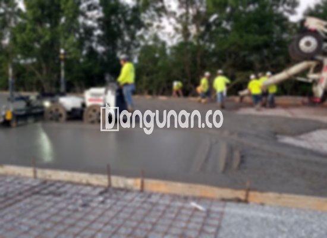

**Jasa Cor Beton Readymix & Jayamix Di Cipari Cilacap** – Bagi Mitra Bangunan yang berencana membangun di Cipari Cilacap, beton readymix dari bangunan.co adalah solusi ideal untuk pengecoran yang cepat, efisien, dan berkualitas tinggi. Adalah campuran material beton yang diformulasikan secara khusus untuk pengecoran instan, terdiri dari pasir, batu pecah, semen, dan air dengan komposisi yang presisi. Dengan begitu, Anda mendapatkan kualitas beton yang konsisten dan sesuai dengan kebutuhan proyek Anda.



## Mengoptimalkan Pengecoran dengan Layanan Profesional di Cipari Cilacap

Jasa pengadukan beton dari bangunan.co hadir untuk mempercepat proses pembangunan Anda dan memastikan kualitas beton yang terjamin. Formulasi yang tepat memungkinkan Anda mengoptimalkan proyek konstruksi dengan material yang memiliki kekuatan sesuai standar yang Anda butuhkan. Layanan ini sangat cocok bagi Anda yang menginginkan efisiensi dan hasil pekerjaan yang tahan lama.

Beton ready mix menawarkan beragam pilihan mutu yang dapat disesuaikan dengan aplikasi konstruksi yang berbeda. Dikenal sebagai beton cair siap pakai, material ini telah dipersiapkan secara khusus di pabrik kami, sehingga siap digunakan langsung di lokasi proyek. Ini memungkinkan Anda menghemat waktu dan tenaga, serta menghindari potensi kesalahan dalam proses pencampuran manual. Fokus Anda dapat sepenuhnya tertuju pada persiapan bekisting sebagai penopang pengecoran.

Pengendalian mutu yang ketat dilakukan mulai dari pengadukan hingga pengiriman, memastikan bahwa beton dari bangunan.co memenuhi standar kualitas yang ditetapkan. Ini memberikan jaminan kepada para pelaku konstruksi di Cipari Cilacap bahwa mereka mendapatkan material yang andal dan terpercaya untuk proyek mereka.

## Keunggulan dan Pertimbangan dalam Penggunaan Beton Readymix

Terdapat perbedaan signifikan antara beton yang diproduksi di pabrik pengolahan beton bangunan.co dan beton yang dicampur secara manual di lokasi proyek. Masing-masing memiliki kelebihan dan kekurangan tersendiri yang perlu Anda pertimbangkan.

Berikut adalah beberapa keunggulan beton yang diproduksi di pabrik kami:

1.  Kualitas mutu yang terjamin dan konsisten di setiap pengiriman.
2.  Keseragaman kualitas karena proses pencampuran yang terkontrol dan terkalibrasi.
3.  Penggunaan material berkualitas tinggi yang dipilih secara cermat untuk mencapai mutu beton yang optimal.
4.  Efisiensi waktu dan biaya, serta proses pengolahan yang tepat dan modern.
5.  Kemudahan penggunaan – Anda tidak perlu melakukan perhitungan atau perumusan adukan beton sendiri.

Namun, penting untuk diingat bahwa pemesanan beton readymix memerlukan penjadwalan yang matang dan survei lokasi untuk menentukan kebutuhan volume yang akurat. Hal ini bertujuan untuk memastikan ketersediaan beton yang cukup saat diperlukan, tanpa menghasilkan sisa material yang berlebihan.

## Jenis Mutu Beton yang Sering Digunakan di Cipari Cilacap

Salah satu jenis mutu beton yang paling umum digunakan di Cipari Cilacap adalah K225. Mutu ini sangat ideal untuk pengecoran dak rumah, lantai dua ke atas, dan juga cocok untuk pengecoran jalan gang yang tidak memiliki lalu lintas kendaraan berat secara rutin.

Selain K225, mutu K250 dan K300 juga banyak digunakan untuk pengecoran tiang, pondasi, atau cakar ayam. Untuk jalan pedesaan, mutu K250, K300, dan K350 sering menjadi pilihan yang tepat karena menawarkan kombinasi kekuatan dan daya tahan yang baik. Mutu beton yang lebih tinggi, seperti K375, K400, dan K500, biasanya digunakan untuk kebutuhan khusus seperti beton *fast track* yang memerlukan waktu pengeringan yang sangat cepat, misalnya untuk proyek jalan tol, lahan parkir, atau konstruksi yang membutuhkan kekuatan ekstra.

## Jasa Cor Beton Readymix & Jayamix Dari bangunan.co Menjamin Kualitas Terbaik



Kualitas beton readymix dari bangunan.co adalah prioritas utama kami. Campuran beton yang ideal perlu dirancang secara cermat untuk memastikan kinerja dan daya tahan yang optimal. Standar komposisi kami meliputi penggunaan 10% hingga 15% semen Portland, 60% hingga 75% agregat halus dan kasar (pasir dan split), serta 10% hingga 15% air. Kandungan udara juga diperhitungkan untuk memastikan beton memiliki karakteristik yang sesuai.

Untuk menghasilkan beton berkualitas tinggi, rasio air terhadap semen diminimalkan tanpa mengorbankan kemampuan kerja beton segar. Penggunaan air bersih yang bebas dari kotoran dan lumut sangat penting untuk menjaga mutu beton. Dengan tim ahli dan proses produksi yang modern, bangunan.co menjamin kualitas beton yang terbaik untuk proyek Anda di Cipari Cilacap.

**Ref by:** [Cor Beton Readymix & Jayamix Cipari Cilacap](https://id.wikipedia.org/wiki/Cor)

Mitra Bangunan yang sedang mencari jasa cor beton readymix dan jayamix terpercaya di Cipari Cilacap, jangan ragu untuk menghubungi kami melalui tombol WhatsApp atau Telepon yang tersedia di halaman ini. Kami siap memberikan solusi konstruksi yang berkualitas dan sesuai dengan kebutuhan Anda.