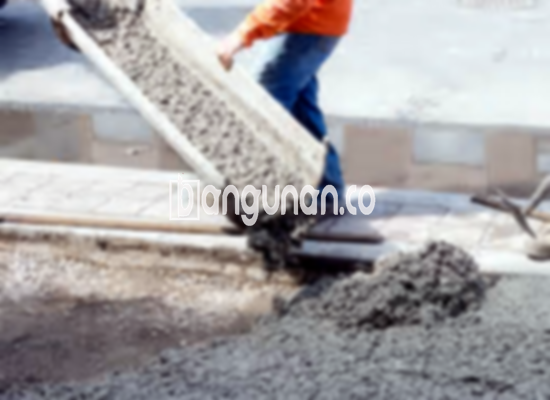

**Jasa Cor Beton Readymix & Jayamix Di Cluwak Pati** – Bagi Mitra Bangunan yang tengah merencanakan pembangunan di Cluwak Pati, layanan cor beton readymix dari bangunan.co adalah penyediaan adukan beton siap pakai yang praktis dan efisien. Beton siap pakai ini merupakan campuran material beton yang dirancang dengan ketepatan tinggi untuk pengecoran yang cepat dan akurat, dengan komposisi yang terdiri dari pasir beton, agregat kasar, semen, dan air. Dengan formulasi dan proporsi yang telah diatur secara cermat, mutu beton yang dihasilkan dapat disesuaikan dengan kebutuhan proyek Anda.



## Keuntungan Menggunakan Jasa Cor Beton Readymix & Jayamix bangunan.co di Cluwak Pati

Penyediaan adukan beton ini bertujuan memperlancar proses pengecoran sekaligus menjamin kualitas yang konsisten. Dengan memanfaatkan readymix dari bangunan.co, Anda dapat mengoptimalkan waktu pengerjaan dan memastikan bahwa kualitas beton yang dihasilkan memenuhi standar yang Anda harapkan. Hal ini sangat penting bagi kelancaran proyek konstruksi yang Anda rencanakan.

Beton Cor Readymix dari bangunan.co menawarkan berbagai mutu beton yang dapat disesuaikan dengan jenis pekerjaan yang akan dikerjakan. Produk ini juga dikenal sebagai beton cair siap pakai karena telah dipersiapkan secara khusus di pabrik pengolahan beton kami. Beton ini siap digunakan langsung di lokasi proyek setelah pengiriman. Dengan demikian, Anda tidak perlu lagi memikirkan proses pencampuran bahan secara manual dan memastikan perbandingan yang tepat. Anda dapat fokus mempersiapkan bekisting yang kokoh sebagai penyangga saat pengecoran.

Kualitas beton yang dihasilkan bangunan.co dikendalikan secara ketat oleh tim ahli kami di pabrik (*batching plant*) selama proses pencampuran bahan hingga pengiriman. Hal ini menjamin bahwa beton yang sampai di lokasi Anda memiliki mutu yang stabil dan terpercaya. Dengan demikian, Anda dapat memusatkan perhatian pada aspek-aspek penting lainnya dari proyek konstruksi Anda. Ini mempermudah seluruh proses pengembangan proyek yang melibatkan konstruksi beton, mengurangi waktu dan meminimalkan kekhawatiran tentang kualitas bahan. 

## Keunggulan dan Pertimbangan Memilih Beton Readymix bangunan.co di Cluwak Pati

Terdapat perbedaan signifikan antara beton yang diproduksi di pabrik bangunan.co dan beton yang dicampur secara manual di lapangan. Masing-masing memiliki kelebihan dan kekurangan yang perlu Anda pertimbangkan dengan seksama. Berikut adalah perbandingan yang lebih rinci:

Beton yang diproduksi oleh bangunan.co memiliki beberapa keunggulan utama:

1.  **Kualitas Mutu Terjamin:** Adukan beton diformulasikan untuk memenuhi mutu yang dipesan secara akurat.
2.  **Konsistensi Mutu:** Proses pencampuran yang homogen menghasilkan mutu beton yang seragam di setiap pengiriman.
3.  **Kualitas Material Unggul:** bangunan.co hanya menggunakan bahan material pilihan terbaik untuk mencapai mutu beton yang optimal.
4.  **Efisiensi Waktu & Biaya:** Proses produksi yang efisien membantu menghemat waktu dan biaya proyek Anda.
5.  **Praktis dan Mudah:** Anda tidak perlu khawatir tentang perbandingan campuran yang tepat karena bangunan.co telah menghitungnya sesuai dengan kebutuhan spesifik proyek Anda.

Meskipun demikian, ada beberapa hal yang perlu Anda ketahui. Pemesanan beton readymix dari bangunan.co biasanya memerlukan penjadwalan karena proses produksi yang terkelola. Selain itu, perlu dilakukan survei lokasi awal untuk memperkirakan volume kubikasi yang dibutuhkan. Hal ini bertujuan untuk memastikan ketersediaan beton yang cukup tanpa membuang sumber daya.

## Jenis Mutu Beton yang Sering Diaplikasikan di Cluwak Pati

Salah satu mutu beton yang paling sering digunakan dalam proyek konstruksi di Cluwak Pati adalah K-225. Mutu beton K-225 merupakan pilihan yang sangat baik untuk pengecoran dak rumah atau lantai atas, karena dirancang khusus untuk aplikasi tersebut. Selain itu, mutu ini juga cocok digunakan untuk pengecoran jalan gang yang tidak menanggung beban berat kendaraan truk.

Pilihan lain yang juga sering dipilih adalah mutu beton K-250 dan K-300 dari bangunan.co. Mutu ini umumnya digunakan untuk pengecoran tiang, pondasi, atau cakar ayam. Pembuatan jalan pedesaan seringkali menggunakan mutu K-250, K-300, bahkan K-350 tergantung pada kondisi lalu lintas dan berat beban yang akan ditanggung. Untuk keperluan yang membutuhkan kekuatan dan daya tahan ekstra, mutu beton yang lebih tinggi seperti K-375, K-400, atau K-500 dari bangunan.co sering menjadi pilihan. Beton dengan mutu tinggi ini dikenal sebagai *fast track concrete*, memungkinkan struktur beton mengeras dan siap digunakan dalam waktu singkat.

## bangunan.co Memprioritaskan Kualitas Cor Beton di Cluwak Pati



Untuk menjamin kualitas beton terbaik, campuran cor readymix dari bangunan.co dirancang secara cermat berdasarkan standar mutu nasional (SNI). Komposisi yang ideal terdiri dari 10% hingga 15% semen Portland, 60% hingga 75% agregat halus dan kasar (pasir dan split), dan 10% hingga 15% air. Selebihnya adalah kandungan udara yang alami dalam campuran. 

Beton berkualitas tinggi dari bangunan.co diproduksi dengan meminimalkan rasio air terhadap semen tanpa mengorbankan kemampuan kerja beton. Penggunaan air bersih adalah kunci penting untuk mencegah kontaminasi yang dapat menurunkan kualitas beton. bangunan.co hanya menggunakan air yang bersih dan bebas dari kotoran, lumpur, dan lumut. Semakin sedikit air yang digunakan, semakin baik mutu beton yang dihasilkan.

Mitra Bangunan yang sedang mencari jasa cor beton readymix dan jayamix di Cluwak Pati, hubungi bangunan.co melalui tombol WhatsApp atau Telepon di halaman website kami. Kami siap membantu memenuhi kebutuhan beton Anda dengan solusi yang tepat dan berkualitas.

**Ref by:** [Cor Beton Readymix & Jayamix Cluwak Pati](https://id.wikipedia.org/wiki/Cor)