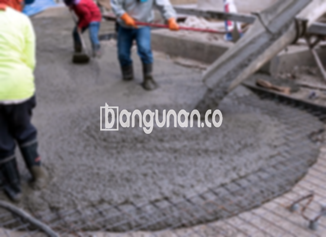

**Jasa Cor Beton Readymix & Jayamix Di Comal Pemalang** – Bagi Mitra Bangunan di Comal Pemalang, bangunan.co hadir dengan solusi pengecoran modern: cor readymix atau adukan beton siap pakai. Material ini dirancang khusus untuk mempercepat pengerjaan konstruksi dengan kualitas yang terjamin, menggunakan campuran bahan terpilih seperti pasir beton, kerikil, semen, dan air dengan komposisi optimal.



## Mengoptimalkan Pengecoran dengan Layanan Profesional dari bangunan.co di Comal Pemalang

Penggunaan adukan beton siap pakai merupakan pilihan cerdas untuk efisiensi waktu dan mutu konstruksi. Hal ini memungkinkan penyelesaian proyek pengecoran dengan lebih cepat dan akurat, sesuai dengan standar kualitas yang diharapkan. Dengan mutu yang terjamin, bangunan.co memastikan beton yang Anda gunakan benar-benar sesuai dengan spesifikasi dan kebutuhan konstruksi yang direncanakan.

Beton ready mix dari bangunan.co menawarkan beragam pilihan mutu yang bisa disesuaikan dengan kebutuhan spesifik proyek Anda. Produk ini dikenal juga sebagai beton cair siap pakai karena telah diproses secara khusus di pabrik kami, sehingga siap langsung digunakan saat tiba di lokasi proyek. Ini berarti Anda dapat menghemat waktu dan tenaga karena tidak perlu lagi melakukan pencampuran beton secara manual di lokasi. Fokus Anda dapat sepenuhnya ditujukan pada persiapan konstruksi bekisting sebagai cetakan beton.

Proses pengendalian kualitas beton dilakukan secara ketat oleh tim ahli bangunan.co, mulai dari seleksi bahan baku hingga proses pencampuran dan pengiriman. Ini menjamin kualitas beton yang seragam dan konsisten, serta memberikan kemudahan bagi para pelaku konstruksi dalam mendapatkan material berkualitas tanpa perlu khawatir akan variasi kualitas.

## Keuntungan dan Pertimbangan dalam Memilih Cor Readymix dari bangunan.co di Comal Pemalang

Tentu saja, ada perbedaan signifikan antara beton yang dicampur oleh pabrik pengolahan bangunan.co dengan beton yang dicampur secara manual oleh tukang bangunan. Masing-masing metode memiliki keunggulan dan kekurangan yang perlu dipertimbangkan. Di bawah ini adalah perbandingan detailnya:

Beton yang diproduksi oleh pabrik bangunan.co menawarkan beberapa keunggulan utama:

1.  Kualitas adukan terjamin dengan mutu yang ideal dan konsisten.
2.  Distribusi material adukan yang merata memastikan kekuatan beton yang seragam.
3.  Penggunaan bahan material berkualitas tinggi memastikan kekuatan dan daya tahan beton.
4.  Efisiensi waktu dan biaya karena proses pengolahan yang cepat dan tepat.
5.  Anda tidak perlu lagi khawatir mengenai perbandingan campuran yang tepat, karena bangunan.co telah menghitung dan mencampurkan semuanya secara akurat sesuai dengan spesifikasi proyek Anda.

Meskipun demikian, perlu diingat bahwa:

Pemesanan beton readymix dari bangunan.co memerlukan perencanaan karena tidak dapat diproses secara instan. Pembelian memerlukan penjadwalan untuk memastikan ketersediaan dan pengiriman tepat waktu. Selain itu, bangunan.co akan melakukan survei lokasi untuk menghitung volume beton yang dibutuhkan secara akurat, guna mencegah kelebihan atau kekurangan material saat tiba di tempat proyek.

## Jenis Mutu Beton yang Paling Banyak Dicari di Comal Pemalang

Salah satu jenis beton yang paling populer dan banyak digunakan dalam proyek-proyek di Comal Pemalang adalah mutu beton K225. Mutu ini sangat cocok untuk pengecoran dak rumah, lantai 2, atau struktur bangunan yang tidak memerlukan kekuatan yang sangat tinggi. Selain itu, K225 juga dapat digunakan untuk pengecoran jalan gang yang tidak sering dilalui kendaraan berat.

Selain K225, mutu beton K250 dan K300 juga banyak diminati. K250 dan K300 secara umum digunakan untuk pengecoran tiang, pondasi, atau cakar ayam. Untuk proyek jalan pedesaan, biasanya digunakan mutu K250, K300, atau bahkan K350 untuk memastikan daya tahan dan kekuatan jalan. Mutu beton di atas K350 seperti K375, K400, dan K500 sering digunakan untuk proyek yang membutuhkan kekuatan beton tinggi dan waktu pengeringan yang cepat, seperti jalan tol atau area parkir dengan beban berat. Jenis beton ini juga dikenal sebagai beton *fast track*.

## bangunan.co Prioritaskan Mutu dan Konsistensi Cor Beton di Comal Pemalang



Dalam memproduksi cor readymix atau ready mix concrete, bangunan.co selalu berupaya untuk menciptakan adukan yang dirancang dengan cermat dan diproduksi sebaik mungkin. Hal ini dilakukan untuk menghasilkan beton dengan performa optimal dan ketahanan yang teruji. Kami memastikan bahwa campuran bahan-bahan beton memenuhi standar campuran beton nasional (SNI), yang meliputi sekitar 10-15% semen Portland, 60-75% agregat halus dan kasar (pasir dan split), serta 10-15% air. Elemen udara juga merupakan komponen penting dalam campuran beton.

Beton berkualitas tinggi dihasilkan melalui proses pengolahan yang mengutamakan pengurangan rasio air terhadap semen tanpa mengorbankan kemudahan saat proses pengerjaan. bangunan.co hanya menggunakan air bersih dan bebas dari kontaminan seperti lumpur atau lumut, karena kotoran tersebut dapat menurunkan kualitas beton secara signifikan.

Mitra Bangunan yang sedang mencari solusi pengecoran beton readymix dan jayamix di Comal Pemalang, jangan ragu untuk menghubungi bangunan.co melalui tombol WhatsApp atau Telepon yang tersedia di halaman ini. Kami siap membantu mewujudkan proyek konstruksi Anda dengan mutu terbaik dan pelayanan yang profesional.

**Ref by:** [Cor Beton Readymix & Jayamix Comal Pemalang](https://id.wikipedia.org/wiki/Cor)