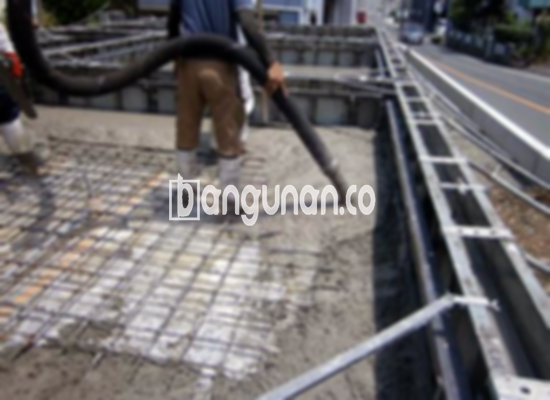

**Jasa Cor Beton Readymix & Jayamix Di Dawe Kudus** – Bagi Mitra Bangunan yang sedang merencanakan proyek konstruksi, beton cor *readymix* atau adukan beton siap pakai dari bangunan.co adalah solusi efisien dan terpercaya. Material ini diformulasikan secara presisi untuk memberikan pengecoran instan dengan kualitas terjamin, terdiri dari campuran pasir beton, batu pecah, semen, serta air dengan proporsi yang telah ditentukan untuk mencapai mutu beton yang diinginkan sesuai kebutuhan proyek Anda.



## Mengoptimalkan Pengecoran dengan Campuran Beton Modern di Dawe Kudus

Penggunaan campuran beton yang diproses melalui pabrik pengolahan beton modern dirancang untuk mempercepat proses konstruksi sekaligus memastikan kualitas beton yang konsisten dan andal. Dengan mutu yang terukur secara presisi, Anda dapat memastikan bahwa setiap elemen konstruksi yang Anda bangun memenuhi standar kualitas yang diinginkan dan selaras dengan perencanaan proyek. 

Beton *ready mix* tersedia dalam berbagai tingkatan mutu, sehingga Anda dapat memilih yang paling sesuai dengan kebutuhan spesifik proyek Anda. Produk ini dikenal sebagai beton cair siap pakai karena telah diproduksi di pabrik pengolahan beton, siap digunakan langsung di lokasi proyek. Kemudahan ini memungkinkan Anda untuk langsung menuangkan dan meratakan beton tanpa repot mencampurnya sendiri, hanya membutuhkan persiapan bekisting yang memadai sebagai wadah cetakan. 

Pengendalian mutu yang ketat diterapkan di pabrik pengolahan beton, mulai dari proses pencampuran bahan hingga pengiriman, memastikan kualitas beton yang optimal dan meminimalkan risiko kesalahan. Dengan demikian, para pelaku konstruksi dapat lebih fokus pada pelaksanaan proyek secara efisien, tanpa perlu menghabiskan waktu untuk memastikan kualitas dan takaran bahan secara manual.

## Keunggulan dan Pertimbangan Penggunaan Beton Cor Readymix di Dawe Kudus

Terdapat perbedaan signifikan antara beton yang dicampur di pabrik pengolahan beton (batching plant) dan beton yang dicampur secara manual oleh tukang bangunan, masing-masing memiliki kelebihan dan kekurangannya sendiri. Berikut adalah perbandingan lebih rinci:

Beton yang dicampur di pabrik pengolahan beton menawarkan beberapa keunggulan utama:

1.  Kualitas campuran yang konsisten dan sesuai standar yang ditetapkan.
2.  Mutu beton yang merata karena proses pencampuran yang dilakukan oleh mesin presisi.
3.  Penggunaan material berkualitas tinggi yang dipilih secara selektif untuk mencapai mutu beton terbaik.
4.  Efisiensi waktu dan biaya dalam proses pengolahan dan konstruksi.
5.  Anda tidak perlu lagi pusing memikirkan komposisi atau takaran adukan beton yang tepat, karena pabrik telah mengoptimalkannya sesuai dengan kebutuhan konstruksi Anda.

Sebagai pertimbangan, terdapat juga beberapa kekurangan yang perlu dipertimbangkan:

Pemesanan beton *readymix* umumnya memerlukan penjadwalan karena tidak dapat diproses secara instan. Selain itu, survei lokasi perlu dilakukan untuk memperkirakan volume kubikasi yang dibutuhkan, guna memastikan ketersediaan pasokan yang cukup tanpa menyebabkan kelebihan produksi atau kekurangan material.

## Ragam Mutu Beton yang Paling Banyak Digunakan di Dawe Kudus

Kualitas beton K225 adalah salah satu pilihan yang paling umum digunakan, terutama untuk pengecoran dak rumah atau lantai dua ke atas. Kualitas ini dirancang khusus untuk aplikasi tersebut, menawarkan kekuatan yang memadai untuk menopang beban dan memastikan keamanan struktur. Selain itu, beton K225 juga cocok untuk pengecoran jalan gang yang tidak diperuntukkan untuk lalu lintas kendaraan berat.

Kualitas beton K250 dan K300 juga sering diaplikasikan, terutama untuk pengecoran tiang, pondasi, atau cakar ayam. K250 juga banyak digunakan untuk jalan pedesaan. Untuk kebutuhan yang lebih tinggi, mutu beton K350, K375, K400, dan K500 biasanya digunakan dalam proyek-proyek yang memerlukan kekuatan dan kecepatan pengerasan yang lebih besar, seperti jalan tol atau area parkir yang menahan beban berat dan membutuhkan waktu pengerjaan yang singkat. Mutu beton ini dikenal sebagai beton *fast track*.

## bangunan.co: Jaminan Kualitas Beton di Dawe Kudus



Formulasi campuran beton *readymix* harus dilakukan dengan sangat cermat agar menghasilkan beton dengan daya kerja yang baik dan kekuatan yang optimal. Untuk mencapai hal ini, beton harus memenuhi standar adukan beton nasional (SNI). Proporsi standar meliputi 10% hingga 15% semen Portland, 60% hingga 75% agregat halus dan kasar (pasir dan split), serta 10% hingga 15% air, sementara sisanya adalah udara yang penting untuk memastikan kemudahan dalam pengerjaan beton.

Kualitas tinggi beton dicapai dengan meminimalkan rasio air-semen tanpa mengurangi daya kerja beton saat masih segar. Penggunaan air bersih yang bebas dari kotoran dan lumut sangat penting untuk menjaga kualitas beton. Air yang digunakan haruslah bersih dan tidak mengandung bahan-bahan yang dapat mengurangi kekuatan dan daya tahan beton.

Dengan demikian, Mitra Bangunan dapat yakin bahwa produk beton bangunan.co akan memberikan hasil yang optimal pada proyek konstruksi Anda di Dawe Kudus. Silahkan hubungi kami untuk mendapatkan penawaran harga terbaik dan layanan konsultasi dari tim ahli kami.

**Ref by:** [Cor Beton Readymix & Jayamix Dawe Kudus](https://id.wikipedia.org/wiki/Cor)