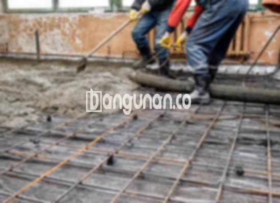

**Jasa Cor Beton Readymix & Jayamix Di Dayeuhluhur Cilacap** – Mencari solusi konstruksi yang efisien dan terpercaya di Dayeuhluhur Cilacap? Layanan cor readymix atau adukan beton siap pakai dari bangunan.co adalah jawaban yang tepat. Kami menyediakan komposisi material beton yang dirancang khusus untuk pengecoran instan, menggunakan pasir beton, batu pecah, semen, dan air dengan takaran yang telah ditetapkan demi kualitas optimal. Mitra Bangunan hadir untuk memastikan fondasi kokoh bagi proyek Anda.



## Mengapa Layanan Cor Beton Readymix & Jayamix dari bangunan.co di Dayeuhluhur Cilacap Menjadi Pilihan Terbaik?

Pembuatan adukan beton siap pakai ini bertujuan untuk mempercepat proses pembangunan sekaligus menjamin mutu yang konsisten. Dengan mutu yang terstandarisasi, Anda dapat memastikan bahwa beton yang digunakan memenuhi spesifikasi proyek dan standar konstruksi yang berlaku.

Cor Readymix dari bangunan.co dikenal sebagai solusi praktis karena sudah siap digunakan begitu tiba di lokasi proyek. Beton ini telah dicampur secara optimal di pabrik kami, sehingga Anda hanya perlu menuangkan dan meratakan pada bekisting yang sudah disiapkan. Ini sangat ideal bagi Anda yang ingin menghemat waktu dan tenaga. Pihak proyek hanya perlu memastikan kesiapan lokasi dan bekisting sebagai penopang saat pengecoran.

Kualitas beton dipantau ketat di setiap tahap produksi, mulai dari pemilihan material hingga proses pengiriman. Hal ini menjamin Anda mendapatkan beton dengan kualitas yang terpercaya dan konsisten, membantu kelancaran proyek konstruksi Anda di Dayeuhluhur Cilacap.

## Kelebihan dan Kekurangan Cor Beton Readymix Dibandingkan Adonan Manual

Beton yang diproduksi di pabrik pengolahan beton bangunan.co tentu memiliki karakteristik berbeda dengan beton yang dicampur secara manual di lapangan. Kedua metode memiliki kelebihan dan kekurangan masing-masing.

Berikut adalah keunggulan beton yang diproduksi di pabrik:

1.  Komposisi yang tepat dan kualitas yang terjamin konsistensinya.
2.  Mutu beton yang seragam karena proses pencampuran yang dikontrol secara ketat.
3.  Penggunaan material konstruksi pilihan dengan grade terbaik untuk menghasilkan beton berkualitas tinggi.
4.  Efisiensi waktu dan biaya, karena proses pengolahan dilakukan dengan cepat dan efisien.
5.  Anda tidak perlu khawatir menentukan formula campuran beton yang sesuai untuk konstruksi Anda, karena kami sudah menghitungnya sesuai standar.

Sebagai pertimbangan, perlu diketahui juga bahwa pemesanan beton readymix dari bangunan.co memerlukan perencanaan yang matang. Pemesanan tidak bisa dilakukan secara spontan dan umumnya memerlukan penjadwalan. Tim kami juga perlu melakukan survei lokasi untuk memperkirakan volume beton yang dibutuhkan, guna menghindari kelebihan atau kekurangan material.

## Jenis Mutu Beton yang Sering Digunakan di Proyek Dayeuhluhur Cilacap

Jenis beton yang paling sering digunakan di berbagai proyek di Dayeuhluhur Cilacap adalah mutu beton struktural K225. Kwalitas beton K225 ideal untuk pengecoran dak rumah, atau lantai dua ke atas, karena dirancang khusus untuk menahan beban pada area tersebut. Penggunaan mutu K225 juga memungkinkan untuk pengecoran jalan gang yang tidak dilalui kendaraan berat.

Selain itu, mutu beton K250 dan K300 juga populer dan sering diaplikasikan. K250 dan K300 umumnya digunakan untuk pengecoran tiang, pondasi, atau cakar ayam. Untuk jalan pedesaan, K250, K300, hingga K350 juga menjadi pilihan yang tepat. 

Untuk aplikasi yang membutuhkan kekuatan dan kecepatan pengerasan yang lebih tinggi, seperti pembangunan jalan tol atau area parkir yang menahan beban berat, mutu beton K400 ke atas (seperti K375, K400, K500, dan seterusnya) dikenal sebagai beton *fast track*. Mutu beton ini memungkinkan konstruksi selesai dengan lebih cepat.

## bangunan.co Memprioritaskan Kualitas Beton dalam Setiap Layanan di Dayeuhluhur Cilacap



Proses pencampuran cor readymix harus dirancang dengan baik untuk memastikan beton memiliki daya kerja dan ketahanan sesuai harapan. Komposisi adukan beton perlu memenuhi Standar Nasional Indonesia (SNI).

Secara umum, campuran beton terdiri dari: 10-15% semen Portland, 60-75% agregat halus dan kasar (pasir dan split), dan 10-15% air. Sisanya adalah udara, karena campuran padat tetap membutuhkan rongga udara.

Beton berkualitas tinggi diproduksi dengan meminimalkan rasio air terhadap semen tanpa mengorbankan kemudahan pengerjaan beton segar. Semakin rendah rasio air, semakin tinggi kualitas beton. Penting untuk menggunakan air bersih yang bebas dari kotoran, lumut, atau kontaminan lain yang dapat mengurangi mutu beton. Penggunaan air yang bersih merupakan kunci untuk menghasilkan beton yang kuat dan tahan lama.

**Ref by:** [Cor Beton Readymix & Jayamix Dayeuhluhur Cilacap](https://id.wikipedia.org/wiki/Cor)

Mitra Bangunan dari bangunan.co siap melayani kebutuhan cor beton readymix dan jayamix Anda di Dayeuhluhur Cilacap. Untuk informasi detail mengenai harga, silakan hubungi kami melalui tombol WhatsApp atau Telepon yang tersedia di halaman ini. Kami siap membantu Anda merencanakan dan melaksanakan proyek konstruksi yang berkualitas dan terpercaya.