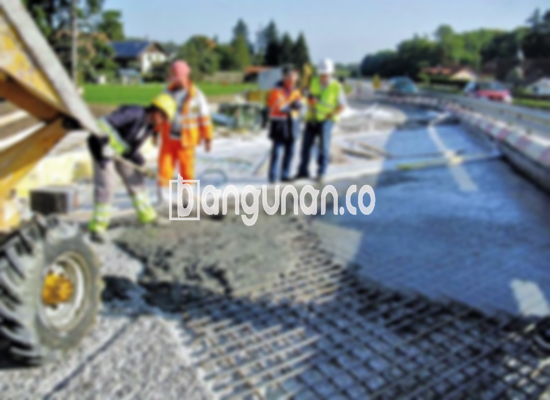

**Jasa Cor Beton Readymix & Jayamix Di Depok Sleman** – Mencari solusi pengecoran yang praktis, efisien, dan berkualitas tinggi di Depok Sleman? Layanan readymix dan jayamix dari Bangunan.co adalah pilihan tepat untuk Anda. Kami menyediakan campuran beton siap pakai yang dirancang presisi untuk menjamin kekuatan dan daya tahan optimal bagi setiap proyek konstruksi Anda. Mitra Bangunan mengerti betul kebutuhan konstruksi modern, dan kami hadir untuk memberikan solusi terbaik.



## Mengapa Memilih Jasa Cor Beton Readymix & Jayamix dari Bangunan.co di Depok Sleman?

Penyediaan campuran beton modern ini bertujuan mempermudah sekaligus mempercepat proses pengecoran. Dengan memanfaatkan layanan kami, Anda diharapkan dapat menjalankan pekerjaan konstruksi dengan efisien dan mencapai standar mutu yang diharapkan, sesuai dengan spesifikasi proyek yang direncanakan. Cor beton readymix menawarkan berbagai pilihan mutu yang disesuaikan dengan kebutuhan spesifik proyek Anda. Seringkali disebut juga sebagai *ready mix concrete*, adukan ini telah disiapkan secara khusus di pabrik pengolah beton agar siap digunakan. Ini berarti, beton ini langsung dapat dicurahkan dan diratakan di lokasi proyek tanpa perlu proses pencampuran manual yang memakan waktu dan berpotensi menurunkan kualitas. Anda hanya perlu menyiapkan bekisting sebagai penyangga beton.

Proses kontrol kualitas yang ketat diterapkan mulai dari pencampuran material hingga pengiriman oleh tim Bangunan.co (batching plant). Hal ini tentu mempermudah para pelaku konstruksi di Depok Sleman dalam mendapatkan beton berkualitas tanpa harus repot memikirkan kualitas bahan dan formulasi campuran yang tepat.

## Kelebihan dan Kekurangan Cor Readymix Dibandingkan Cara Tradisional Menurut Bangunan.co di Depok Sleman

Terdapat perbedaan signifikan antara beton yang diproses di pabrik pengolahan beton (batching plant) dan beton yang dicampur secara manual oleh tukang bangunan. Masing-masing memiliki kelebihan dan kekurangannya. Berikut adalah perbandingan mendetailnya:

Beberapa keunggulan utama beton yang diproses di pabrik pengolahan beton antara lain:

1.  Pertama, komposisi adukan yang presisi sesuai dengan mutu atau kualitas yang telah ditetapkan.
2.  Kedua, kualitas beton lebih konsisten karena proses pencampuran yang terstandarisasi dan terkontrol.
3.  Ketiga, material yang digunakan adalah material terbaik yang dipilih ketat untuk menghasilkan mutu beton yang optimal.
4.  Keempat, efisiensi waktu dan biaya yang signifikan karena proses pengolahan yang tepat dan efektif.
5.  Kelima, Anda tidak perlu lagi memusingkan bagaimana meracik campuran beton yang tepat untuk proyek Anda, karena tim Bangunan.co sudah merancang komposisi yang paling sesuai.

Walaupun ada kelebihan, ada juga kekurangannya:

Pemesanan beton readymix biasanya memerlukan penjadwalan karena pabrik perlu memastikan ketersediaan bahan dan mengatur waktu produksi. Selain itu, dibutuhkan survei lokasi untuk menghitung volume beton secara akurat, sehingga dapat menghindari pemborosan atau kekurangan material.

## Ragam Kualitas Beton Paling Sering Digunakan di Depok Sleman

Dari berbagai jenis mutu beton yang tersedia, K225 merupakan pilihan paling umum untuk berbagai keperluan konstruksi, khususnya pengecoran dak rumah atau lantai dua dan seterusnya. Mutu ini dirancang khusus untuk aplikasi tersebut. Akan tetapi, K225 juga cocok untuk pengecoran jalan gang yang tidak diperuntukkan bagi lalu lintas kendaraan berat.

Selain itu, K250 dan K300 juga sering digunakan untuk proyek yang membutuhkan kekuatan lebih. Kualitas beton ini umumnya dipakai untuk pengecoran tiang, pondasi (cakar ayam), dan jalan pedesaan. Bagi proyek yang membutuhkan kekuatan yang lebih tinggi, tersedia pilihan K350, K375, K400, K500, dan seterusnya. Mutu beton yang lebih tinggi ini sering diaplikasikan pada beton *fast track*, yaitu beton yang memerlukan waktu pengerasan cepat, seperti proyek jalan tol atau area parkir yang menahan beban berat.

## Bangunan.co di Depok Sleman Menjamin Mutu dan Kualitas Beton yang Diproduksi



Campuran beton *ready mix* harus dirancang dengan cermat untuk menjamin kinerja dan ketahanan yang optimal. Kami selalu memastikan komposisi adukan memenuhi standar mutu nasional (SNI). Komposisi standar meliputi kira-kira 10% hingga 15% semen Portland, 60% hingga 75% agregat halus dan kasar (pasir dan split), lalu ditambah 10% hingga 15% air, serta sisanya terdiri dari udara. 

Beton bermutu tinggi dihasilkan melalui proses yang meminimalkan rasio air dan semen tanpa mengurangi kemampuan kerjanya. Semakin sedikit air yang digunakan, kualitas beton justru semakin baik. Pastikan pula bahwa air yang digunakan bersih dan bebas dari kontaminasi tanah atau lumut. Penggunaan air bersih sangat penting untuk mempertahankan kualitas beton.

Seperti yang telah dijelaskan, Mitra Bangunan menawarkan jasa cor beton readymix dan jayamix yang terpercaya di Depok Sleman. Untuk mengetahui informasi lebih lanjut mengenai harga setiap mutu beton, Anda dapat menghubungi kami melalui tombol WhatsApp yang tersedia di halaman ini.

**Ref by:** [Cor Beton Readymix & Jayamix Depok Sleman](https://id.wikipedia.org/wiki/Cor)