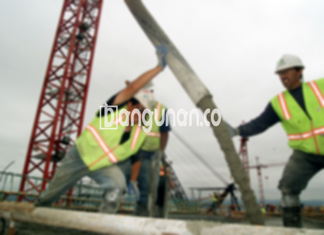

**Jasa Cor Beton Readymix & Jayamix Di Dlingo Bantul** – Bagi Mitra Bangunan di Dlingo Bantul yang sedang merencanakan proyek konstruksi, beton readymix atau adukan beton siap pakai dari bangunan.co adalah solusi yang efisien dan terpercaya. Beton siap pakai ini dirancang khusus untuk pengecoran instan, memanfaatkan campuran bahan material berkualitas tinggi seperti pasir beton, batu pecah, semen, dan air dengan proporsi yang telah terkalibrasi untuk memastikan mutu beton yang konsisten dan optimal.



## Pentingnya Penggunaan Campuran Beton yang Tepat dari Jasa Cor Beton Readymix & Jayamix Di Dlingo Bantul

Pembuatan adukan beton modern sebagaimana yang disediakan oleh layanan kami bertujuan untuk menyederhanakan dan mempercepat progres pengecoran. Kami memastikan bahwa setiap campuran beton diproduksi dengan presisi untuk memenuhi standar kualitas yang diperlukan, sesuai dengan spesifikasi konstruksi yang Anda rencanakan. Dengan demikian, Anda mendapatkan kualitas beton yang terjamin dan andal.

Beton *ready mix* merupakan jenis beton yang menawarkan berbagai opsi mutu sesuai dengan kebutuhan spesifik konstruksi Anda. Sering disebut juga sebagai beton cair siap pakai, beton ini telah difabrikasi di pabrik pengolahan beton dengan formulasi yang tepat agar langsung siap diaplikasikan di lokasi proyek. Beton ini didesain agar mudah dituangkan dan diratakan setelah pengiriman dari pabrik, sehingga membebaskan Anda dari kerumitan pencampuran manual yang memakan waktu dan berpotensi tidak konsisten. Fokus Anda menjadi penyediaan kondisi konstruksi yang ideal, seperti persiapan bekisting yang memadai.

Pengendalian mutu beton dilakukan secara komprehensif oleh tim ahli kami di pabrik pengolahan beton, mulai dari penimbangan dan pencampuran bahan material hingga pengiriman ke lokasi Anda. Proses ini menjamin kualitas beton yang seragam dan memenuhi standar yang Anda harapkan. Dengan begitu, Anda dapat menghindari potensi masalah kualitas yang sering terjadi pada pencampuran manual.

## Keunggulan dan Pertimbangan Memilih Cor Readymix dari bangunan.co di Dlingo Bantul

Terdapat perbedaan signifikan antara beton yang dicampur di pabrik pengolahan beton dengan beton yang dicampur secara manual oleh tukang bangunan. Memahami keunggulan dan kekurangannya akan membantu Anda membuat keputusan yang tepat.

Berikut adalah keunggulan utama beton yang dicampur di pabrik (batching plant):

1.  Adukan yang presisi dan konsisten sesuai spesifikasi.
2.  Kualitas beton yang merata karena proses pencampuran yang seragam dengan mesin.
3.  Penggunaan material berkualitas tinggi yang dipilih secara cermat untuk mencapai mutu beton terbaik.
4.  Efisiensi waktu dan biaya karena proses pengolahan yang cepat dan teroptimasi.
5.  Kemudahan karena Anda tidak perlu khawatir tentang formulasi adukan beton yang tepat untuk proyek Anda.

Namun, perlu diingat pula beberapa pertimbangannya:

Pemesanan beton readymix memerlukan perencanaan, karena tidak dapat dilakukan secara spontan. Anda perlu menjadwalkan pemesanan dan memungkinkan survei lokasi untuk menentukan volume beton yang dibutuhkan secara akurat. Hal ini untuk memastikan ketersediaan beton sesuai dengan kebutuhan proyek Anda dan menghindari pemborosan atau kekurangan material.

## Ragam Mutu Beton Populer yang Tersedia dari Jasa Cor Beton Readymix & Jayamix Di Dlingo Bantul

K225 merupakan salah satu mutu beton yang paling banyak digunakan di Dlingo Bantul, khususnya untuk pengecoran dak rumah atau lantai dua dan seterusnya. Mutu ini sangat ideal untuk aplikasi tersebut, menawarkan kekuatan dan daya tahan yang memadai. Selain itu, K225 juga cukup ekonomis untuk pengecoran jalan gang yang tidak menahan beban kendaraan berat.

Pilihan lain yang sering direkomendasikan adalah K250 dan K300. Kedua mutu ini sangat cocok untuk pengecoran tiang, pondasi, atau cakar ayam. Untuk proyek skala lebih besar, seperti pembangunan jalan pedesaan, mutu K250, K300, dan K350 seringkali menjadi pilihan. Untuk aplikasi yang membutuhkan kekuatan dan waktu pengeringan yang sangat cepat, mutu K375, K400, K500, dan seterusnya (beton *fast track*) menjadi solusi yang efektif, misalnya untuk jalan tol atau area parkir yang membutuhkan daya tahan tinggi dan waktu operasional yang singkat.

## bangunan.co: Garansi Kualitas pada Setiap Layanan Cor Beton Readymix & Jayamix Di Dlingo Bantul



Kualitas adukan cor readymix atau *ready mix concrete* merupakan faktor penting yang mempengaruhi kekuatan dan umur panjang struktur beton. Oleh karena itu, kami di bangunan.co selalu memastikan bahwa setiap campuran beton dirancang dengan cermat dan diproduksi dengan standar yang ketat. Kombinasi material yang tepat, seperti 10% hingga 15% semen Portland, 60% hingga 75% agregat halus dan kasar (pasir dan split), ditambah 10% hingga 15% air, dan sisa untuk udara, dipadukan secara optimal.

Untuk menghasilkan beton berkualitas tinggi, kami menggunakan rasio air terhadap semen yang serendah mungkin tanpa mengorbankan kemudahan pengerjaan. Kami juga memastikan penggunaan air bersih dan bebas dari kontaminan, seperti lumpur, lumut, atau bahan organik, karena hal tersebut dapat mengurangi kualitas beton secara signifikan. Penggunaan air bersih sangat penting untuk memastikan reaksi kimia yang optimal antara semen dan air, yang merupakan kunci utama kekuatan beton.

Dengan komitmen terhadap kualitas dan teknologi terkini, bangunan.co siap menjadi mitra terpercaya Anda dalam menyediakan solusi beton readymix dan jayamix untuk berbagai proyek konstruksi di Dlingo Bantul.

Seperti itulah penjelasan dari Jasa Cor Beton Readymix & Jayamix Di Dlingo Bantul yang kami berikan. Mitra Bangunan siap membantu Anda dalam menentukan mutu beton yang tepat dan memberikan penawaran harga yang kompetitif. Jangan ragu untuk menghubungi kami melalui tombol WhatsApp atau Telepon yang tersedia di halaman ini, dan bersama-sama kita wujudkan proyek konstruksi yang berkualitas dan tahan lama.

**Ref by:** [Cor Beton Readymix & Jayamix Dlingo Bantul](https://id.wikipedia.org/wiki/Cor)