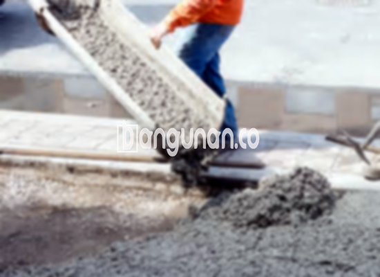

**Jasa Cor Beton Readymix & Jayamix Di Donorojo Jepara** – Mencari solusi konstruksi yang handal dan efisien di Donorojo Jepara? Layanan dari bangunan.co hadir untuk Anda. Beton readymix atau campuran beton siap pakai merupakan solusi ideal untuk pengecoran cepat dan akurat, menjamin kekuatan dan ketahanan bangunan Anda. Mitra Bangunan siap mendukung kelancaran proyek konstruksi Anda dengan layanan terbaik, memastikan setiap detail memenuhi standar kualitas tertinggi.



## Mengapa Memilih Layanan Pengadukan Beton dari bangunan.co di Donorojo Jepara?

Kami di bangunan.co memahami pentingnya ketepatan waktu dan mutu dalam setiap proyek konstruksi. Layanan pengadukan beton readymix kami dirancang untuk mempercepat proses pengecoran dengan menjamin kualitas yang terstandarisasi. Tujuan utama kami adalah menyediakan beton yang sesuai dengan spesifikasi proyek Anda, memastikan kekuatan dan daya tahan bangunan Anda terjamin. Dengan mutu yang teruji, Anda dapat memastikan bahwa konstruksi yang dibangun memenuhi standar kualitas yang diharapkan sesuai dengan perencanaan.

Beton readymix menawarkan kemudahan karena sudah diformulasikan secara presisi di pabrik pengolahan beton, siap digunakan begitu tiba di lokasi proyek. Anda tidak perlu lagi khawatir tentang proses pencampuran manual yang memakan waktu dan berpotensi menimbulkan kesalahan. Cukup siapkan infrastruktur bekisting yang memadai untuk menampung beton yang akan dicurahkan.

Proses pengendalian kualitas dilakukan secara ketat oleh tim ahli bangunan.co, mulai dari pemilihan material hingga proses pencampuran dan pengiriman, untuk menjamin kualitas beton yang konsisten dan optimal. Investasi pada layanan kami adalah investasi pada keandalan dan keberhasilan proyek Anda.

## Keunggulan dan Kekurangan Cor Readymix Menurut bangunan.co Di Donorojo Jepara

Beton yang diproduksi melalui pabrik pengolahan beton, seperti yang kami lakukan di bangunan.co, memiliki karakteristik yang berbeda dibandingkan dengan adukan manual yang dibuat secara tradisional. Memahami kelebihan dan kekurangan ini penting untuk membuat keputusan yang tepat.

Keunggulan utama beton readymix meliputi:

1.  Konsistensi kualitas dan komposisi yang presisi sesuai dengan standar.
2.  Mutu beton yang homogen dan merata karena proses pencampuran yang terkontrol.
3.  Penggunaan bahan material berkualitas tinggi yang telah teruji dan bersertifikasi.
4.  Efisiensi waktu dan biaya karena proses pengolahan yang lebih cepat dan tepat.
5.  Kemudahan dalam penggunaan, mengurangi tenaga kerja dan potensi kesalahan manusia. 

Namun, perlu diingat bahwa layanan beton readymix juga memiliki beberapa kekurangan, yaitu:

Pemesanan beton readymix memerlukan perencanaan yang matang dan penjadwalan yang tepat. Proses pemesanan tidak dapat dilakukan secara spontan dan membutuhkan waktu untuk persiapan dan pengiriman. Selain itu, survei lokasi diperlukan untuk menghitung volume beton yang dibutuhkan agar sesuai dengan kebutuhan proyek.

## Ragam Kualitas Beton yang Paling Banyak Diaplikasikan Di Donorojo Jepara

Untuk kebutuhan konstruksi di Donorojo Jepara, mutu beton K225 merupakan salah satu pilihan yang paling umum digunakan. K225 sangat cocok untuk pengecoran lantai rumah atau lantai dua ke atas, karena memenuhi persyaratan kekuatan yang dibutuhkan untuk struktur tersebut. Mutu beton ini juga banyak dimanfaatkan untuk pengecoran jalan gang yang tidak memperhitungkan beban lalu lintas berat.

Selain K225, mutu K250 dan K300 juga sering disesuaikan untuk pengecoran tiang, pondasi, atau cakar ayam. Sedangkan aplikasi mutu K250, K300, bahkan K350 sering dijumpai pada pembangunan jalan pedesaan. Jenis beton lain dengan kekuatan yang lebih tinggi seperti K375, K400, dan K500 biasanya digunakan pada proyek yang membutuhkan ketahanan ekstra, seperti jalan tol atau area parkir yang menahan beban berat. Beton dengan mutu tinggi ini juga sering disebut "beton *fast track*" karena waktu pengerasan yang lebih singkat, memungkinkan penggunaan area tersebut dengan cepat setelah pengecoran.

## bangunan.co Mengutamakan Kualitas dan Kepuasan Pelanggan Di Donorojo Jepara



Proses pengadukan beton readymix atau *ready mix concrete* harus dilakukan dengan presisi untuk menghasilkan campuran yang memiliki kemampuan kerja dan kekuatan optimal. Kualitas beton yang baik akan memberikan kekuatan yang luar biasa, mencegah keretakan atau kerusakan dini. Oleh karena itu, adukan material harus sesuai dengan standar mutu nasional (SNI). Komposisi yang direkomendasikan umumnya terdiri dari 10% hingga 15% semen Portland, 60% hingga 75% agregat halus dan kasar (pasir dan split), serta 10% hingga 15% air. Prosentase sisanya diisi oleh udara yang terperangkap dalam campuran.

Untuk mencapai beton berkualitas tinggi, rasio air dan semen harus diminimalkan tanpa mengurangi kemampuan kerja beton saat segar. Semakin sedikit air yang digunakan, semakin tinggi kualitas beton yang dihasilkan. Selain itu, penggunaan air bersih sangat penting untuk mencegah kontaminasi yang dapat menurunkan kekuatan dan daya tahan beton. Hindari penggunaan air yang kotor, berlumpur, atau mengandung bahan organik yang dapat bereaksi dengan semen. 

Dengan demikian, Anda dapat memastikan bahwa beton yang digunakan untuk konstruksi Anda memiliki kekuatan dan daya tahan yang optimal. Mitra Bangunan, dari bangunan.co, siap menjadi partner terpercaya Anda dalam menyediakan beton readymix berkualitas di Donorojo Jepara. Hubungi kami untuk mendapatkan penawaran dan layanan terbaik.

**Ref by:** [Cor Beton Readymix & Jayamix Donorojo Jepara](https://id.wikipedia.org/wiki/Cor)