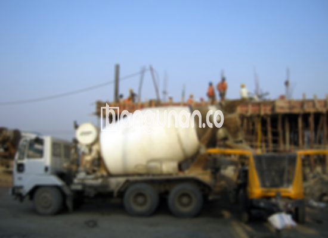

**Jasa Cor Beton Readymix & Jayamix Di Dukuhseti Pati** – Bagi Mitra Bangunan yang sedang merencanakan proyek konstruksi di Dukuhseti Pati, layanan cor readymix dari bangunan.co hadir sebagai solusi praktis dan terpercaya. Beton siap pakai ini menawarkan kemudahan, kecepatan pengerjaan, dan mutu yang konsisten, menghilangkan kebutuhan untuk mencampur adukan beton secara manual di lokasi proyek Anda. Kami melayani penyediaan dan pengiriman readymix dan jayamix menggunakan truk molen, siap mendukung kelancaran pembangunan Anda.

## Mengapa Memilih Layanan Cor Beton Readymix & Jayamix dari bangunan.co di Dukuhseti Pati?

Penyediaan beton dalam bentuk siap pakai ini dirancang untuk mempercepat proses pembangunan sekaligus menjaga kualitas hasil akhir. Dengan memanfaatkan layanan kami, Anda dapat memastikan bahwa beton yang digunakan memenuhi standar mutu yang diharapkan dan sesuai dengan spesifikasi konstruksi yang telah direncanakan.

Beton cor readymix yang disediakan oleh bangunan.co hadir dengan berbagai pilihan mutu, memungkinkan Anda memilih jenis yang paling optimal untuk proyek Anda. Sering disebut sebagai beton cair siap pakai, material ini telah diformulasikan secara presisi di pabrik pengolahan beton, siap untuk langsung dituangkan dan diratakan di lokasi proyek. Hal ini memberikan kemudahan bagi Anda, karena Anda tidak perlu lagi repot mempersiapkan campuran beton sendiri.

Kami, di bangunan.co, menerapkan kontrol kualitas yang ketat dalam setiap tahap produksi, mulai dari pemilihan bahan baku hingga proses pencampuran dan pengiriman. Hal ini bertujuan untuk memastikan konsistensi dan keseragaman kualitas beton, sehingga Anda dapat membangun dengan keyakinan dan tanpa khawatir terhadap potensi masalah terkait mutu material.

## Kelebihan dan Kekurangan Beton Cor Readymix Dibandingkan Campuran Manual

Beton yang diproduksi oleh pabrik pengolahan beton, seperti bangunan.co, memiliki karakteristik yang berbeda dengan beton yang dicampur secara manual oleh tukang bangunan. Berikut adalah perbandingan antara kelebihan dan kekurangan masing-masing metode:

Kelebihan beton readymix meliputi:

1.  Ketepatan mutu yang terjamin, sesuai dengan spesifikasi yang telah ditentukan.
2.  Mutu beton yang lebih homogen dan merata, berkat proses pencampuran yang terkontrol.
3.  Penggunaan bahan material berkualitas tinggi yang telah diseleksi secara ketat oleh bangunan.co.
4.  Efisiensi waktu dan biaya, karena Anda tidak perlu repot mencampur beton sendiri.
5.  Anda dapat fokus pada pekerjaan konstruksi lainnya, tanpa perlu memikirkan formula campuran beton.

Sementara itu, kekurangan beton readymix adalah:

Pemesanan beton readymix memerlukan penjadwalan yang cermat karena tidak dapat dilakukan secara spontan. Tim bangunan.co perlu melakukan survei lokasi terlebih dahulu untuk memastikan jumlah kubikasi beton yang dibutuhkan, sehingga produksi dapat disesuaikan dengan kebutuhan Anda.

## Jenis Mutu Beton yang Paling Banyak Digunakan di Dukuhseti Pati

Di Dukuhseti Pati, mutu beton K225 merupakan pilihan yang paling umum digunakan, terutama untuk pengecoran dak rumah atau lantai 2 ke atas. Mutu ini sangat ideal untuk aplikasi tersebut karena kekuatan dan karakteristiknya yang sesuai. Selain itu, mutu K225 juga dapat digunakan untuk pengecoran jalan gang yang tidak dilalui oleh kendaraan berat seperti truk atau mobil.

Pilihan lain yang sering digunakan adalah mutu beton K250 dan K300. Keduanya umumnya dipakai untuk pengecoran tiang, pondasi, atau cakar ayam. Untuk pengecoran jalan pedesaan, mutu K250, K300, dan K350 seringkali menjadi pilihan yang tepat. Mutu beton yang lebih tinggi, seperti K375, K400, K500, dan seterusnya, biasanya digunakan untuk beton *fast track* – jenis beton yang membutuhkan kekuatan cepat, seperti jalan tol atau area parkir yang membutuhkan daya tahan tinggi.



## bangunan.co: Prioritas Kami adalah Kualitas Beton yang Terjamin

Formulasi campuran beton cor readymix yang kami produksi di bangunan.co dirancang dengan cermat untuk memastikan daya kerja dan ketahanan yang optimal. Komposisi campuran yang tepat terdiri dari sekitar 10% hingga 15% semen Portland, 60% hingga 75% agregat halus dan kasar (pasir dan split), serta 10% hingga 15% air. Sisanya adalah kandungan udara yang penting untuk menjaga daya kerja beton.

Kami, di bangunan.co, sangat memperhatikan kualitas beton yang dihasilkan. Oleh karena itu, kami selalu berusaha meminimalkan rasio air dan semen tanpa mengorbankan kemampuan kerja beton segar. Penggunaan air bersih sangat krusial dalam proses produksi. Air yang kotor atau mengandung lumpur dapat menurunkan kualitas beton. Oleh karena itu, kami hanya menggunakan air bersih yang bebas dari kontaminan yang dapat mengganggu proses pengerasan dan kekuatan beton.

Anda dapat mengandalkan bangunan.co untuk menyediakan beton readymix dan jayamix berkualitas tinggi yang sesuai dengan kebutuhan proyek Anda di Dukuhseti Pati. Kami berkomitmen untuk memberikan layanan terbaik dan produk yang terpercaya.



Mitra Bangunan yang sedang mencari jasa cor beton readymix dan jayamix di Dukuhseti Pati, jangan ragu untuk menghubungi kami melalui tombol WhatsApp atau Telepon yang tertera di halaman ini. Tim bangunan.co siap membantu Anda memilih mutu beton yang tepat dan memberikan penawaran harga terbaik untuk mewujudkan proyek konstruksi Anda dengan sukses.

**Ref by:** [Cor Beton Readymix & Jayamix Dukuhseti Pati](https://id.wikipedia.org/wiki/Cor)