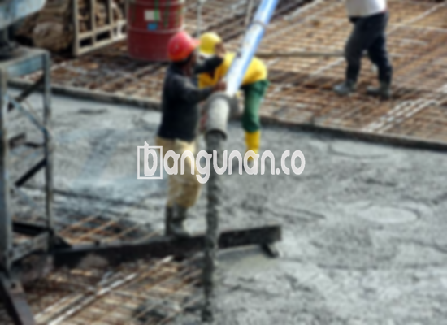

**Jasa Cor Beton Readymix & Jayamix Di Dukuhturi Tegal** – Bagi Mitra Bangunan yang mencari solusi pengecoran praktis dan efisien di Dukuhturi Tegal, layanan beton readymix atau adukan beton siap pakai dari Bangunan.co adalah pilihan yang tepat. Material ini dirancang untuk proses pengecoran yang cepat dan presisi, dengan komposisi material yang sama dengan beton konvensional – campuran pasir beton, batu split, semen, dan air – namun dengan takaran yang telah diformulasikan secara akurat untuk memastikan kualitas beton yang optimal.



## Alasan Memilih Campuran Beton Terstandarisasi dari Jasa Cor Beton Readymix & Jayamix Di Dukuhturi Tegal

Penggunaan beton readymix dari Bangunan.co bertujuan untuk mempercepat proses konstruksi sekaligus menjamin kualitas yang konsisten. Dengan memilih mutu yang tepat, Anda dapat memastikan kekuatan beton sesuai dengan standar yang diharapkan dan memenuhi kebutuhan spesifik proyek Anda.

Beton ready mix tersedia dalam berbagai pilihan mutu, memberikan fleksibilitas untuk memilih yang paling sesuai dengan aplikasi yang dituju. Sering disebut sebagai beton cair siap pakai, material ini telah dipersiapkan secara khusus di pabrik pengolahan beton, siap untuk langsung dicurahkan dan diratakan di lokasi proyek. Dengan demikian, Anda tidak perlu lagi memikirkan proses pencampuran dan memastikan proporsi yang tepat – semua itu telah ditangani oleh tim profesional Bangunan.co. Anda hanya perlu mempersiapkan kondisi bekisting sebagai penopang atau cetakan beton.

Proses pengendalian mutu beton dilakukan secara ketat oleh Bangunan.co sejak pencampuran bahan hingga pengiriman. Kontrol kualitas yang ketat ini menjamin bahwa beton yang Anda terima memenuhi spesifikasi yang Anda butuhkan dan memiliki kualitas terjamin. Hal ini sangat membantu pelaku konstruksi dalam mendapatkan material berkualitas tanpa memakan waktu lama atau kesulitan mencari bahan yang terbaik.

## Keunggulan dan Kekurangan Cor Readymix Menurut Jasa Cor Beton Readymix & Jayamix Di Dukuhturi Tegal

Tentu ada perbedaan antara beton yang dicampur di pabrik pengolahan beton Bangunan.co (batching plant) dengan beton yang dicampur secara manual oleh pekerja konstruksi. Masing-masing metode memiliki kelebihan dan kekurangannya sendiri. Berikut perbandingan rinci yang perlu Anda ketahui:

Keunggulan beton yang dicampur di pabrik pengolahan beton Bangunan.co:

1.  Adukan beton yang konsisten dengan kualitas yang telah ditetapkan.
2.  Mutu beton yang merata berkat penggunaan teknologi mesin modern.
3.  Kualitas bahan baku terjamin, karena Bangunan.co hanya memilih material terbaik untuk menghasilkan beton berkualitas tinggi.
4.  Waktu pengolahan yang efisien, menghemat biaya dan waktu proyek.
5.  Anda tidak perlu khawatir tentang komposisi adukan yang tepat karena Bangunan.co telah merancangnya sesuai dengan kebutuhan konstruksi yang Anda rencanakan. 

Meskipun memiliki banyak keunggulan, ada juga beberapa kekurangan yang perlu Anda pertimbangkan:

Pemesanan beton readymix dari Bangunan.co memerlukan penjadwalan dan survei lokasi terlebih dahulu untuk menentukan jumlah kubikasi yang dibutuhkan. Hal ini bertujuan untuk memastikan ketersediaan pasokan dan menghindari pemborosan material di lokasi pengecoran.

## Jenis Mutu Beton yang Paling Banyak Diminta di Dukuhturi Tegal

Jenis mutu beton yang paling populer dan sering digunakan di Dukuhturi Tegal adalah K225, terutama untuk aplikasi pengecoran dak rumah atau lantai dua ke atas. Mutu beton ini dirancang khusus untuk aplikasi tersebut. K225 juga cocok untuk pengecoran jalan gang yang tidak sering dilalui kendaraan berat.

Selain itu, mutu beton K250 dan K300 juga banyak diminati untuk pengecoran tiang, pondasi, atau cakar ayam. K250, K300, dan bahkan K350 sering digunakan untuk pembangunan jalan pedesaan.  Mutu yang lebih tinggi, seperti K375, K400, K500, dan seterusnya,  umumnya digunakan untuk aplikasi yang memerlukan kekuatan dan kecepatan pengerasan yang lebih cepat, seperti konstruksi jalan tol atau area parkir yang menahan beban berat. Jenis beton ini sering disebut sebagai beton *fast track*.

## Jasa Cor Beton Readymix & Jayamix Di Dukuhturi Tegal Menjamin Kualitas Beton yang Terpercaya



Untuk menghasilkan campuran cor readymix atau *ready mix concrete* yang optimal, proses perancangan harus dilakukan dengan cermat dan teliti. Tujuan utamanya adalah untuk memastikan beton memiliki kekuatan dan daya tahan yang sesuai dengan harapan.  Untuk mencapai mutu beton yang berkualitas tinggi dan tahan lama, adukan beton harus memenuhi standar nasional Indonesia (SNI). Komposisi idealnya terdiri dari 10% hingga 15% semen Portland, kemudian 60% hingga 75% agregat halus dan kasar (pasir dan split), serta tambahan 10% hingga 15% air. Sisanya adalah kandungan udara, yang tetap ada dalam campuran beton padat.

Beton yang berkualitas tinggi dihasilkan dengan meminimalkan rasio air dan semen tanpa mengorbankan kemampuan kerja beton segar. Umumnya, semakin sedikit air yang digunakan, semakin tinggi pula mutu beton yang dihasilkan. Penggunaan air bersih yang berkualitas juga sangat penting.  Sebaiknya hindari menggunakan air yang mengandung tanah atau lumpur, karena dapat menurunkan kualitas beton secara signifikan. 

Mitra Bangunan yang sedang mencari jasa cor beton readymix di Dukuhturi Tegal, Bangunan.co siap menjadi mitra terpercaya Anda. Hubungi kami melalui tombol WhatsApp atau Telepon di halaman ini untuk mendapatkan penawaran terbaik dan solusi konstruksi yang sesuai dengan kebutuhan Anda.

**Ref by:** [Cor Beton Readymix & Jayamix Dukuhturi Tegal](https://id.wikipedia.org/wiki/Cor)