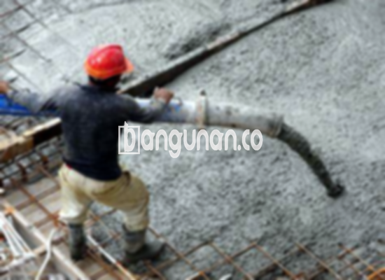

**Jasa Cor Beton Readymix & Jayamix Di Dukun Magelang** – Solusi konstruksi modern untuk pengecoran cepat dan berkualitas hadir di Dukun Magelang! Beton cor readymix atau adukan beton siap pakai dari bangunan.co adalah pilihan tepat bagi Anda yang menginginkan kepraktisan dan mutu terjamin. Campuran material beton yang dirancang khusus ini memungkinkan pengecoran instan, ideal untuk berbagai proyek konstruksi di wilayah Dukun Magelang. Mitra Bangunan hadir sebagai mitra terpercaya Anda dalam memenuhi kebutuhan beton readymix.



## Mengapa Layanan Cor Beton Readymix dari bangunan.co Dukun Magelang Pilihan Terbaik?

Penggunaan beton readymix dari bangunan.co bertujuan untuk mempercepat proses pengecoran sekaligus menjamin kualitas yang konsisten. Dengan mutu terstandarisasi, Anda sebagai pelaku konstruksi bisa fokus pada penyelesaian proyek tanpa harus khawatir mengenai kualitas adukan beton yang digunakan. Beton ready mix hadir dalam berbagai pilihan mutu, menyesuaikan dengan persyaratan khusus dari konstruksi yang Anda kerjakan. Layanan ini juga populer dikenal sebagai beton cair siap pakai, karena beton telah diformulasikan secara khusus di pabrik kami agar langsung siap digunakan. Cukup tuangkan dan ratakan, beton langsung diangkut dari pabrik ke lokasi proyek di Dukun Magelang. Hal ini membebaskan Anda dari kerepotan mencampur adukan sendiri.

Proses pengendalian kualitas beton dilakukan secara ketat oleh tim bangunan.co – atau *batching plant* – dimulai dari tahap pencampuran material hingga pengiriman. Hal ini memberikan kepastian bagi para profesional konstruksi dalam mendapatkan beton berkualitas tanpa perlu menghabiskan waktu dan tenaga untuk memverifikasi kualitas bahan dan adukan.

## Keunggulan dan Pertimbangan Menggunakan Beton Cor Readymix dari bangunan.co

Beton yang dicampur di pabrik bangunan.co memiliki keunggulan dibandingkan adukan manual yang dibuat di lokasi proyek. Berikut adalah beberapa perbedaannya:

Untuk beton yang dicampur di pabrik pengolahan beton bangunan.co, keunggulannya meliputi:

1.  Komposisi campuran yang presisi, menyesuaikan dengan mutu yang diharapkan.
2.  Kualitas beton yang merata berkat proses pencampuran yang terotomatisasi.
3.  Penggunaan material konstruksi berkualitas tinggi untuk menciptakan beton terbaik.
4.  Waktu pengolahan yang lebih ringkas, menghemat biaya dan waktu penyelesaian proyek.
5.  Anda tidak perlu lagi pusing memikirkan formula adukan yang tepat, karena pabrik sudah menghitungnya sesuai standar konstruksi.

Namun, perlu juga dipertimbangkan beberapa hal sebelum memilih beton readymix, antara lain:

Pemesanan beton readymix membutuhkan perencanaan yang matang karena tidak dapat dilakukan secara spontan. Diperlukan penjadwalan dan survei lokasi untuk memperkirakan volume beton yang dibutuhkan secara akurat. Hal ini penting agar bangunan.co dapat memproduksi beton sesuai kebutuhan tanpa menimbulkan kelebihan atau kekurangan.

## Ragam Mutu Beton yang Umum Digunakan di Dukun Magalang

Salah satu mutu beton yang paling banyak dipilih oleh pelanggan bangunan.co di Dukun Magelang adalah K225. Mutu ini sangat ideal untuk pengecoran dak rumah atau lantai dua ke atas. K225 juga merupakan pilihan tepat untuk pengecoran jalan gang yang tidak dilalui oleh kendaraan berat.

Selain K225, pelanggan bangunan.co juga sering menggunakan mutu beton K250 dan K300. Mutu K250 dan K300 umumnya diaplikasikan untuk pengecoran tiang, pondasi, atau cakar ayam. Untuk Jalan pedesaan pun seringkali memanfaatkan mutu K250, K300, dan K350 untuk memastikan kekuatan dan durabilitas. Adapun untuk mutu yang lebih tinggi seperti K375, K400, K500, dan seterusnya biasanya dipakai untuk *fast track concrete* atau beton yang membutuhkan pengeringan cepat, seperti untuk proyek jalan tol atau lahan parkir yang membutuhkan daya dukung besar dan waktu pengerjaan singkat.

## bangunan.co: Jasa Cor Beton Readymix & Jayamix dengan Kualitas Terjamin di Dukun Magelang



Adukan cor readymix dari bangunan.co harus dirancang dengan optimal untuk menjamin performa dan daya tahan yang unggul. Beton berkualitas tinggi diproduksi dengan meminimalkan rasio air terhadap semen tanpa mengorbankan kemampuan kerja beton segar. Pada umumnya, mutu beton yang lebih tinggi membutuhkan kandungan air yang lebih sedikit. Penggunaan air bersih juga merupakan prioritas utama. Penting untuk menghindari penggunaan air yang kotor atau mengandung lumut, karena hal tersebut dapat menurunkan kualitas beton secara signifikan. Air yang digunakan harus bersih dan bebas dari material yang dapat mengganggu proses pengerasan beton.

Kami, sebagai penyedia jasa cor beton readymix & jayamix di Dukun Magelang, memastikan bahwa setiap campuran beton memenuhi standar adukan beton nasional (SNI). Komposisi campuran ideal terdiri dari sekitar 10-15% semen Portland, 60-75% agregat halus dan kasar (pasir dan split), dan 10-15% air. Sisanya adalah ruang udara, yang penting untuk kekuatan dan daya tahan beton. Melalui proses yang terkontrol, bangunan.co menjamin Anda mendapatkan beton berkualitas tinggi untuk proyek Anda.

Dengan layanan bangunan.co, Anda tidak perlu merasa khawatir akan kualitas beton yang digunakan dalam proyek Anda di Dukun Magelang.

**Ref by:** [Cor Beton Readymix & Jayamix Dukun Magelang](https://id.wikipedia.org/wiki/Cor)

Mitra Bangunan yang sedang mencari layanan cor beton readymix dan jayamix berkualitas tinggi di Dukun Magelang, segera hubungi tim bangunan.co melalui tombol WhatsApp atau Telepon yang tersedia di halaman ini. Kami siap memberikan konsultasi dan penawaran harga terbaik untuk memenuhi kebutuhan konstruksi Anda. Percayakan proyek Anda pada ahlinya!