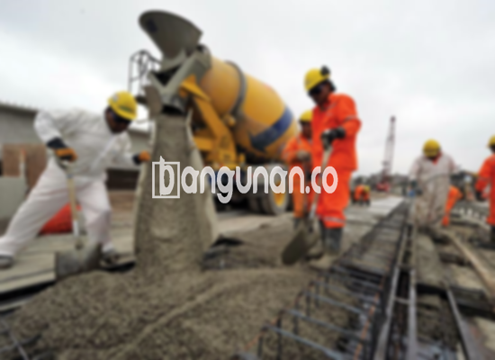

**Jasa Cor Beton Readymix & Jayamix Di Gabus Grobogan** – Memastikan kelancaran konstruksi dengan adukan beton berkualitas adalah prioritas utama bagi setiap proyek. Di Gabus Grobogan, readymix-bangunan-co.pages.dev hadir sebagai solusi terpercaya untuk kebutuhan beton siap pakai Anda, Mitra Bangunan. Kami menyediakan beton readymix dan jayamix dengan pengiriman langsung ke lokasi proyek Anda menggunakan truk molen modern dan terpercaya.



## Mengapa Memilih Layanan Cor Beton Readymix & Jayamix Di Gabus Grobogan?

Dengan memanfaatkan layanan cor beton readymix dari kami, Anda dapat mengoptimalkan waktu pengerjaan pengecoran dengan kualitas mutu yang terjamin kehandalannya. Tujuan utama kami adalah memastikan kualitas beton yang dihasilkan sesuai dengan standar mutu yang telah ditetapkan dan selaras dengan spesifikasi konstruksi yang direncanakan. Dengan begitu, proyek Anda berjalan lancar dan sesuai harapan.

Beton ready mix hadir dengan beragam pilihan mutu, yang dapat disesuaikan dengan kebutuhan dan peruntukan konstruksi Anda. Seringkali disebut juga sebagai beton cair siap guna, beton ini telah dipersiapkan secara cermat di pabrik pengolahan beton agar selalu siap untuk digunakan kapanpun Anda memerlukannya. Pengiriman dilakukan langsung dari pabrik pengolahan beton ke lokasi proyek Anda melalui truk molen, sehingga Anda tidak perlu lagi direpotkan dengan proses pencampuran adukan beton secara manual. Anda hanya perlu memastikan kesiapan bekisting sebagai penopang yang kuat untuk beton yang akan dituang. 

Kualitas beton kami dikontrol secara ketat oleh tim ahli di pabrik pengolahan beton, mulai dari proses pencampuran material hingga pengiriman ke lokasi proyek. Kontrol kualitas ini menjamin bahwa beton yang Anda terima selalu konsisten dan sesuai dengan standar yang berlaku, mempermudah Anda dalam melaksanakan konstruksi tanpa perlu khawatir akan kualitas material yang digunakan.

## Keunggulan dan Hal yang Perlu Dipertimbangkan Saat Menggunakan Cor Readymix

Terdapat perbedaan substansial antara beton yang dicampur di pabrik pengolahan beton (batching plant) dengan campuran manual yang seringkali dilakukan oleh tukang bangunan konvensional. Berikut adalah rincian mengenai kelebihan dan hal-hal yang perlu Anda pertimbangkan:

**Kelebihan Beton Readymix:**

1.  Campuran beton yang dihasilkan akurat dan selalu sesuai dengan mutu yang telah ditentukan.
2.  Kualitas beton konsisten dan merata karena adukan tercampur secara homogen dengan teknologi modern.
3.  Penggunaan material konstruksi berkualitas tinggi yang telah diseleksi secara ketat untuk menghasilkan beton yang tahan lama.
4.  Proses pengolahan beton yang cepat dan efisien, menghemat biaya operasional dan waktu pengerjaan proyek Anda.
5.  Anda tidak perlu memusingkan rumitnya perhitungan campuran beton yang tepat, karena semua sudah ditangani oleh tim ahli kami.

**Pertimbangan Penggunaan Beton Readymix:**

Pemesanan beton readymix memerlukan penjadwalan yang efektif dan survei lokasi yang akurat. Hal ini penting untuk memastikan semua kebutuhan beton Anda terpenuhi dan pengiriman tepat waktu, menghindari keterlambatan atau kelebihan pasokan di lokasi proyek.

## Ragam Mutu Beton yang Paling Sering Digunakan di Area Gabus Grobogan

Jenis mutu beton K225 merupakan salah satu yang paling banyak digunakan di wilayah Gabus Grobogan, khususnya untuk pengecoran dak rumah atau lantai 2 dan ke atas. Mutu beton ini dirancang khusus untuk aplikasi pengecoran dak dengan mempertimbangkan kekuatan dan ketahanan yang diperlukan. Selain itu, K225 juga bisa digunakan untuk pengecoran jalan gang yang tidak menanggung beban kendaraan berat. 

Selain K225, mutu beton K250 dan K300 juga sering dipilih untuk pengecoran tiang, pondasi atau cakar ayam. K250, K300, dan bahkan K350 juga umum digunakan untuk proyek pengecoran jalan pedesaan. Untuk proyek-proyek spesifik yang membutuhkan kekuatan ekstra, seperti jalan tol atau area parkir berbeban berat, mutu beton K400 atau lebih tinggi (sering disebut sebagai beton *Fast Track*) disarankan. Beton Fast Track dirancang untuk meminimalkan waktu pengeringan sehingga konstruksi dapat segera digunakan dalam hitungan hari.

## Jasa Cor Beton Readymix & Jayamix Di Gabus Grobogan: Mengutamakan Standar Mutu Beton



Proses pembuatan adukan beton readymix memerlukan perencanaan dan ketelitian tinggi. Tujuannya adalah untuk menciptakan beton dengan kekuatan dan kinerja yang optimal serta ketahanan yang teruji. Campuran material beton harus sepenuhnya sesuai dengan Standar Nasional Indonesia (SNI) yang berlaku. Secara umum, komposisi campuran material beton terdiri dari 10% hingga 15% semen Portland, 60% hingga 75% agregat halus dan kasar (pasir dan split), serta 10% hingga 15% air. Sisanya adalah kandungan udara yang terdapat dalam adukan.

Untuk menghasilkan beton yang berkualitas tinggi, rasio air dan semen perlu diminimalkan tanpa mengorbankan kemampuan kerja beton saat diaplikasikan. Penggunaan air yang bersih dan bebas dari kontaminasi sangat penting. Hindari penggunaan air yang mengandung lumpur, tanah liat, atau lumut karena dapat menurunkan kualitas dan kekuatan beton secara signifikan. Pastikan air yang digunakan bersih dan memenuhi standar kualitas yang ditetapkan.

Dengan komitmen kami terhadap kualitas dan pengalaman bertahun-tahun, readymix-bangunan-co.pages.dev siap menjadi mitra terpercaya Anda dalam membangun infrastruktur di Gabus Grobogan. 

**Ref by:** [Cor Beton Readymix & Jayamix Gabus Grobogan](https://id.wikipedia.org/wiki/Cor)

Mitra Bangunan yang sedang mencari jasa cor beton readymix berkualitas di Gabus Grobogan, jangan ragu untuk menghubungi kami melalui tombol WhatsApp atau Telepon yang tersedia di halaman website kami. Tim kami siap membantu Anda memenuhi semua kebutuhan beton Anda dengan layanan terbaik dan hasil yang memuaskan.