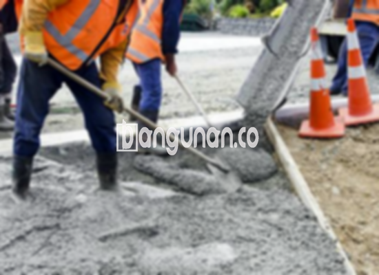

**Jasa Cor Beton Readymix & Jayamix Di Gabus Pati** – Bagi Mitra Bangunan yang tengah mempersiapkan pembangunan di Gabus Pati, beton readymix dari bangunan.co adalah solusi efisien untuk pengecoran cepat dan mutu terjamin. Material beton siap pakai ini diformulasikan dengan presisi dari campuran pasir beton, batu split, semen, dan air, memastikan kekuatan dan durabilitas optimal bagi proyek Anda.



## Mengapa Memilih Jasa Cor Beton Readymix & Jayamix Di Gabus Pati dari bangunan.co?

Penggunaan beton readymix dari bangunan.co dirancang untuk mempercepat proses pembangunan sekaligus menjamin kualitas yang stabil dan terukur. Dengan mutu yang dikontrol secara ketat, Anda dapat memastikan bahwa beton sesuai dengan standar yang dibutuhkan untuk konstruksi yang direncanakan.

Beton cor readymix dari bangunan.co tersedia dalam berbagai pilihan mutu, disesuaikan dengan kebutuhan proyek Anda. Material ini dipersiapkan secara profesional di pabrik pengolahan beton kami, siap langsung dituang dan diratakan di lokasi proyek Anda. Anda tidak lagi perlu memikirkan proses pencampuran manual, cukup menyiapkan area dan bekisting sebagai penyangga.

Proses pengolahan mutu beton di bangunan.co diatur ketat, mulai dari pemilihan material, pencampuran, hingga pengiriman. Hal ini memberikan jaminan kualitas yang tak tertandingi, sehingga memudahkan Anda sebagai pelaku konstruksi dalam menyelesaikan proyek pengecoran dengan efisien dan optimal.

## Keunggulan dan Pertimbangan Penggunaan Beton Readymix dari bangunan.co di Gabus Pati

Beton yang diproduksi melalui pabrik bangunan.co memiliki keunggulan berbeda dengan beton yang dicampur secara manual. Berikut adalah perbandingan kelebihan dan pertimbangannya:

Kelebihan beton readymix dari bangunan.co meliputi:

1.  Kualitas yang presisi dan konsisten dalam setiap batch produksi.
2.  Kualitas beton yang merata karena proses pencampuran menggunakan teknologi modern.
3.  Penerapan material konstruksi terbaik untuk menciptakan mutu beton unggul.
4.  Efisiensi waktu dan biaya dalam pengolahan dan pengiriman.
5.  Anda tidak perlu repot mengurus pencampuran beton, bangunan.co yang menanganinya.

Meskipun demikian, perlu dipertimbangkan juga:

Pemesanan beton readymix dari bangunan.co memerlukan perencanaan yang matang, karena prosesnya tidak instan. Anda perlu melakukan penjadwalan pesanan dan survey lokasi untuk menentukan volume yang dibutuhkan secara akurat. Hal ini bertujuan untuk menghindari kelebihan atau kekurangan produksi, sehingga beton dapat tiba di lokasi pengecoran tepat waktu.

## Pilihan Mutu Beton Terpopuler dari bangunan.co di Gabus Pati

Jenis mutu beton yang paling banyak digunakan adalah K225, yang ideal untuk pengecoran dak rumah atau lantai dua. Mutu ini dirancang khusus untuk aplikasi tersebut, memberikan kekuatan yang memadai. K225 juga cocok digunakan untuk pengecoran jalan gang yang tidak dilewati kendaraan berat. 

Selain K225, mutu K250 dan K300 juga sering dipilih, terutama untuk pengecoran tiang, pondasi, atau cakar ayam. Untuk jalan pedesaan, mutu K250, K300 dan K350 seringkali direkomendasikan. Mutu yang lebih tinggi seperti K375, K400, dan K500 biasanya digunakan untuk beton *fast track* – proyek yang membutuhkan kekuatan cepat, seperti jalan tol atau area parkir yang menahan beban berat.

## Jasa Cor Beton Readymix & Jayamix Di Gabus Pati dari bangunan.co: Komitmen Terhadap Kualitas Konstruksi



Campuran cor readymix dari bangunan.co dirancang dengan cermat untuk memastikan kemampuan kerja dan daya tahan yang optimal. Kami menerapkan standar campuran beton nasional (SNI) secara ketat. Komposisi idealnya terdiri dari 10% hingga 15% semen Portland berkualitas tinggi, 60% hingga 75% agregat halus dan kasar (pasir dan split yang teruji), dan 10% hingga 15% air bersih. Sisanya adalah udara, yang tetap berperan penting dalam kualitas beton. 

Beton berkualitas tinggi dari bangunan.co dihasilkan dengan meminimalkan rasio air dan semen tanpa mengurangi kemampuan kerja. Semakin sedikit air yang digunakan, semakin tinggi pula kualitas beton yang dihasilkan. Kami hanya menggunakan air bersih dan bebas dari kotoran, lumpur, atau lumut yang dapat menurunkan kualitas beton.

Mitra Bangunan, jika Anda membutuhkan solusi pengecoran yang terpercaya di Gabus Pati, Jasa Cor Beton Readymix & Jayamix dari bangunan.co adalah pilihan terbaik. Untuk mendapatkan informasi harga masing-masing mutu beton, jangan ragu untuk menghubungi kami melalui tombol WhatsApp atau Telepon yang tersedia di halaman ini. Tim kami siap membantu Anda.

**Ref by:** [Cor Beton Readymix & Jayamix Gabus Pati](https://id.wikipedia.org/wiki/Cor)