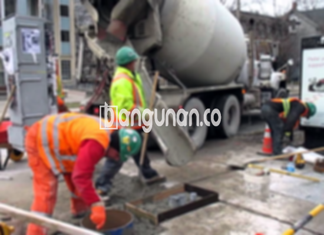

**Jasa Cor Beton Readymix & Jayamix Di Gajah Demak** – Memastikan fondasi bangunan yang kokoh dan tahan lama di Gajah Demak memerlukan material berkualitas tinggi dan proses pengecoran yang tepat. Beton readymix atau adukan beton siap pakai dari bangunan.co hadir sebagai solusi andal untuk proyek konstruksi Anda. Dengan formulasi presisi dan material pilihan, kami menyediakan beton yang siap digunakan secara instan, meringankan beban kerja Anda dan menjamin mutu bangunan yang optimal. Mitra Bangunan hadir untuk mendukung kesuksesan proyek Anda di Gajah Demak.



## Pentingnya Memilih Jasa Cor Beton Readymix & Jayamix Di Gajah Demak dari bangunan.co

Penggunaan beton readymix dari bangunan.co menawarkan kemudahan dan efisiensi tinggi dalam pengerjaan proyek konstruksi. Beton siap pakai ini dirancang untuk mempercepat proses pengecoran sekaligus menjamin kualitas yang konsisten. Dengan memilih mutu yang sesuai, Anda dapat membangun struktur yang memenuhi standar kekuatan dan daya tahan yang diinginkan. Kami menyediakan berbagai pilihan mutu beton untuk mengakomodasi kebutuhan spesifik proyek Anda di Gajah Demak.

Beton Cor Readymix dari bangunan.co dikenal sebagai solusi praktis karena telah diproses secara optimal di pabrik pengolahan beton yang modern. Beton ini dirancang untuk langsung dituang dan diratakan di lokasi proyek, menghilangkan kebutuhan untuk mencampur bahan-bahan secara manual. Hal ini memungkinkan Anda untuk fokus pada aspek-aspek penting lainnya dari konstruksi, seperti persiapan bekisting yang kuat dan stabil.

Pengendalian mutu adalah prioritas utama kami. Setiap batch beton readymix dari bangunan.co melalui proses pengujian ketat untuk memastikan kualitasnya memenuhi standar nasional dan internasional. Dengan begitu, Anda dapat yakin bahwa beton yang Anda terima memiliki kualitas terjamin dan sesuai dengan spesifikasi yang Anda butuhkan.

## Keunggulan dan Kekurangan Beton Readymix dari bangunan.co

Membandingkan beton yang diproduksi oleh pabrik bangunan.co dengan adukan manual yang dibuat di lokasi, terdapat perbedaan signifikan dalam hal kualitas dan efisiensi. Berikut adalah beberapa poin yang perlu Anda pertimbangkan:

Keunggulan penggunaan beton readymix dari bangunan.co meliputi:

1.  Formulasi campuran yang tepat dan konsisten untuk memastikan mutu yang optimal.
2.  Kualitas beton yang seragam berkat proses pengadukan menggunakan mesin modern.
3.  Penggunaan material berkualitas tinggi yang telah teruji untuk mencapai kekuatan dan daya tahan yang terbaik. 
4.  Efisiensi waktu dan biaya karena proses pengolahan yang lebih cepat dan terorganisir.
5.  Tidak perlu khawatir tentang perhitungan dan pencampuran bahan, karena semuanya ditangani oleh tim profesional bangunan.co.

Namun, perlu juga diperhatikan beberapa kekurangannya:

Pemesanan beton readymix dari bangunan.co memerlukan penjadwalan terlebih dahulu untuk memastikan ketersediaan dan kesiapan produksi. Selain itu, survei lokasi diperlukan untuk menghitung volume kubikasi yang tepat, sehingga kami dapat memproduksi beton sesuai dengan kebutuhan Anda dan menghindari pemborosan material.

## Ragam Mutu Beton Paling Banyak Diminati di Gajah Demak dari bangunan.co

Untuk proyek-proyek konstruksi di Gajah Demak, mutu beton K225 merupakan salah satu pilihan yang paling populer. Mutu ini ideal untuk pengecoran dak rumah atau lantai 2 ke atas, karena memberikan kekuatan yang memadai untuk menahan beban yang umum dijumpai pada struktur tersebut. Selain itu, K225 juga dapat digunakan untuk pengecoran jalan gang yang tidak terlalu sering dilalui oleh kendaraan berat.

K250 dan K300 adalah pilihan yang sering direkomendasikan untuk pengecoran tiang, pondasi, atau cakar ayam. K250, K300, dan K350 juga sering digunakan untuk pembangunan jalan pedesaan, memastikan daya tahan dan kekuatan yang cukup untuk menahan beban lalu lintas sehari-hari. Untuk aplikasi yang lebih menuntut, seperti konstruksi jalan tol atau area parkir dengan beban berat, mutu beton K400 ke atas (K375, K400, K500, dan seterusnya) menjadi solusi yang tepat.  Beton dengan mutu tinggi ini sering disebut sebagai beton *fast track* karena menawarkan waktu pengerasan yang lebih cepat, sehingga proyek dapat segera dilanjutkan.

## bangunan.co: Jaminan Kualitas untuk Jasa Cor Beton Readymix & Jayamix Di Gajah Demak



Kami di bangunan.co memahami bahwa campuran beton yang berkualitas harus dirancang dengan cermat untuk mencapai performa dan daya tahan yang optimal. Untuk itu, kami selalu berpedoman pada Standar Nasional Indonesia (SNI) dalam merumuskan campuran beton readymix kami. Secara umum, campuran tersebut terdiri dari 10-15% semen Portland, 60-75% agregat halus dan kasar (pasir dan split), serta 10-15% air. 

Untuk memastikan kualitas yang superior, kami menggunakan air yang bersih dan bebas dari kontaminan yang dapat menurunkan kekuatan beton. Air yang mengandung kotoran atau lumut sebaiknya dihindari. Selain itu, kami berupaya meminimalkan rasio air terhadap semen tanpa mengorbankan kemampuan kerja beton segar. Semakin rendah rasio air, semakin tinggi potensi kekuatan beton yang dihasilkan. Dengan demikian, Anda akan mendapatkan beton dengan kualitas terbaik dan sesuai dengan kebutuhan proyek Anda.

Mitra Bangunan yang sedang merencanakan pengecoran di Gajah Demak, percayakan kebutuhan beton Anda kepada bangunan.co. Hubungi kami melalui tombol WhatsApp atau Telepon di halaman ini untuk mendapatkan penawaran terbaik dan layanan yang responsif.

**Ref by:** [Cor Beton Readymix & Jayamix Gajah Demak](https://id.wikipedia.org/wiki/Cor)