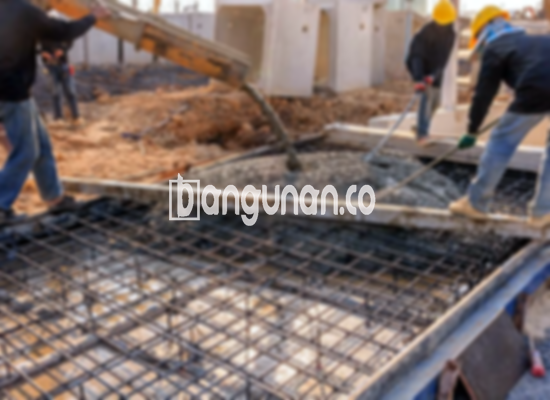

**Jasa Cor Beton Readymix & Jayamix Di Gajahmungkur Kota Semarang** – Mencari solusi pengecoran yang praktis dan berkualitas di Gajahmungkur Kota Semarang? bangunan.co hadir sebagai penyedia jasa cor readymix dan jayamix, menawarkan kemudahan dalam konstruksi dengan beton siap pakai yang dirancang khusus untuk memenuhi kebutuhan Anda. Dengan layanan kami, Mitra Bangunan dapat mempercepat proyek tanpa mengorbankan kualitas bangunan.



## Mengoptimalkan Pengecoran dengan Layanan Cor Readymix & Jayamix dari bangunan.co di Gajahmungkur Kota Semarang

Kami menghadirkan adukan beton siap pakai yang didesain untuk mempercepat proses pembangunan sekaligus memastikan mutu yang konsisten dan sesuai dengan standar. Dengan layanan dari bangunan.co, Anda tidak perlu lagi repot menyiapkan material dan mengaduk beton secara manual di lokasi proyek.

Beton cor readymix atau jayamix merupakan campuran beton yang telah diformulasikan secara khusus di pabrik pengolahan beton, siap untuk langsung digunakan. Beton ini terdiri dari material-material standar seperti semen, pasir, split, dan air, dengan takaran yang telah dihitung secara presisi untuk menghasilkan mutu beton yang optimal. Tujuan utama kami adalah memberikan solusi pengecoran yang efisien dan terpercaya bagi proyek konstruksi Anda di Gajahmungkur Kota Semarang.

Dengan memilih layanan kami, Anda akan mendapatkan beton dengan kualitas yang terjamin, pengiriman yang tepat waktu, dan kemudahan dalam proses pengecoran. bangunan.co berkomitmen untuk menyediakan produk dan layanan terbaik bagi setiap pelanggan kami.

## Keunggulan dan Kekurangan Cor Readymix Dibandingkan Pengecoran Manual di Gajahmungkur Kota Semarang

Terdapat perbedaan signifikan antara beton yang diproduksi di pabrik pengolahan beton bangunan.co dan beton yang dicampur secara tradisional di lokasi proyek. Masing-masing metode memiliki kelebihan dan kekurangannya sendiri yang perlu Anda pertimbangkan.

Berikut adalah beberapa keunggulan cor readymix:

1.  Konsistensi kualitas yang terjamin berkat kontrol mutu yang ketat di pabrik.
2.  Efisiensi waktu yang signifikan karena Anda tidak perlu lagi melakukan pencampuran manual.
3.  Pengurangan biaya tenaga kerja dan peralatan karena proses pencampuran dilakukan oleh kami.
4.  Kualitas material yang terjamin karena kami hanya menggunakan bahan-bahan berkualitas tinggi.
5.  Kemudahan dalam pengelolaan proyek karena Anda tidak perlu khawatir tentang proses pencampuran beton.

Namun, perlu diingat bahwa penggunaan cor readymix juga memiliki beberapa pertimbangan:

Pemesanan harus dilakukan jauh-jauh hari karena memerlukan penjadwalan dan persiapan material. Selain itu, aksesibilitas lokasi proyek juga menjadi faktor penting karena truk molen membutuhkan ruang yang cukup untuk melakukan pengiriman.

## Ragam Mutu Beton yang Tersedia dari bangunan.co di Gajahmungkur Kota Semarang

bangunan.co menawarkan berbagai pilihan mutu beton untuk memenuhi kebutuhan proyek yang beragam di Gajahmungkur Kota Semarang. Salah satu mutu yang paling banyak digunakan adalah K225, yang ideal untuk pengecoran dak rumah, lantai dua, atau jalan gang yang tidak menahan beban berat.

Selain K225, kami juga menyediakan mutu K250 dan K300, yang sering digunakan untuk pengecoran tiang, pondasi, atau cakar ayam. Untuk proyek yang membutuhkan kekuatan yang lebih tinggi, tersedia juga mutu K350, K375, K400, dan seterusnya. Mutu beton yang lebih tinggi biasanya digunakan untuk konstruksi jalan tol, area parkir, atau bangunan-bangunan yang membutuhkan daya tahan ekstra.

Memilih mutu beton yang tepat sangat penting untuk memastikan kekuatan dan keamanan struktur bangunan Anda. Jika Anda ragu, tim ahli kami siap memberikan konsultasi untuk membantu Anda memilih mutu yang paling sesuai dengan kebutuhan proyek Anda.

## bangunan.co: Jaminan Kualitas dalam Setiap Aduk Beton di Gajahmungkur Kota Semarang



Untuk mendapatkan hasil pengecoran yang optimal, adukan beton ready mix harus diformulasikan dengan presisi. Komposisi yang tepat terdiri dari sekitar 10-15% semen Portland, 60-75% agregat halus dan kasar (pasir dan split), serta 10-15% air. Proporsi ini penting untuk memastikan beton memiliki daya kerja yang baik dan kekuatan yang sesuai dengan standar.

Di bangunan.co, kami menggunakan air bersih yang bebas dari kontaminan untuk memastikan kualitas beton tidak terganggu. Kami juga mengontrol rasio air terhadap semen secara ketat untuk menghasilkan beton yang kuat dan tahan lama. Dengan demikian, Anda dapat yakin bahwa beton yang kami sediakan akan memenuhi semua persyaratan konstruksi Anda.

**Ref by:** [Cor Beton Readymix & Jayamix Gajahmungkur Kota Semarang](https://id.wikipedia.org/wiki/Cor)

Mitra Bangunan yang mencari solusi pengecoran yang andal dan efisien di Gajahmungkur Kota Semarang, jangan ragu untuk menghubungi bangunan.co. Kami siap membantu Anda mewujudkan proyek konstruksi impian Anda dengan layanan cor readymix dan jayamix berkualitas tinggi. Hubungi kami melalui tombol WhatsApp atau Telepon di halaman ini untuk mendapatkan penawaran terbaik.